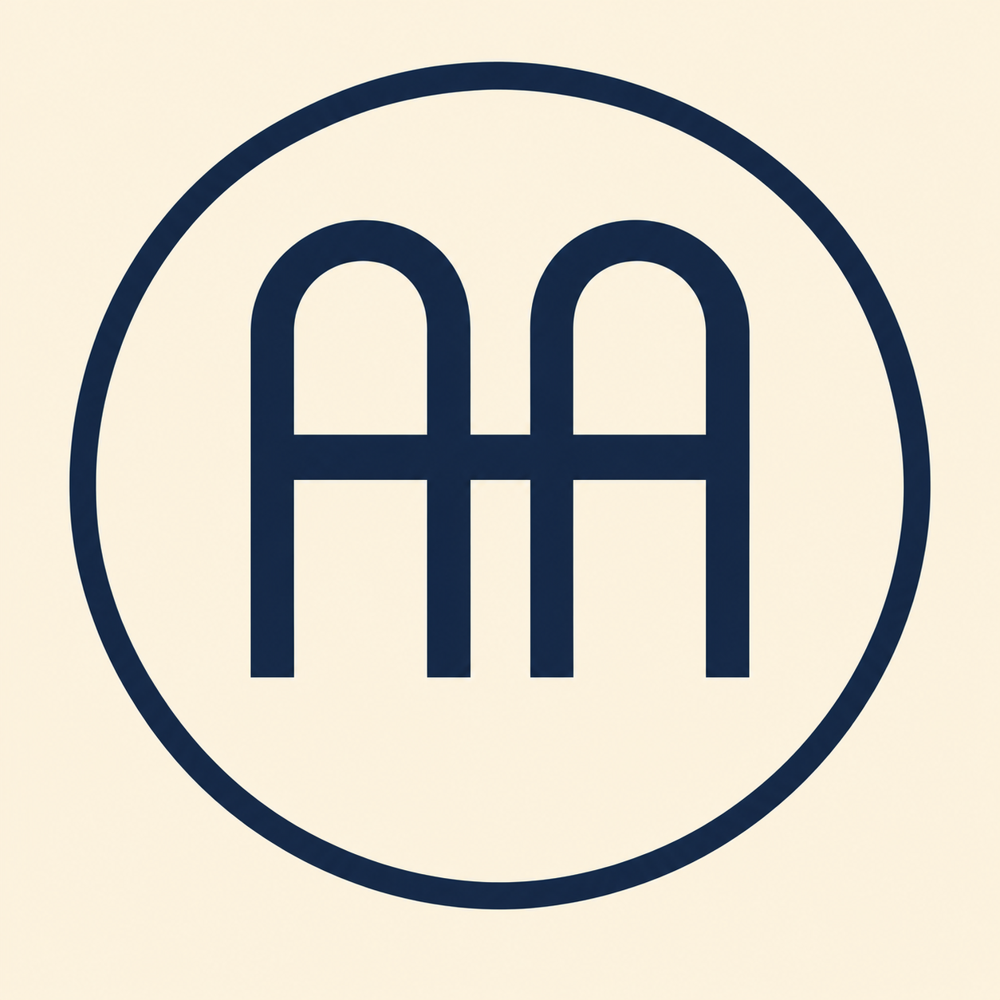

# Project Voynich

**Paper: [A copying procedure, not a cipher: 249 controlled tests on the Voynich Manuscript (PDF)](paper/paper.pdf)**
Version 1.1, 26 November 2026. Preprint, not peer-reviewed. Written with AI assistance (Claude Opus 5.5); see the paper's AI assistance statement.

This repository holds the code, transliterations and model weights behind 249 tests on Beinecke MS 408. Most of the tests check hypotheses published by other researchers (Layfield and Davis, Timm, Bax, Cheshire, Greshko, Stolfi and others), using the data and code they made public. Every result was compared against shuffled text, generated text or both, and 120 tests were pre-registered.

## In plain terms: the scribe's writing habits

* Words are built from fixed slots. Every word follows the same pattern: an optional beginning, a middle built around the tall "gallows" letters, then an ending. It's like a word built from Lego pieces that only snap together in a certain order. The rare one-off words keep most of these habits, though many of them combine a beginning and an ending that never appear together in the more common words.
* Copy and tweak. Rather than inventing each word, the scribe mostly looked back at a recent word, within the last few dozen, and wrote it again with a small change. That's why near-identical words cluster together.
* Lines have their own start and end habits. Certain letters and word types favour the start of a line and others the end, much like a capital letter starts a sentence. That habit turns out to be normal for scribes of the period.
* Each section and scribe has its own style. The two "dialects" (Currier A and B) and different sections use slightly different stocks of words and endings, like two people with different favourite phrases.
* Simple freedom of choice! The scribe was free to choose which word to copy and how much to change it. None of this needs the text to carry meaning, but none of it rules meaning out either.

## Main results

| Question | Result |
|---|---|
| Was the bifolium the unit of writing? | Yes. Same-sheet pages share vocabulary far beyond controls, as Layfield and Davis found; sheets were written Xr→Xv→Yr→Yv (p 0.0008). |
| Can the text recover sheet order? | No quire beats a shuffled-page null (p 0.55–0.997). Calibration shows the method cannot see order at quire scale. |
| Does physical evidence show an earlier order? | The current nesting fits best in 6 of 9 quires. |
| Is it a plain language? | Not on 12 statistics: h2 is 2.07 bits against 3.06–3.33 for six languages. |
| Ciphers, codes, cribs, published readings | All failed on held-out text, while the decoders recovered planted signals at 92–99%. |
| Structure | Strong line and paragraph rules; word-boundary coupling of 0.16–0.19 bits, at natural-language strength and not sandhi. |
| Best generative model | S6-Z1b, a copy-and-vary generator that extends Timm and Schinner's self-citation model: 20.8 of 24 statistics on held-out sheets. Frozen. This is not a ranking against Timm's generator (11.4 on the same sheets): we chose the 24 statistics and tuned S6-Z1b towards them with far more settings. |
| Line-edge pen form | Ordinary scribal behaviour. Line-initial glyphs are drawn differently from mid-line ones (AUC 0.641), but a dated Latin control hand, BSB Clm 5905 (1479), shows the same effect more strongly (0.681). Line-final effect weak in both (0.587 vs 0.556). |

No reading passed the translation criteria, which required holding on held-out pages and beating generated and shuffled controls.

## Layout

| Folder | Contents |
|---|---|
| `paper/` | `paper.pdf`, its Markdown source and CSS (`src/`), figures, the 249-row results table and the scripts that build them |
| `tools/score_profile.py` | The 24-statistic target-profile scorer; scores any text |
| `tools/generator/` | Frozen S6-Z1b generator (`s6z/`, see `REFERENCE.md`), the S6-Y stage it imports, and the hybrid base |
| `tools/decoders/` | Decipherment harness with calibration, language-model decoders, crib and choice-channel decoders |
| `tools/tests/` | Language profile, sheet-order search with shuffled null and calibration, line-start and line-end statistics, boundary coupling, one-off words, gibberish comparison, Timm fit |
| `tools/reader/` | Kraken line-reader training and full transcription scripts |
| `tools/segmenter/` | Glyph-segmenter U-Net: exemplar harvest, training, inference, features |
| `tools/letterbox/` | Letter-box rendering, pen-form features, the P3-c/P3-d line-edge tests and the P3-e control-hand test |
| `third_party/timm/` | Timm's SelfCitationTextGenerator with our position rules, under his MIT licence |
| `data/transliterations/` | ZL3b-n, IT2a-n, RF1b-e and CD2a-n (CC0, from voynich.nu) |
| `data/oneoff_catalogue/` | All 1,328 free one-off words and the 133 start–ending pairs found only in one-offs (paper Appendix E), with the build script |
| `results/` | The research log behind the paper: consolidated findings and the list of open and finished directions |
| `fetch/` | Download scripts for comparison corpora and images, which we do not redistribute |
| `weights/` | Trained weights with checksums: Kraken reader seeds and segmenter folds (62 MB) |

## Running the code

The scripts were written as research code, not as a package. They expect a working folder named `work/` in the repository root that holds the transliterations and any fetched corpora, laid out as the script paths show (for example `work/transcriptions/ZL3b-n.txt`). Python 3.11 or later with numpy, scipy, scikit-learn and matplotlib covers most tests. The reader needs `kraken==7.1.1` and the segmenter needs PyTorch. The segmenter and P3-c folders include their `PREREG.md` and `REPORT.md`; the decision rules and outcomes of every other test are summarised in the paper's appendices and in `paper/master_results_table.csv`.

## Licences

Code: MIT (`LICENSE`). Paper text, tables and figures: CC BY 4.0 (`LICENSE-TEXT.md`). Manuscript images in figures: Beinecke Rare Book and Manuscript Library, Yale University (MS 408). Transliterations: CC0. Timm's code keeps his MIT notice. Kraken (Apache-2.0) is a dependency and is not included.

## Acknowledgements

This work depends on the transliterations of René Zandbergen and Gabriel Landini and the other transcribers credited in the file headers, on Torsten Timm's generator code, on Greshko's Naibbe code, on the word and letter boxes of Rozanova and Temerev and of Ward, on Kraken, on the comparison corpora listed in `fetch/`, and on the Beinecke Library's images. The full list is in the paper.
