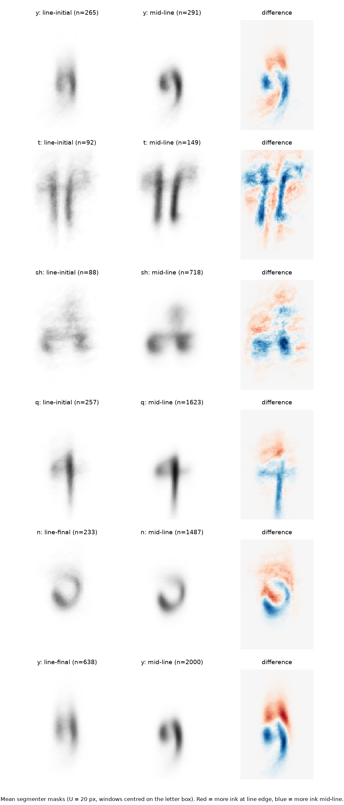

# Appendix A: test register {.appendix .unnumbered}

All 248 test entries in the consolidated findings, one row per test, in the order recorded. "Pre" marks pre-registered tests. Verdicts are quoted from each entry, or written by hand where an entry had none. The machine-readable table is `master_results_table.csv`.

<table class="reg"><thead><tr><th>ID</th><th>Theme</th><th>Test</th><th>Pre</th><th>Verdict</th></tr></thead><tbody>
<tr><td>§2</td><td>Page order &amp; physical (§2)</td><td>Do pages on the same sheet share text? (same-sheet similarity)</td><td></td><td>CONFIRMED: same-sheet pages share vocabulary far beyond controls</td></tr>
<tr><td>§3</td><td>Page order &amp; physical (§3)</td><td>In what order were the four pages of a sheet written? (within-sheet sequence)</td><td></td><td>CONFIRMED (fairly strong): sheets written Xr→Xv→Yr→Yv (LSA p 0.0008)</td></tr>
<tr><td>§4</td><td>Page order &amp; physical (§4)</td><td>Can the text recover the order of sheets? (sheet sequence from text)</td><td></td><td>NO: text cannot recover sheet order</td></tr>
<tr><td>§4a</td><td>Page order &amp; physical (§4)</td><td>Exhaustive search vs shuffled-page null, all quires with ≥3 complete sheets</td><td></td><td>FAIL: no quire beats shuffled-page null (9 quires); q20 borderline p 0.06–0.14</td></tr>
<tr><td>§4b</td><td>Page order &amp; physical (§4)</td><td>Exact rebuild of Layfield &amp; Davis LSA (mis-binding thread, finding 12)</td><td></td><td>L&amp;D orders reproducible but at random-assignment level</td></tr>
<tr><td>§4c</td><td>Page order &amp; physical (§4)</td><td>Positive control on Voynich text of known order (manuscript-wide, T5)</td><td></td><td>WEAK: little order signal even in known-order Voynich chunks</td></tr>
<tr><td>§4d</td><td>Page order &amp; physical (§4)</td><td>Are quires textual units? (T6)</td><td></td><td>NEGATIVE: quires are not textual units</td></tr>
<tr><td>§4e</td><td>Page order &amp; physical (§4)</td><td>Timm&#x27;s Experiment 3, held-out A/B gradient (T7)</td><td></td><td>PARTIAL: A/B split survives; held-out gradient inside B only</td></tr>
<tr><td>§5</td><td>Page order &amp; physical (§5)</td><td>What does the physical evidence say about sheet order?</td><td></td><td>Physical evidence fits the current (old) nesting</td></tr>
<tr><td>§5a</td><td>Page order &amp; physical (§5)</td><td>Stain and discolouration sharing (manuscript-wide, results 7–8; mis-binding finding 11)</td><td></td><td>CONFIRMED: current nesting fits stains best in 6/9 quires; no earlier order recoverable</td></tr>
<tr><td>§5b</td><td>Page order &amp; physical (§5)</td><td>Paint offsets and show-through (physical-offsets thread; manuscript-wide p3)</td><td></td><td>NEGATIVE, weak test: only the current binding is visible</td></tr>
<tr><td>§5c</td><td>Page order &amp; physical (§5)</td><td>Gutter-crossing paint, automated (manuscript-wide, p2)</td><td></td><td>INCONCLUSIVE: too little gutter paint to test</td></tr>
<tr><td>§5d</td><td>Page order &amp; physical (§5)</td><td>Literature constraints at full resolution (P7/P9 thread, 22 Nov, physical_p7p9/REPORT.md, pre-registered)</td><td>yes</td><td>Literature quire-20 evidence fits the current stack</td></tr>
<tr><td>§6</td><td>Page order &amp; physical (§6)</td><td>Skin side (hair vs flesh) and Gregory&#x27;s rule</td><td>yes</td><td>Faces differ consistently; orientation random (no Gregory&#x27;s rule)</td></tr>
<tr><td>§7</td><td>Page order &amp; physical (§7)</td><td>Wear and handling</td><td></td><td>DOWNGRADED: wear finding is mostly a photography artefact</td></tr>
<tr><td>§8</td><td>Page order &amp; physical (§8)</td><td>Illustration continuities across the gutter</td><td></td><td>2 of 5 claimed continuities confirmed, 1 contradicted, 2 non-discriminating</td></tr>
<tr><td>§9</td><td>Page order &amp; physical (§9)</td><td>Calibration on known texts (final for the quire 20 shape)</td><td></td><td>Calibration: q20-shape p cannot separate no-sequence from herbal-like sequence</td></tr>
<tr><td>§9b</td><td>Page order &amp; physical (§9)</td><td>S17: quire 13 shape, longer texts, adjacency test (22 Nov, calibration/s17/REPORT.md)</td><td>yes</td><td>Old test conservative; pre-registered adjacency test A1 FAIL (power 7–15%)</td></tr>
<tr><td>§9c</td><td>Page order &amp; physical (§9)</td><td>S6-B: which bands judge the hybrid generator? (22 Nov, bundle/s6b/REPORT.md): FAIL</td><td></td><td>FAIL</td></tr>
<tr><td>§9d</td><td>Page order &amp; physical (§9)</td><td>S17-E: calibration on Voynich-like text with a planted sheet order (26 Nov, PC s17e/REPORT.md, pre-registered)</td><td>yes</td><td>LSA weak (power 0.15), Timm blind, tf-idf discriminates</td></tr>
<tr><td>§9e</td><td>Page order &amp; physical (§9)</td><td>S17-I: the Voynich&#x27;s own page carry-over (26 Nov, cloud, s17i/REPORT.md, pre-registered)</td><td>yes</td><td>Same-leaf r→v carry real (R 2.53, p 0.0005); quire 20 no measurable carry</td></tr>
<tr><td>§9f</td><td>Page order &amp; physical (§9)</td><td>C3: genre-sensitive tests rerun on period German herbal/medical texts (26 Nov, cloud, c3/REPORT.md, pre-registered): all FAIL</td><td>yes</td><td>FAIL</td></tr>
<tr><td>§10</td><td>Page order &amp; physical (§10)</td><td>Published orders scored against every alternative</td><td></td><td>Published orders at random-assignment level</td></tr>
<tr><td>S13:Sheets as units</td><td>Language, generator &amp; decipherment (§13)</td><td>Sheets as units (sheets_as_units/). Hand and section each carry vocabulary independently (p ≤ 0.008). Language adds nothing once hand is …</td><td></td><td>PASS: hand and section carry vocabulary; sheet affinities replicate</td></tr>
<tr><td>S13:Plant drawings</td><td>Language, generator &amp; decipherment (§13)</td><td>Plant drawings (plant_drawings/). A six-feature drawing code does not explain those affinities (split-half r 0.341 → 0.338). Drawing …</td><td></td><td>FAIL: drawings do not predict text similarity</td></tr>
<tr><td>S13:Labels</td><td>Language, generator &amp; decipherment (§13)</td><td>Labels (labels/, grammar_labels/). Labels are mostly one-offs: they are reused 2–4× *less* than length-matched text words (p ≤ 0.008). They …</td><td></td><td>Labels are one-offs, not captions or reusable names</td></tr>
<tr><td>S13:Language test</td><td>Language, generator &amp; decipherment (§13)</td><td>Language test (language_test/). It is not like any plain language tested. Character predictability h2 is 2.07 bits (languages 3.06–3.33), …</td><td></td><td>not like any plain language tested</td></tr>
<tr><td>S13:Word families</td><td>Language, generator &amp; decipherment (§13)</td><td>Word families (word_families/). Pharma has specialised vocabulary that recurs in the herbal text and replicates on a held-out pharma sheet …</td><td></td><td>REPLICATES</td></tr>
<tr><td>S13:Fitted Timm generator</td><td>Language, generator &amp; decipherment (§13)</td><td>Fitted Timm generator (timm_generator/, Timm&#x27;s own Java code, fitted on FIT sheets). The &quot;roots generalise better than words&quot; lead does not …</td><td></td><td>not replicate</td></tr>
<tr><td>S13:Grammar-like dependence</td><td>Language, generator &amp; decipherment (§13)</td><td>Grammar-like dependence (grammar_labels/). Ending-to-ending dependence is real (z 11–15) and beats fitted Timm on different-ending pairs …</td><td></td><td>FAIL grammar rule: ending dependence real but a third of the weakest language</td></tr>
<tr><td>S13:Decipherment harness</td><td>Language, generator &amp; decipherment (§13)</td><td>Decipherment harness (decipherment_harness/). The harness recovers a true simple-substitution key from about 2,300 words (95–100% correct). …</td><td></td><td>Bax 2014 fails</td></tr>
<tr><td>S13:Cribs and keys</td><td>Language, generator &amp; decipherment (§13)</td><td>Cribs and keys (cribs/REPORT.md). Five candidate &quot;Rosetta stones&quot; tested; none holds on held-out text. Zodiac nymph labels are not numerals …</td><td></td><td>none holds on held-out text.</td></tr>
<tr><td>S13b:Step 1, human gibberish</td><td>Language, generator &amp; decipherment (§13)</td><td>Step 1, human gibberish (gibberish/; Gaskell &amp; Bowern 2022 data). At 300 words, gibberish matches the Voynich&#x27;s weak word order and weak …</td><td></td><td>Gibberish matches weak word order but lacks the line rules</td></tr>
<tr><td>S13b:Step 2, line-start rule</td><td>Language, generator &amp; decipherment (§13)</td><td>Step 2, line-start rule (line_start/). 45% of lines start with p, t, y, s or f words (p 17×, t 6×, y 3.9× their mid-line rates). Stripping …</td><td>yes</td><td>CONFIRMED: strong line-start glyph rule (p 17×, t 6×)</td></tr>
<tr><td>S13b:Step 3, word-level codes</td><td>Language, generator &amp; decipherment (§13)</td><td>Step 3, word-level codes (word_codes/). All fail:</td><td></td><td>FAIL</td></tr>
<tr><td>S13b:Step 3b, ingredient-list notation</td><td>Language, generator &amp; decipherment (§13)</td><td>Step 3b, ingredient-list notation (ingredient_list/). Fails. There are no closed quantity slots, and paragraph-initial words are *more* …</td><td></td><td>FAIL</td></tr>
<tr><td>S13b:Step 4, Naibbe cipher</td><td>Language, generator &amp; decipherment (§13)</td><td>Step 4, Naibbe cipher (naibbe_test/; Greshko&#x27;s published Latin ciphertext). It matches 5/14 held-out statistics. It has no burstiness, …</td><td></td><td>FAIL: Naibbe matches 5/14 held-out statistics</td></tr>
<tr><td>S13b:Step 6, Currier A vs B as one system res</td><td>Language, generator &amp; decipherment (§13)</td><td>Step 6, Currier A vs B as one system respelled (ab_alignment/). No evidence. Rewrite rules close 22% of the herbal A→B vocabulary gap on …</td><td></td><td>FAIL</td></tr>
<tr><td>S13b:Own copy-and-vary generator</td><td>Language, generator &amp; decipherment (§13)</td><td>Own copy-and-vary generator (own_generator/; pair copying, line-start class, no trimming; fitted on FIT). Fails: 5–6/14 TEST statistics, …</td><td></td><td>FAIL</td></tr>
<tr><td>S13b:Word order lives at word boundaries</td><td>Language, generator &amp; decipherment (§13)</td><td>Word order lives at word boundaries (word_order/, exploratory). The last glyph of a word predicts the next word&#x27;s first glyph by 0.19 bits …</td><td></td><td>Boundary coupling 0.16–0.19 bits, natural-language strength</td></tr>
<tr><td>S13b:Generators v2–v4</td><td>Language, generator &amp; decipherment (§13)</td><td>Generators v2–v4 (own_generator/). Choosing which earlier word to copy by how it joins the previous word matches the Voynich word order for …</td><td></td><td>Junction-based copying matches word order; 9–12/14</td></tr>
<tr><td>S13b:Not sandhi</td><td>Language, generator &amp; decipherment (§13)</td><td>Not sandhi (sandhi/). With the root held fixed, a word&#x27;s final glyph does not depend on the next word (excess 0.005 vs Sanskrit 0.23–0.34, …</td><td></td><td>NEGATIVE for sandhi: coupling comes from word choice</td></tr>
<tr><td>S13b:Line-start rule has two parts</td><td>Language, generator &amp; decipherment (§13)</td><td>Line-start rule has two parts (line_start/ addendum). Paragraph starts take a gallows &quot;capital&quot; (84%: p 46%, t 23%, k 11%). Lines inside a …</td><td></td><td>CONFIRMED: paragraph gallows capital + line-start y/s/d class</td></tr>
<tr><td>S13b:Copy-and-vary generator plateau</td><td>Language, generator &amp; decipherment (§13)</td><td>Copy-and-vary generator plateau (own_generator/ v5). With less noisy selection, the best FIT setting scores only 6–8/14 on TEST, so v3&#x27;s …</td><td></td><td>Plateau: v3 12/14 was partly luck (6–8/14)</td></tr>
<tr><td>S13b:Cribs thread</td><td>Language, generator &amp; decipherment (§13)</td><td>Cribs thread (cribs/REPORT.md): zodiac labels as numbers, the f57v ring alphabet, plant names, and the f116v marginalia all fail; the …</td><td></td><td>FAIL</td></tr>
<tr><td>S13b:Robustness</td><td>Language, generator &amp; decipherment (§13)</td><td>Robustness (word_order/ addendum 4, transcriptions/). At certain spaces only, the boundary coupling is still 0.159. In three independent …</td><td></td><td>ROBUST across three transliterations and certain spaces</td></tr>
<tr><td>S13b:Capitals by image</td><td>Language, generator &amp; decipherment (§13)</td><td>Capitals by image (capitals/). With per-word boxes (voynichese.com via the Rozanova archive, 95 pages), paragraph-initial p-words are the …</td><td></td><td>Paragraph p is not enlarged; t slightly (+12%)</td></tr>
<tr><td>S13b:Full self-citation generator with the th</td><td>Language, generator &amp; decipherment (§13)</td><td>Full self-citation generator with the three scribal rules (sc_generator/). Fails (5–9/14). The rules fix line ends (E2 matched for the …</td><td></td><td>FAIL</td></tr>
<tr><td>S13b:Glyph variants (allographs)</td><td>Language, generator &amp; decipherment (§13)</td><td>Glyph variants (allographs) (allographs/; v101 aligned with EVA). The variant of p (Claston&#x27;s g vs j) is decided by line and paragraph …</td><td></td><td>p-variant chosen by line/paragraph position</td></tr>
<tr><td>S13b:Timm&#x27;s own generator + the four rules</td><td>Language, generator &amp; decipherment (§13)</td><td>Timm&#x27;s own generator + the four rules (timm_rules/, run by the Timm thread; patched Java source, rules from FIT). Best model yet: 10–12/14 …</td><td></td><td>Best model yet: 10–12/14 on TEST</td></tr>
<tr><td>S13b:Joint fit and line-end rule</td><td>Language, generator &amp; decipherment (§13)</td><td>Joint fit and line-end rule (timm_rules/REPORT3.md, REPORT_ENDRULE.md). Across about 170 settings, Timm + rules tops out at about 12/14. …</td><td>yes</td><td>Timm + rules tops at ~12/14; line-end rule FAILS pre-registered check</td></tr>
<tr><td>S13b:Where the ending misfit comes from</td><td>Language, generator &amp; decipherment (§13)</td><td>Where the ending misfit comes from (ending_agreement/, exploratory, plus one pre-registered test). Copy-and-vary text has twice the Voynich …</td><td>yes</td><td>Generators over-produce first-glyph edits in near-copies</td></tr>
<tr><td>S13b:The boundary link is glyph-driven, not w</td><td>Language, generator &amp; decipherment (§13)</td><td>The boundary link is glyph-driven, not word-driven (boundary_source/, pre-registered, PASS). Beyond the two touching glyphs, the words add …</td><td>yes</td><td>pre-registered, PASS</td></tr>
<tr><td>S13b:Window-chain generators</td><td>Language, generator &amp; decipherment (§13)</td><td>Window-chain generators (window_chain/, pre-registered, 3 versions, all FAIL). The next word&#x27;s opening is chosen by the previous word&#x27;s …</td><td>yes</td><td>all FAIL</td></tr>
<tr><td>S13b:Timm + rules with copied endings re-draw</td><td>Language, generator &amp; decipherment (§13)</td><td>Timm + rules with copied endings re-drawn (timm_rules/REPORT_REDRAW.md). It passes its own pre-registered test with setting #1: 12–13/14, …</td><td>yes</td><td>FAIL</td></tr>
<tr><td>S13b:Glyph n-gram calibration</td><td>Language, generator &amp; decipherment (§13)</td><td>Glyph n-gram calibration (glyph_ngram/, pre-registered, diagnostic). A model with 3–5 glyphs of memory, trained on FIT, matches 15–17/24 …</td><td>yes</td><td>Diagnostic: 3–5-glyph model 15–17/24; misses burstiness</td></tr>
<tr><td>S13b:Glyph model plus word cache</td><td>Language, generator &amp; decipherment (§13)</td><td>Glyph model plus word cache (cache_ngram/, pre-registered, FAIL). 15–18/24 and 6–8/10 never-fitted statistics. It misses burstiness …</td><td>yes</td><td>FAIL</td></tr>
<tr><td>S13b:Small neural model of the text</td><td>Language, generator &amp; decipherment (§13)</td><td>Small neural model of the text (neural_lm/, pre-registered, LSTM, two-fold).</td><td>yes</td><td>Diagnostic: 1.97 bits/glyph held-out</td></tr>
<tr><td>S13b:Target profile</td><td>Language, generator &amp; decipherment (§13)</td><td>Target profile (target_profile/TARGET_PROFILE.md, score.py). 24 statistics with Voynich bands and a scorer for any generated text. The best …</td><td></td><td>Tool: 24-statistic profile and scorer</td></tr>
<tr><td>S13b:Cache models v2 and v3</td><td>Language, generator &amp; decipherment (§13)</td><td>Cache models v2 and v3 (cache_ngram/, pre-registered, FAIL). Bursty copying is worse (14–16/24). Copying from the current page only is the …</td><td>yes</td><td>FAIL</td></tr>
<tr><td>S13b:Opening-class transitions and an onset-c</td><td>Language, generator &amp; decipherment (§13)</td><td>Opening-class transitions and an onset-conditioned cache (first_runs/, exploratory; onset_cache/, pre-registered FAIL). Neighbours&#x27; first …</td><td>yes</td><td>FAIL</td></tr>
<tr><td>S13b:Step 5, regional languages in real manus</td><td>Language, generator &amp; decipherment (§13)</td><td>Step 5, regional languages in real manuscript lines (regional/, pre-registered). Sources: 14th-c. Middle High German (Tauler, Freising law …</td><td>yes</td><td>FAIL: no regional language has the Voynich boundary or line profile</td></tr>
<tr><td>S13b:Decoding the copying choices</td><td>Language, generator &amp; decipherment (§13)</td><td>Decoding the copying choices (choice_decode/, pre-registered with one documented fix). The 26 choice symbols (which earlier word was …</td><td>yes</td><td>FAIL: choice symbols decode no better than shuffled</td></tr>
<tr><td>S13b:Boundary rule, A vs B</td><td>Language, generator &amp; decipherment (§13)</td><td>Boundary rule, A vs B (ab_boundary/, exploratory). The last→first lift table correlates 0.79 between Currier A and B, against 0.95–0.97 …</td><td></td><td>Same rule, different settings in Currier A and B</td></tr>
<tr><td>S13b:Step 7 / Hypothesis C, syllable-sized un</td><td>Language, generator &amp; decipherment (§13)</td><td>Step 7 / Hypothesis C, syllable-sized units (syllables/, pre-registered). With spaces removed, a BPE inventory of about 100 units predicts …</td><td>yes</td><td>Rule PASS (~100 units) but Timm text does the same: not specific</td></tr>
<tr><td>S13b:Abbreviation, Lingua Ignota swap and hom</td><td>Language, generator &amp; decipherment (§13)</td><td>Abbreviation, Lingua Ignota swap and homophonic/verbose ciphers on the boundary test (codes_boundary/, pre-registered; 7 models × 4 …</td><td>yes</td><td>All fail</td></tr>
<tr><td>S13b:Slot generator</td><td>Language, generator &amp; decipherment (§13)</td><td>Slot generator (slot_gen/, pre-registered, FAIL, 14–16/24). Each word is built as onset (chosen by the previous ending) + body (copied from …</td><td>yes</td><td>FAIL</td></tr>
<tr><td>S13b:Historical and contextual items H1–H8</td><td>Language, generator &amp; decipherment (§13)</td><td>Historical and contextual items H1–H8 (historical/REPORT.md; H1a, H3 and H6 pre-registered). No historical anchor works. (1) The C1 zodiac …</td><td>yes</td><td>No historical anchor works.</td></tr>
<tr><td>S13b:Cheap meaning tests S7, S8, S9, S10, S11</td><td>Language, generator &amp; decipherment (§13)</td><td>Cheap meaning tests S7, S8, S9, S10, S11, S15, S18 and charms (meaning_tests/REPORT.md, pre-registered with addenda A–C, 21 Nov 23:00–23:40 …</td><td>yes</td><td>FAIL: formulaic Latin and charm texts do not match</td></tr>
<tr><td>S13b:H5: Parisel&#x27;s per-folio cho/che switch a</td><td>Language, generator &amp; decipherment (§13)</td><td>H5: Parisel&#x27;s per-folio cho/che switch and Timm&#x27;s single-hand continuum (historical/REPORT.md, pre-registered). The switch replicates in …</td><td>yes</td><td>replicates</td></tr>
<tr><td>S13b:Section topic words</td><td>Language, generator &amp; decipherment (§13)</td><td>Section topic words (word_identity/REPORT_TOPIC.md, pre-registered, FAIL in all 3 contrasts). Section words replicate on held-out sheets (ρ …</td><td>yes</td><td>FAIL</td></tr>
<tr><td>S13b:Systematic nomenclator</td><td>Language, generator &amp; decipherment (§13)</td><td>Systematic nomenclator (word_identity/REPORT_NOMEN.md, pre-registered, FAIL, 10–12/24 on held-out plaintext). The first glyph codes a …</td><td>yes</td><td>FAIL</td></tr>
<tr><td>S13b:H1b, zodiac labels vs Lilly&#x27;s degree qua</td><td>Language, generator &amp; decipherment (§13)</td><td>H1b, zodiac labels vs Lilly&#x27;s degree qualities (historical/, pre-registered; table from Lilly 1647 p. 116 via skyscript). FAIL. Same-gender …</td><td>yes</td><td>FAIL.</td></tr>
<tr><td>S13b:Codebook + page copying (D3c) and codebo</td><td>Language, generator &amp; decipherment (§13)</td><td>Codebook + page copying (D3c) and codebook recovery (word_identity/REPORT_D3C.md, pre-registered, FAIL). Adding decodable copying to the …</td><td>yes</td><td>FAIL</td></tr>
<tr><td>S13b:Structure tests S12, S13, S14, S11-C</td><td>Language, generator &amp; decipherment (§13)</td><td>Structure tests S12, S13, S14, S11-C (structure2/REPORT.md, pre-registered, 22 Nov 06:50–08:30 UTC, cloud).</td><td>yes</td><td>FAIL: no recipe↔astro link; other structure tests mixed</td></tr>
<tr><td>S13b:S16, Greshko&#x27;s own Naibbe code</td><td>Language, generator &amp; decipherment (§13)</td><td>S16, Greshko&#x27;s own Naibbe code (naibbe_greshko/REPORT.md, pre-registered, 22 Nov, PC). FAIL. His generators were run from a reviewed copy …</td><td>yes</td><td>FAIL.</td></tr>
<tr><td>S13b:S16b (26 Nov, PC naibbe_greshko/s16b/,</td><td>Language, generator &amp; decipherment (§13)</td><td>S16b (26 Nov, PC naibbe_greshko/s16b/, pre-registered): D1 decoder on Greshko&#x27;s real N52 tables. FAIL His N52 encryption re-implemented …</td><td>yes</td><td>FAIL</td></tr>
<tr><td>S13b:S16d (26 Nov, PC naibbe_greshko/s16d/,</td><td>Language, generator &amp; decipherment (§13)</td><td>S16d (26 Nov, PC naibbe_greshko/s16d/, pre-registered): more search for the D1 annealer on Greshko&#x27;s N52 key. FAIL Attempt 1 (16 x 200M …</td><td>yes</td><td>FAIL</td></tr>
<tr><td>S13b:S16e (26 Nov, cloud s16e/, pre-registe</td><td>Language, generator &amp; decipherment (§13)</td><td>S16e (26 Nov, cloud s16e/, pre-registered + amendment): new search (heat-bath sweeps over every letter per symbol, 4-gram LM, 64 restarts; …</td><td>yes</td><td>FAIL</td></tr>
<tr><td>S13b:S16f (26 Nov, cloud s16e/REPORT_S16f.md</td><td>Language, generator &amp; decipherment (§13)</td><td>S16f (26 Nov, cloud s16e/REPORT_S16f.md, pre-registered): S16e decoder on the Voynich (FIT→TEST) in Latin, MHG, Occitan. FAIL in all three …</td><td>yes</td><td>FAIL</td></tr>
<tr><td>S13b:H10, Timm&#x27;s Archetype palaeography data</td><td>Language, generator &amp; decipherment (§13)</td><td>H10, Timm&#x27;s Archetype palaeography data (h10/REPORT.md, pre-registered, 22 Nov, PC). Inconclusive. The database (1,684 boxed glyphs, …</td><td>yes</td><td>Inconclusive.</td></tr>
<tr><td>S13b:Section keys: a separate cipher key per</td><td>Language, generator &amp; decipherment (§13)</td><td>Section keys: a separate cipher key per section or Currier language (section_keys/REPORT.md, pre-registered, 22 Nov, cloud). FAIL in all 32 …</td><td>yes</td><td>FAIL in all 32 runs</td></tr>
<tr><td>S13b:Meaning inside the writing procedure: D6</td><td>Language, generator &amp; decipherment (§13)</td><td>Meaning inside the writing procedure: D6, D2, D3b (meaning_procedure/REPORT.md, pre-registered, 22 Nov ~07:05–09:00 UTC, cloud).</td><td>yes</td><td>D6 PASS as a possibility only (procedure could hide text); no hidden text found</td></tr>
<tr><td>S13b:D3d (26 Nov, PC d3d/, pre-registered)</td><td>Language, generator &amp; decipherment (§13)</td><td>D3d (26 Nov, PC d3d/, pre-registered): homophone merging, then the D3c one-to-one decoder. Calibration FAIL, Voynich not run Variants …</td><td>yes</td><td>CALIBRATION FAIL</td></tr>
<tr><td>S13b:D3e (26 Nov, cloud d3e/, development o</td><td>Language, generator &amp; decipherment (§13)</td><td>D3e (26 Nov, cloud d3e/, development only): joint word-level decoder (code type → word heat-bath, cell rule as a Dirichlet-multinomial term …</td><td></td><td>FAIL</td></tr>
<tr><td>S13b:D10a (26 Nov, PC d10/, pre-registered)</td><td>Language, generator &amp; decipherment (§13)</td><td>D10a (26 Nov, PC d10/, pre-registered): pharma (PH, 1,176 FIT / 1,126 TEST tokens), original D1 decoder, 8x stronger search (32 restarts x …</td><td>yes</td><td>FAIL</td></tr>
<tr><td>S13b:D10b (26 Nov, PC d10/, pre-registered</td><td>Language, generator &amp; decipherment (§13)</td><td>D10b (26 Nov, PC d10/, pre-registered amendment): shared cipher alphabet with one letter shift per sheet (Alberti-style). Calibration FAIL, …</td><td>yes</td><td>CALIBRATION FAIL</td></tr>
<tr><td>S13b:D10c (26 Nov, cloud d10c/, development</td><td>Language, generator &amp; decipherment (§13)</td><td>D10c (26 Nov, cloud d10c/, development only): three new searches for per-sheet shifted keys (joint heat-bath over key + shifts; key from a …</td><td>yes</td><td>FAIL</td></tr>
<tr><td>S13b:Follow-ups A4-G and D6-V2</td><td>Language, generator &amp; decipherment (§13)</td><td>Follow-ups A4-G and D6-V2 (meaning_procedure/REPORT.md, PREREG2.md, 22 Nov ~07:55–11:45 UTC, cloud).</td><td>yes</td><td>A4-G PASS: onset alternation is a writing habit; D6-V2 see summary</td></tr>
<tr><td>S13b:Overnight cloud run M5, D4, D5</td><td>Language, generator &amp; decipherment (§13)</td><td>Overnight cloud run M5, D4, D5 (pre-registered, 22 Nov ~08:40–12:10 UTC).</td><td>yes</td><td>D4 FAIL (13 runs), D5 FAIL, M5 untestable</td></tr>
<tr><td>S13b:Follow-ups A4-P and D6-C</td><td>Language, generator &amp; decipherment (§13)</td><td>Follow-ups A4-P and D6-C (meaning_procedure/REPORT.md, PREREG3.md, 22 Nov ~11:40–12:30 UTC, cloud).</td><td></td><td>A4-P PASS (25th statistic); D6-C calibration PASS, Voynich FAIL</td></tr>
<tr><td>S13b:PC overnight bundle T1–T5 + drawings v2</td><td>Language, generator &amp; decipherment (§13)</td><td>PC overnight bundle T1–T5 + drawings v2 (pre-registered in bundle/PREREG.md and vlm_drawings_v2/PASS_RULE_DRAWINGS_V2.md, 22 Nov …</td><td>yes</td><td>PASS</td></tr>
<tr><td>S13b:D6-C2, plant-name crib over 5 channels ×</td><td>Language, generator &amp; decipherment (§13)</td><td>D6-C2, plant-name crib over 5 channels × 2 positions (meaning_procedure/REPORT.md, PREREG4.md, 22 Nov ~13:00–14:00 UTC, cloud). All 9 new …</td><td></td><td>FAIL: decoders calibrate 92–99%, Voynich hits none</td></tr>
<tr><td>S13b:D6-C3, zodiac labels and a 2-bit plant c</td><td>Language, generator &amp; decipherment (§13)</td><td>D6-C3, zodiac labels and a 2-bit plant crib (meaning_procedure/REPORT.md, PREREG5.md, 22 Nov 13:25–17:30 UTC with a pause, cloud). FAIL. …</td><td></td><td>FAIL.</td></tr>
<tr><td>PC bundle 2</td><td>Other</td><td>PC bundle 2 (22 Nov 2026, partial; U1 stopped, U2/U3 not yet run)</td><td></td><td>M3-R FAIL (drawings do not predict text); partial run</td></tr>
<tr><td>PC bundle 2 final results</td><td>Other</td><td>PC bundle 2 final results (finished 22 Nov 21:51 local)</td><td>yes</td><td>M3-R FAIL; M2/P1 glyph clusters PASS; S6-C see summary</td></tr>
<tr><td>PC bundle 3 results</td><td>Other</td><td>PC bundle 3 results (23 Nov 2026)</td><td></td><td>S6-D PASS (19–21/24)</td></tr>
<tr><td>PC bundle 4 results</td><td>Other</td><td>PC bundle 4 results (23 Nov 2026, 12:00 local)</td><td></td><td>S6-E FAIL by prereg (rule on 2/5 seeds)</td></tr>
<tr><td>PC bundle 5 results</td><td>Other</td><td>PC bundle 5 results (23 Nov 2026, 12:23 local)</td><td></td><td>S6-F FAIL (all conditions 0/5)</td></tr>
<tr><td>PC bundle 6 results</td><td>Other</td><td>PC bundle 6 results (24 Nov 2026, 19:04 local)</td><td></td><td>Diagnostic: local near-copy rate and H-band checks</td></tr>
<tr><td>Hidden message inside the proc</td><td>Other</td><td>Hidden message inside the procedure (25 Nov 2026, cloud, hidden_message/PREREG.md, REPORT.md)</td><td></td><td>N2 line-indicator cipher FAIL (link real but not a cipher)</td></tr>
<tr><td>Published physical evidence</td><td>Other</td><td>Published physical evidence (25 Nov 2026, cloud, physical/README.md)</td><td></td><td>Little underlying data published; inventory only</td></tr>
<tr><td>Line endings, LE series</td><td>Other</td><td>Line endings, LE series (25 Nov 2026, cloud, line_end/PREREG.md, REPORT.md)</td><td>yes</td><td>ESTABLISHED: line-final words are their own class</td></tr>
<tr><td>PC bundle 8: blocked diplomatic sources fetched and screened</td><td>Other</td><td>PC bundle 8: blocked diplomatic sources fetched and screened (25 Nov 2026, bundle8/, regional/comparison/README.md)</td><td>yes</td><td>Data: 13 diplomatic comparison texts fetched</td></tr>
<tr><td>S6-H</td><td>Generator (S6 family)</td><td>S6-H (cloud, 25 Nov 2026): line-start copying generator, PASS</td><td></td><td>PASS</td></tr>
<tr><td>LE14</td><td>Line structure</td><td>LE14 (cloud, 25 Nov 2026): line-type line-final words on S6-H, FAIL (le14/PREREG.md, REPORT.md)</td><td></td><td>FAIL</td></tr>
<tr><td>H10d</td><td>Ink &amp; image tests</td><td>H10d (cloud, 25 Nov 2026): can image measures see a known hand change? BLIND (h10d/PREREG.md, REPORT.md)</td><td></td><td>BLIND</td></tr>
<tr><td>P4-S-a</td><td>Ink &amp; image tests</td><td>P4-S-a (cloud, 25 Nov 2026): ink-tone steps across pages — not testable (p4s/PREREG.md, REPORT.md)</td><td>yes</td><td>not testable</td></tr>
<tr><td>D11b</td><td>Decipherment / cribs</td><td>D11b (cloud, 25 Nov 2026): decoding margin over 5 hybrid seeds (d11b/PREREG.md, REPORT.md)</td><td></td><td>Voynich beats hybrid in 13–14/32 runs; bar too strict, residual real</td></tr>
<tr><td>S6-I</td><td>Generator (S6 family)</td><td>S6-I (cloud, 25 Nov 2026): first-glyph insertion in the copy route, PASS (s6i/PREREG.md, REPORT.md)</td><td></td><td>PASS</td></tr>
<tr><td>LE14b</td><td>Line structure</td><td>LE14b (cloud, 25 Nov 2026): every last word through the line-type route, FAIL 2/5 (le14b/PREREG.md, REPORT.md)</td><td></td><td>FAIL 2/5</td></tr>
<tr><td>N3c</td><td>Hidden-signal / meaning tests</td><td>N3c (cloud, 25 Nov 2026): cross-validated signal finder, calibration FAIL (n3c/PREREG.md, REPORT.md)</td><td></td><td>calibration FAIL</td></tr>
<tr><td>C5</td><td>Comparison corpora</td><td>C5 (cloud, 25 Nov 2026): Voynich line end vs 13 real manuscripts (c5/PREREG.md, REPORT.md)</td><td></td><td>Voynich-specific: line-end glyph shift (E2 +0.083 vs ≤ +0.056)</td></tr>
<tr><td>LE10</td><td>Line structure</td><td>LE10 (cloud, 25 Nov 2026): line-initial lengthening beyond wrapping (le10/PREREG.md, REPORT.md)</td><td></td><td>PASS: real line-start lengthening ~0.18 glyphs; no generator has it</td></tr>
<tr><td>C5b/C5c</td><td>Comparison corpora</td><td>C5b/C5c (cloud, 25 Nov 2026): line ends and rhyme (c5/REPORT.md, PREREG_C5c.md)</td><td>yes</td><td>Rhyme absent; line-end shift is not verse</td></tr>
<tr><td>D11c</td><td>Decipherment / cribs</td><td>D11c (cloud, 25 Nov 2026): the Currier B decoding residual with newer generators (d11c/PREREG.md, REPORT.md)</td><td>yes</td><td>Residual shrinks only partly (6 of 10 runs persist)</td></tr>
<tr><td>S6-J</td><td>Generator (S6 family)</td><td>S6-J (cloud, 25 Nov 2026): copy edits + line end combined, FAIL 1/5 (s6j/PREREG.md, REPORT.md)</td><td></td><td>FAIL 1/5</td></tr>
<tr><td>D11d</td><td>Decipherment / cribs</td><td>D11d (cloud, 25 Nov 2026): what the decoder uses in the Currier B residual, mixed (d11d/PREREG.md, REPORT.md)</td><td></td><td>mixed</td></tr>
<tr><td>WS1</td><td>Generator (S6 family)</td><td>WS1 (cloud, 25 Nov 2026): word skeletons (glyph-class strings), Voynich vs generators (ws1/PREREG.md, REPORT.md)</td><td></td><td>FAIL for generators: skeletons too varied</td></tr>
<tr><td>N3-A4</td><td>Hidden-signal / meaning tests</td><td>N3-A4 (cloud, 25 Nov 2026): the top-10 types&#x27; extra order is not the A4 onset habit (n3a4/PREREG.md, REPORT.md)</td><td></td><td>Top-10 types&#x27; extra order is not the onset habit</td></tr>
<tr><td>S6-K</td><td>Generator (S6 family)</td><td>S6-K (cloud, 25 Nov 2026): vertical line-start chain + line-initial lengthening — FAIL 1/5 (s6k/PREREG.md, REPORT.md)</td><td></td><td>FAIL 1/5</td></tr>
<tr><td>WS2</td><td>Generator (S6 family)</td><td>WS2 (cloud, 25 Nov 2026): word-skeleton filter on S6-I — FAIL 0/5 (ws2/PREREG.md, REPORT.md)</td><td></td><td>FAIL 0/5</td></tr>
<tr><td>N3d</td><td>Hidden-signal / meaning tests</td><td>N3d (cloud, 25 Nov 2026): two-chain hidden-word finder — calibration FAIL (n3d/PREREG.md, REPORT.md)</td><td></td><td>calibration FAIL</td></tr>
<tr><td>S6-L</td><td>Generator (S6 family)</td><td>S6-L (cloud, 25 Nov 2026): joint refit of all generator stages — FAIL 0/5 (s6l/PREREG.md, REPORT.md)</td><td></td><td>FAIL 0/5</td></tr>
<tr><td>N3e</td><td>Hidden-signal / meaning tests</td><td>N3e (cloud, 25 Nov 2026): pruned finder with fair calibration — calibration FAIL (n3e/PREREG.md, REPORT.md)</td><td></td><td>calibration FAIL</td></tr>
<tr><td>WS3</td><td>Generator (S6 family)</td><td>WS3 (cloud, 25 Nov 2026): word-shape filter on all routes inside S6-L — FAIL (ws3/PREREG.md, REPORT.md)</td><td></td><td>FAIL</td></tr>
<tr><td>N2-b</td><td>Hidden-signal / meaning tests</td><td>N2-b (cloud, 25 Nov 2026): the line-start glyph → rest-of-line link is missing from every S6 generator (n2b/)</td><td></td><td>Line-start glyph → rest-of-line link missing from all S6 generators</td></tr>
<tr><td>S6-M</td><td>Generator (S6 family)</td><td>S6-M (cloud, 25 Nov 2026): a word-table line mode cannot add the line-start link — FAIL 0/5 (s6m/)</td><td></td><td>FAIL 0/5</td></tr>
<tr><td>S6-N</td><td>Generator (S6 family)</td><td>S6-N (cloud, 25 Nov 2026): a glyph-level line mode reproduces the line-start link — PASS 5/5 (s6n/)</td><td></td><td>PASS 5/5</td></tr>
<tr><td>S6-O</td><td>Generator (S6 family)</td><td>S6-O (cloud, 25 Nov 2026): line mode + word-shape filters together — FAIL 0/5 (s6o/)</td><td></td><td>FAIL 0/5</td></tr>
<tr><td>S6-O2</td><td>Generator (S6 family)</td><td>S6-O2 (cloud, 25 Nov 2026): the closest generator yet — FAIL 0/5 (s6o2/)</td><td>yes</td><td>FAIL 0/5</td></tr>
<tr><td>S6-P</td><td>Generator (S6 family)</td><td>S6-P (cloud, 25 Nov 2026): onset-swap copies — FAIL 0/5 (s6p/)</td><td></td><td>FAIL 0/5</td></tr>
<tr><td>S6-Q</td><td>Generator (S6 family)</td><td>S6-Q (cloud, 25 Nov 2026): a word-junction preference closes the boundary gap — PASS 5/5 (s6q/)</td><td></td><td>PASS 5/5</td></tr>
<tr><td>S6-R</td><td>Generator (S6 family)</td><td>S6-R (cloud, 25 Nov 2026): joint refit — strict all-targets FAIL 0/5 (s6r/)</td><td></td><td>strict all-targets FAIL 0/5</td></tr>
<tr><td>S6-S</td><td>Generator (S6 family)</td><td>S6-S (cloud, 25 Nov 2026): the best generator does not carry over to the other half — FAIL 0/5 (s6s/)</td><td></td><td>FAIL 0/5</td></tr>
<tr><td>M1b</td><td>Machine transliteration</td><td>M1b / PC bundle 7 (PC, 25 Nov 2026): Kraken line reader on held-out pages, PASS (bundle7/PREREG.md, bundle7/RESULTS_SUMMARY.md, …</td><td>yes</td><td>PASS</td></tr>
<tr><td>S6-S2</td><td>Generator (S6 family)</td><td>S6-S2 (cloud, 25 Nov 2026): fully refit on the other half, the generator still fails — FAIL 0/5 (s6s2/)</td><td></td><td>FAIL 0/5</td></tr>
<tr><td>M1c</td><td>Machine transliteration</td><td>M1c / PC bundle 9 (PC, 25 Nov 2026): machine transliteration of every page (bundle9/, bundle9/RESULTS_SUMMARY.md, bundle9/results_full/)</td><td>yes</td><td>Data: machine transliteration of 226/227 pages</td></tr>
<tr><td>B9</td><td>Robustness on machine transliteration</td><td>B9 recheck (cloud, 25 Nov 2026): key findings hold on the machine transliteration (b9_recheck/, pre-registered)</td><td>yes</td><td>HOLDS: line rules and profile not transcription artefacts</td></tr>
<tr><td>Bundle 10</td><td>Ring/diagram pages</td><td>Bundle 10 (PC, 25 Nov 2026): ring-aware re-read of the circular pages; f101v both halves</td><td></td><td>Data: ring-aware re-read of circular pages</td></tr>
<tr><td>X1</td><td>Robustness on machine transliteration</td><td>X1 (cloud, 25 Nov 2026): key findings hold on our own machine transliteration (x1/)</td><td></td><td>HOLDS on machine transliteration (65–100% of ZL size)</td></tr>
<tr><td>X2</td><td>Robustness on machine transliteration</td><td>X2 (cloud, 25 Nov 2026): the full 24-statistic profile holds on the machine transliteration (x2/)</td><td></td><td>HOLDS: all 24 statistics agree with ZL within 2 sd</td></tr>
<tr><td>X3</td><td>Robustness on machine transliteration</td><td>X3 (cloud, 25 Nov 2026): the line-end glyph shift holds on the machine transliteration (x3/)</td><td></td><td>HOLDS: line-end glyph shift in machine reading</td></tr>
<tr><td>Bundle 11</td><td>Ring/diagram pages</td><td>Bundle 11 (B10a): ring geometry fixes on the weak circular pages: ADOPTED (25 Nov 2026, PC)</td><td>yes</td><td>ADOPTED</td></tr>
<tr><td>B10b</td><td>Ring/diagram pages</td><td>B10b: edge rules and profile rechecked on b10 (held-out, 63 slots): reproduced</td><td></td><td>REPLICATES</td></tr>
<tr><td>B10c</td><td>Ring/diagram pages</td><td>B10c: does ring text behave like paragraph text? Mostly no (machine and ZL agree)</td><td></td><td>Ring starts marked; ring text differs from paragraphs</td></tr>
<tr><td>X4</td><td>Robustness on machine transliteration</td><td>X4 (cloud, 25 Nov 2026): the A4 onset alternation holds on the machine transliteration (x4/)</td><td>yes</td><td>HOLDS: A4 onset alternation in machine reading</td></tr>
<tr><td>M1k</td><td>Machine transliteration</td><td>M1k (cloud, 25 Nov 2026): the B9 line rules do not hang on the noisy machine lines (m1k/)</td><td>yes</td><td>HOLDS: rules survive dropping low-confidence lines</td></tr>
<tr><td>S6-T</td><td>Generator (S6 family)</td><td>S6-T (cloud, 25 Nov 2026): the generator&#x27;s held-out pass does not transfer reliably to other splits (s6t/)</td><td>yes</td><td>PASS</td></tr>
<tr><td>Bundle 12</td><td>Ring/diagram pages</td><td>Bundle 12: f57v&#x27;s &quot;key-like&quot; rings read: ADOPTED (25 Nov 2026, PC)</td><td>yes</td><td>ADOPTED</td></tr>
<tr><td>B11g</td><td>Ring/diagram pages</td><td>B11g: is f57v R2 (or R4) a key? No support beyond list-like form</td><td></td><td>List-like only; no key support</td></tr>
<tr><td>P4-S-b</td><td>Ink &amp; image tests</td><td>P4-S-b (PC, 25 Nov 2026): ink-tone steps with Kraken-bundle lines — CUT ACROSS ENTRIES (weak; detector misses f115r) (files on PC: …</td><td></td><td>CUT ACROSS ENTRIES</td></tr>
<tr><td>P4-S-c</td><td>Ink &amp; image tests</td><td>P4-S-c (PC, 25 Nov 2026): long-block changepoint on P4-S-b tones — CUT ACROSS ENTRIES, calibration passes (PC: Voynich\p4sb\PREREG_c.md, …</td><td></td><td>CUT ACROSS ENTRIES, calibration passes</td></tr>
<tr><td>S6-V</td><td>Generator (S6 family)</td><td>S6-V (cloud, 25 Nov 2026): a word-level junction rule fixes R but the generator still fails the any-split rule (s6v/)</td><td></td><td>FAIL</td></tr>
<tr><td>S11-D</td><td>Page drift</td><td>S11-D pace (cloud, 25 Nov 2026): the down-page drift is not a line-length effect (s11d_pace/)</td><td>yes</td><td>PASS: page drift is not a line-length effect</td></tr>
<tr><td>N7</td><td>Hidden-signal / meaning tests</td><td>N7 (cloud, 25 Nov 2026): words are not a few independent choices (dice, geomancy, cards) — FAIL (n7_divination/)</td><td>yes</td><td>FAIL</td></tr>
<tr><td>N4</td><td>Hidden-signal / meaning tests</td><td>N4 (cloud, 25 Nov 2026): a medieval synonym glossary (*Alphita*, *Sinonoma Bartholomei*) — FAIL (n4_alphita/)</td><td>yes</td><td>FAIL</td></tr>
<tr><td>C4</td><td>Comparison corpora</td><td>C4 (cloud, 25 Nov 2026): recipe formulae vs the boundary contrasts — separation holds (c4_recipes/)</td><td>yes</td><td>separation holds</td></tr>
<tr><td>M1d</td><td>Machine transliteration</td><td>M1d (cloud, 25 Nov 2026): ZL vs IT disagreements on held-out pages — mixed, the reader backs neither (m1d_zl_it/)</td><td>yes</td><td>mixed, the reader backs neither</td></tr>
<tr><td>S11-G</td><td>Page drift</td><td>S11-G (cloud, 25 Nov 2026): drift by page height vs writing order — not testable (s11g/)</td><td>yes</td><td>not testable</td></tr>
<tr><td>N7b</td><td>Hidden-signal / meaning tests</td><td>N7b (cloud, 25 Nov 2026): the S6 generators miss the slot-vs-glyph gap — FAIL (n7b/)</td><td>yes</td><td>FAIL</td></tr>
<tr><td>f57v R2 follow-up</td><td>Decipherment / cribs</td><td>f57v R2 follow-up (cloud, 25 Nov 2026): rare glyphs and the cycle&#x27;s placement (f57v_r2/)</td><td></td><td>Descriptive: rare glyphs confined to f57v/f66r</td></tr>
<tr><td>S6-W</td><td>Generator (S6 family)</td><td>S6-W (cloud, 25 Nov 2026): boosting the commonest words does not help (s6w/)</td><td>yes</td><td>FAIL: frequency boost does not help (3/6)</td></tr>
<tr><td>F57-a</td><td>Decipherment / cribs</td><td>F57-a (cloud, 25 Nov 2026): f66r/f49v letter columns vs the f57v rings — no shared order (f57a/)</td><td>yes</td><td>no shared order</td></tr>
<tr><td>B11a</td><td>Ring/diagram pages</td><td>B11a (cloud, 25 Nov 2026): ring vs paragraph text with the page held fixed — real but small (b11a/)</td><td>yes</td><td>Ring text matches paragraph text on the same page</td></tr>
<tr><td>S11-F</td><td>Page drift</td><td>S11-F page part (cloud, 25 Nov 2026): the drift starts afresh on each page, no carry-over (s11f/)</td><td>yes</td><td>Drift restarts on each page; no carry-over</td></tr>
<tr><td>N7c</td><td>Hidden-signal / meaning tests</td><td>N7c (cloud, 25 Nov 2026): slot-vs-glyph gap by Currier language — B is more slot-like than A (n7c/)</td><td>yes</td><td>B is more slot-like than A</td></tr>
<tr><td>S11-I</td><td>Page drift</td><td>S11-I (cloud, 25 Nov 2026): the per-page drift is uniform across pages, hands and languages (s11i/)</td><td>yes</td><td>Drift uniform across pages, hands, languages</td></tr>
<tr><td>S11-J</td><td>Page drift</td><td>S11-J (cloud, 25 Nov 2026): no generator shows the page-relative drift — FAIL (s11j/)</td><td>yes</td><td>FAIL</td></tr>
<tr><td>D4-V</td><td>Decipherment / cribs</td><td>D4-V (cloud, 25 Nov 2026): Bax-style plant names with verified Arabic names — FAIL (d4v/)</td><td>yes</td><td>FAIL</td></tr>
<tr><td>P5</td><td>Ink &amp; image tests</td><td>P5 text proxy (cloud, 25 Nov 2026): ZL-flagged corrections (p5/) — inconclusive</td><td>yes</td><td>inconclusive</td></tr>
<tr><td>B11c</td><td>Ring/diagram pages</td><td>C6 (cloud, 25 Nov 2026): RIDGES diplomatic vs normalised vs lemma — spelling variation does not make near-copies (c6/) / B11c (PC, 25 Nov, …</td><td></td><td>ring starts are marked without ZL&#x27;s clock</td></tr>
<tr><td>M1d-i</td><td>Machine transliteration</td><td>C6 (cloud, 25 Nov 2026): RIDGES diplomatic vs normalised vs lemma — spelling variation does not make near-copies (c6/) / M1d-i (PC, 25 Nov, …</td><td></td><td>no i-specific over-count</td></tr>
<tr><td>S-long-runs</td><td>Other</td><td>S-long-runs (cloud, 25 Nov 2026): profile robust to ZL&#x27;s i/e stroke counts (longruns/)</td><td>yes</td><td>ROBUST to i/e stroke counts</td></tr>
<tr><td>B11h-gaps</td><td>Ring/diagram pages</td><td>N5 (cloud, 25 Nov 2026): duplicated passages across sheets (garbled exemplar copy) — FAIL (n5/) / B11h-gaps (PC, 25 Nov, …</td><td></td><td>NEGATIVE: inner ring gaps do not mark word starts</td></tr>
<tr><td>Strip-start</td><td>Other</td><td>N5 (cloud, 25 Nov 2026): duplicated passages across sheets (garbled exemplar copy) — FAIL (n5/) / Strip-start reading artefact (PC, …</td><td></td><td>Reader artefact: Kraken learned a line-start prior</td></tr>
<tr><td>B11c</td><td>Ring/diagram pages</td><td>N5 (cloud, 25 Nov 2026): duplicated passages across sheets (garbled exemplar copy) — FAIL (n5/) / B11c CORRECTED:</td><td></td><td>CORRECTED: about half the machine ring-start marking is reader artefact; rest weak</td></tr>
<tr><td>P5-b</td><td>Ink &amp; image tests</td><td>P5-b (cloud, 25 Nov 2026): the ZL &quot;corr?&quot; spots by eye (p5b/) — descriptive, originals unreadable</td><td></td><td>descriptive, originals unreadable</td></tr>
<tr><td>D9b</td><td>Decipherment / cribs</td><td>D9b (cloud, 25 Nov 2026): one glyph rewrite between section vocabularies — FAIL (d9b/)</td><td>yes</td><td>FAIL</td></tr>
<tr><td>D9c</td><td>Decipherment / cribs</td><td>D9c (cloud, 26 Nov 2026): section glyph shifts are frequency changes, not swaps (d9c/)</td><td>yes</td><td>Section glyph shifts are frequency changes, not swaps</td></tr>
<tr><td>M1h</td><td>Machine transliteration</td><td>N7d (cloud, 26 Nov 2026): generators too slot-like in both Currier A and B (n7d/) / M1h (PC, 25 Nov, Voynich\b11c_m1di\, paragraph …</td><td>yes</td><td>FAIL</td></tr>
<tr><td>B11i</td><td>Ring/diagram pages</td><td>N7d (cloud, 26 Nov 2026): generators too slot-like in both Currier A and B (n7d/) / B11i (PC, 25 Nov, Voynich\b11c_m1di\, mixed: ring start …</td><td></td><td>ring start marked; its p/t/y/s/f excess is a reader artefact</td></tr>
<tr><td>M1d-b</td><td>Machine transliteration</td><td>N7d (cloud, 26 Nov 2026): generators too slot-like in both Currier A and B (n7d/) / M1d-b (PC, 25 Nov, Voynich\b11c_m1di\, neither: ZL and …</td><td></td><td>ZL and IT fit the ink equally where they disagree</td></tr>
<tr><td>S6-X</td><td>Generator (S6 family)</td><td>S6-X (cloud, 26 Nov 2026): glyph-built new words don&#x27;t close the slot-vs-glyph gap (s6x/)</td><td>yes</td><td>FAIL: glyph-built new words do not close the gap (4/6)</td></tr>
<tr><td>S6-Y</td><td>Generator (S6 family)</td><td>S6-Y (cloud, 26 Nov 2026): a page-position term reproduces the page drift on every split (s6y/)</td><td>yes</td><td>PASS: page-position term reproduces page drift on 6/6 directions</td></tr>
<tr><td>S6-X3</td><td>Generator (S6 family)</td><td>S6-X3 (cloud, 26 Nov 2026): a never-recopied rare-word stream is rejected by the fit (s6x3/)</td><td>yes</td><td>FAIL: rare-word stream rejected by the fit (2/6)</td></tr>
<tr><td>B11a</td><td>Ring/diagram pages</td><td>B11a (cloud, 26 Nov 2026, ZL only): ring text matches paragraph text on the same page (b11a/)</td><td>yes</td><td>Ring text matches paragraph text on the same page</td></tr>
<tr><td>Generator gap diagnosis</td><td>Other</td><td>Generator gap diagnosis (cloud, 26 Nov 2026, exploratory with controls): why S6-Y misses what it misses (GENERATOR_GAPS.md, gapdiag/)</td><td></td><td>Diagnostic: real text varies by scribe more than one setting allows</td></tr>
<tr><td>GG-3</td><td>Generator (S6 family)</td><td>GG-3 (cloud, 26 Nov 2026): the ending-order preference follows the Currier language, not the scribe (s6z/gg3/)</td><td>yes</td><td>Ending-order preference follows Currier language, not scribe</td></tr>
<tr><td>D7</td><td>Decipherment / cribs</td><td>D7 (cloud, 26 Nov 2026): the margin glyph columns are not a key (d7/)</td><td>yes</td><td>FAIL: margin glyph columns are not a key</td></tr>
<tr><td>P4-D</td><td>Ink &amp; image tests</td><td>P4-D (cloud, 26 Nov 2026): the per-page text drift has no ink or pen counterpart (p4d/)</td><td>yes</td><td>NULL: page drift has no ink or pen counterpart</td></tr>
<tr><td>D8</td><td>Decipherment / cribs</td><td>D8 (cloud, 26 Nov 2026): zodiac labels are not degree names with planetary rulers (d8/)</td><td>yes</td><td>FAIL: zodiac labels are not degree names with planetary rulers</td></tr>
<tr><td>P2-W</td><td>Other</td><td>P2-W (PC, 25-26 Nov 2026): voynich-letters per-letter boxes regenerated — DONE (PC Voynich\p2w\)</td><td></td><td>DONE</td></tr>
<tr><td>P4-L</td><td>Ink &amp; image tests</td><td>P4-L (PC, 26 Nov 2026): was the line-initial glyph written apart? — gap PASS, tone NULL; box-free check holds in Currier B only (PC …</td><td>yes</td><td>gap PASS, tone NULL; box-free check holds in Currier B only</td></tr>
<tr><td>P4-D-b</td><td>Ink &amp; image tests</td><td>P4-D-b (PC, 26 Nov 2026): ink on o/e/y vs the S11 drift — PASS by rule, but a letter-mix artefact; each letter alone null (PC p4d_b/)</td><td></td><td>PASS by rule, but a letter-mix artefact; each letter alone null</td></tr>
<tr><td>H10e</td><td>Ink &amp; image tests</td><td>H10e (PC, 26 Nov 2026): f115r 17/18 ink step vs hand change — NOT TESTABLE (calibration fails) (PC h10e/)</td><td></td><td>NOT TESTABLE</td></tr>
<tr><td>S6-Z1</td><td>Generator (S6 family)</td><td>S6-Z1 (cloud, 26 Nov 2026): separate tables and settings for Currier A and B — PASS 5/6, first pass of the any-split rule (s6z/z1/)</td><td>yes</td><td>PASS 5/6, first pass of the any-split rule</td></tr>
<tr><td>S6-Z2</td><td>Generator (S6 family)</td><td>S6-Z2 (cloud, 26 Nov 2026): fresh word building from word parts — not kept; the fit switches it off (s6z/z2/)</td><td>yes</td><td>not kept; the fit switches it off</td></tr>
<tr><td>S6-Z3</td><td>Generator (S6 family)</td><td>S6-Z3 (cloud, 26 Nov 2026): per-language ending-order table — not kept (s6z/z3/)</td><td>yes</td><td>not kept</td></tr>
<tr><td>S6-Z4</td><td>Generator (S6 family)</td><td>S6-Z4 (cloud, 26 Nov 2026): ending-order table in Currier A only / B only — not kept (s6z/z4/)</td><td>yes</td><td>not kept</td></tr>
<tr><td>S6-Z</td><td>Generator (S6 family)</td><td>S6-Z frozen reference (26 Nov 2026): S6-Z1b, mean TEST 20.83/24, 5/6 directions (s6z/REFERENCE.md, s6z/REPORT.md)</td><td></td><td>S6-Z1b</td></tr>
<tr><td>P4-L-r</td><td>Ink &amp; image tests</td><td>P4-L-r (cloud, 26 Nov 2026): line-initial glyph gap REPLICATES on held-out sheets, but follows page layout (non-herbal), not Currier B …</td><td>yes</td><td>REPLICATES</td></tr>
<tr><td>D7-b</td><td>Decipherment / cribs</td><td>D7-b (cloud, 26 Nov 2026): is the f49v margin column a counting sequence? — PATTERNED, not shown to count (d7b/)</td><td>yes</td><td>PATTERNED, not shown to count</td></tr>
<tr><td>P3</td><td>Ink &amp; image tests</td><td>P3 + H10f (PC, 26 Nov 2026): line-edge glyph shapes and Davis&#x27;s stroke criteria — P3 PASS but NOT ROBUST; H10f NOT TESTABLE (p3h10f/)</td><td>yes</td><td>P3 PASS but NOT ROBUST; H10f NOT TESTABLE</td></tr>
<tr><td>P5-i</td><td>Ink &amp; image tests</td><td>P5-i (PC, 26 Nov 2026): image search for overwrites and erasures — both detectors NOT TESTABLE (corrections/)</td><td>yes</td><td>both detectors NOT TESTABLE</td></tr>
<tr><td>P5-j</td><td>Ink &amp; image tests</td><td>P5-j (PC, 26 Nov 2026): retracing detector for overwrites — NOT TESTABLE (Voynich\retrace\)</td><td>yes</td><td>NOT TESTABLE</td></tr>
<tr><td>P4-L-e</td><td>Ink &amp; image tests</td><td>P4-L-e (cloud, 26 Nov 2026): line-start glyph rule vs the line-initial gap — SEPARATE (p4l_e/)</td><td>yes</td><td>SEPARATE</td></tr>
<tr><td>S17-J</td><td>Page order &amp; calibration</td><td>S17-J (cloud, 26 Nov 2026): slow vocabulary drift in the frozen generator — FAIL (drift 2/6; profile guard met) (s17j/)</td><td>yes</td><td>FAIL</td></tr>
<tr><td>S17-L</td><td>Page order &amp; calibration</td><td>S17-L (cloud, 26 Nov 2026): is the S17-I slow drift section mix? — YES, no drift inside sections; one-page bonus survives (s17l/)</td><td>yes</td><td>YES, no drift inside sections; one-page bonus survives</td></tr>
<tr><td>S17-K-A</td><td>Page order &amp; calibration</td><td>S17-K-A (cloud, 26 Nov 2026): page order inside Currier A herbal — cross-leaf bonus weak PASS, nesting rank FAIL (s17k_a/)</td><td>yes</td><td>cross-leaf bonus weak PASS, nesting rank FAIL</td></tr>
<tr><td>P4-L-f</td><td>Ink &amp; image tests</td><td>P4-L-f (cloud, 26 Nov 2026): why the Currier A line-start rule is weaker on herbal pages — SECTION, not length or drawing (p4l_f/)</td><td>yes</td><td>SECTION, not length or drawing</td></tr>
<tr><td>GG-3b</td><td>Generator (S6 family)</td><td>GG-3b (cloud, 26 Nov 2026): Currier B ending order across sections within hand 2 — SECTION-SPECIFIC (gg3b/)</td><td>yes</td><td>SECTION-SPECIFIC</td></tr>
<tr><td>P4-L-g</td><td>Ink &amp; image tests</td><td>P4-L-g (cloud, 26 Nov 2026): the weaker herbal A line-start rule is weaker choice, not vocabulary — CHOICE (p4l_g/)</td><td>yes</td><td>CHOICE</td></tr>
<tr><td>GG-3c</td><td>Generator (S6 family)</td><td>GG-3c (cloud, 26 Nov 2026): section ending order is general, not fixed word pairs — GENERAL ORDER (gg3c/)</td><td>yes</td><td>GENERAL ORDER</td></tr>
<tr><td>GG-3d</td><td>Generator (S6 family)</td><td>GG-3d (cloud, 26 Nov 2026): ending order with line position removed — NOT TESTABLE (gg3d/)</td><td>yes</td><td>NOT TESTABLE</td></tr>
<tr><td>GG-3e</td><td>Generator (S6 family)</td><td>GG-3e (cloud, 26 Nov 2026): adjacent-only ending order at full section size — NOT TESTABLE; most stars and herbal A ending order is line …</td><td>yes</td><td>NOT TESTABLE; most stars and herbal A ending order is line position</td></tr>
<tr><td>P4-L-h</td><td>Ink &amp; image tests</td><td>P4-L-h (cloud, 26 Nov 2026): herbal A line-initial q-/o- words — particular word types, not a paragraph/label formula; not clustered on …</td><td>yes</td><td>particular word types, not a paragraph/label formula; not clustered on pages</td></tr>
<tr><td>S17-K-b</td><td>Page order &amp; calibration</td><td>S17-K-b (cloud, 26 Nov 2026): A-herbal cross-leaf bonus REPLICATES across transcriptions; tf-idf clearer (s17k_b/)</td><td>yes</td><td>REPLICATES</td></tr>
<tr><td>S17-L-b</td><td>Page order &amp; calibration</td><td>S17-L-b (cloud, 26 Nov 2026): A-herbal one-page bonus, topic or carry? — NOT RESOLVED; coded plant type cannot account for it (s17l_b/)</td><td>yes</td><td>NOT RESOLVED; coded plant type cannot account for it</td></tr>
<tr><td>M1g</td><td>Machine transliteration</td><td>M1g / P5-M / H8-M (PC, 26 Nov 2026): glyph ambiguity map and MSI checks (m1g/, msi/) / M1g (glyph ambiguity map):</td><td></td><td>PASS: reader doubts the ZL/IT-disputed glyphs; k/t, ch/sh distinct in ink</td></tr>
<tr><td>P5-M</td><td>Ink &amp; image tests</td><td>M1g / P5-M / H8-M (PC, 26 Nov 2026): glyph ambiguity map and MSI checks (m1g/, msi/) / P5-M (MSI erasures): NOT TESTABLE.</td><td></td><td>NOT TESTABLE</td></tr>
<tr><td>H8-M</td><td>Ink &amp; image tests</td><td>M1g / P5-M / H8-M (PC, 26 Nov 2026): glyph ambiguity map and MSI checks (m1g/, msi/) / H8-M (marginalia in MSI): descriptive.</td><td></td><td>descriptive</td></tr>
<tr><td>D4-V2</td><td>Decipherment / cribs</td><td>D4-V2 (PC, 26 Nov 2026): Bax-style plant names with verified lists — FAIL (d4v2/)</td><td></td><td>FAIL</td></tr>
<tr><td>D4-V3</td><td>Decipherment / cribs</td><td>D4-V3 (26 Nov 2026): Leclerc t.3 added to the Arabic plant-name list — FAIL (d4v3/)</td><td></td><td>FAIL</td></tr>
<tr><td>B11d</td><td>Ring/diagram pages</td><td>B11d + B11f (PC, 26 Nov 2026): ring-page fixes — NO FIX FOUND (b11df/)</td><td>yes</td><td>NO FIX FOUND</td></tr>
<tr><td>S6-Z2-b</td><td>Generator (S6 family)</td><td>S6-Z2-b (cloud, 26 Nov 2026): one-off share and local-edit rate added to the profile — fit still refuses fresh words; &quot;unmodelled process&quot; …</td><td>yes</td><td>fit still refuses fresh words; &quot;unmodelled process&quot;</td></tr>
<tr><td>OO</td><td>Generator: one-off words</td><td>OO (cloud, 26 Nov 2026, pre-registered): one-off words split into &quot;small edits&quot; and &quot;free&quot; — free ones are the long words; no drawing or …</td><td>yes</td><td>free ones are the long words; no drawing or subject clustering</td></tr>
<tr><td>S6-Z4-d</td><td>Generator (S6 family)</td><td>S6-Z4-d (cloud, 26 Nov 2026): per-section ending-order table on Z1b — not kept (s6z/z4d/)</td><td>yes</td><td>not kept</td></tr>
<tr><td>OO-N</td><td>Generator: one-off words</td><td>OO-N / OO-L / OO-G (cloud, 26 Nov 2026, pre-registered): one-offs as nouns? names? a long-word stream? (oneoffs/REPORT_N.md)</td><td>yes</td><td>Nouns not supported; labels-as-names FAIL; long-word stream FAIL</td></tr>
<tr><td>OO-SP</td><td>Generator: one-off words</td><td>OO-SP (cloud, 26 Nov 2026, pre-registered): spelling patterns in free one-offs (oneoffs/REPORT_SP.md)</td><td>yes</td><td>Free one-offs: fewer doubled glyphs, more gallows and p/f pairs</td></tr>
<tr><td>P5-M-b</td><td>Ink &amp; image tests</td><td>Track 2 PC image tests (26 Nov 2026): P5-M-b, H8-M-b, B11j, B11k, P3-b / P5-M-b (local-contrast UV erasure detector), NOT TESTABLE</td><td></td><td>NOT TESTABLE</td></tr>
<tr><td>H8-M-b</td><td>Ink &amp; image tests</td><td>Track 2 PC image tests (26 Nov 2026): P5-M-b, H8-M-b, B11j, B11k, P3-b / H8-M-b (f17r margin hand vs f116v), INCONCLUSIVE</td><td></td><td>INCONCLUSIVE</td></tr>
<tr><td>B11j</td><td>Ring/diagram pages</td><td>Track 2 PC image tests (26 Nov 2026): P5-M-b, H8-M-b, B11j, B11k, P3-b / B11j (f67r2 with the label rule), ADOPTED</td><td></td><td>ADOPTED</td></tr>
<tr><td>B11k</td><td>Ring/diagram pages</td><td>Track 2 PC image tests (26 Nov 2026): P5-M-b, H8-M-b, B11j, B11k, P3-b / B11k (ring counts from ink cues), NO INK FIX</td><td></td><td>NO INK FIX</td></tr>
<tr><td>P3-b</td><td>Ink &amp; image tests</td><td>Track 2 PC image tests (26 Nov 2026): P5-M-b, H8-M-b, B11j, B11k, P3-b / P3-b (line-edge glyph shape, placement-matched), PASS, ROBUST</td><td></td><td>PASS, ROBUST</td></tr>
<tr><td>H10g</td><td>Ink &amp; image tests</td><td>M1g-b (cloud, 26 Nov 2026): doubtful a/o and r/s glyphs vs the statistics that use them (m1gb/) / H10g (stroke-level masks + H10f gate), …</td><td></td><td>NOT TESTABLE</td></tr>
<tr><td>P4-L-c</td><td>Ink &amp; image tests</td><td>M1g-b (cloud, 26 Nov 2026): doubtful a/o and r/s glyphs vs the statistics that use them (m1gb/) / P4-L-c (f88v first-glyph column, …</td><td></td><td>NOT TESTABLE</td></tr>
<tr><td>B11b</td><td>Ring/diagram pages</td><td>B11b (cloud, 26 Nov 2026): machine vs ZL ring ends (b11b/)</td><td></td><td>Machine rings show the ring-end -m lift; ring-end stats too sparse to compare transcriptions</td></tr>
<tr><td>N1-b</td><td>Hidden-signal / meaning tests</td><td>N1-b (cloud, 26 Nov 2026): re-keying-invariant word-order metric — FAIL (n1b/)</td><td>yes</td><td>FAIL</td></tr>
<tr><td>S6-Z5</td><td>Generator (S6 family)</td><td>S6-Z5 / A4-P full re-search (cloud, 26 Nov 2026): onset habit + A4 as statistic 25, refit on Z1b — not kept (s6z/z5/)</td><td>yes</td><td>not kept</td></tr>
<tr><td>S16g</td><td>Other</td><td>S16g (cloud, 26 Nov 2026): Italian calibrated, Voynich in Italian FAIL (s16g/)</td><td></td><td>FAIL</td></tr>
<tr><td>S6-Z6</td><td>Generator (S6 family)</td><td>S6-Z6 (cloud, 26 Nov 2026): last generator try — not kept; generator frozen at S6-Z1b (s6z/z6/)</td><td></td><td>not kept; generator frozen at S6-Z1b</td></tr>
<tr><td>P5-l</td><td>Ink &amp; image tests</td><td>P5-l (cloud, 26 Nov 2026): published corrections and overwrites, literature sweep — reading only; ~16 scribal corrections, not 40 …</td><td></td><td>reading only; ~16 scribal corrections, not 40</td></tr>
<tr><td>GS</td><td>Other</td><td>Glyph segmenter and letter-level reruns (PC, 26 Nov 2026) / GS (trained per-glyph segmenter, glyphseg/): PASSES validation.</td><td></td><td>PASSES validation</td></tr>
<tr><td>H10h</td><td>Ink &amp; image tests</td><td>Glyph segmenter and letter-level reruns (PC, 26 Nov 2026) / H10h (scribe gate with GS masks): NOT TESTABLE, third failure.</td><td></td><td>NOT TESTABLE, third failure</td></tr>
<tr><td>P3-c</td><td>Ink &amp; image tests</td><td>Glyph segmenter and letter-level reruns (PC, 26 Nov 2026) / P3-c (line-edge pen form, clipped GS masks): PASS, ROBUST, pen form.</td><td></td><td>PASS, ROBUST, pen form</td></tr>
<tr><td>P4-L-d</td><td>Ink &amp; image tests</td><td>Glyph segmenter and letter-level reruns (PC, 26 Nov 2026) / P4-L-d (f88v first-glyph column, model boxes): NOT SUPPORTED.</td><td></td><td>NOT SUPPORTED</td></tr>
<tr><td>P4-S</td><td>Ink &amp; image tests</td><td>Glyph segmenter and letter-level reruns (PC, 26 Nov 2026) / P4-S (f105r ink-session breaks): NOT FOUND.</td><td></td><td>NOT FOUND</td></tr>
</tbody></table>

# Appendix B: pre-registrations {.appendix .unnumbered}

119 of 248 tests were pre-registered: the decision rule, bands and controls were written to a `PREREG.md` file in the test's folder before the data were examined. The list below gives each pre-registered test and its folder in the repository's results archive.

<table class="reg"><thead><tr><th>ID</th><th>Test</th><th>Folder</th></tr></thead><tbody>
<tr><td>§5d</td><td>Literature constraints at full resolution (P7/P9 thread, 22 Nov, physical_p7p9/REPORT.md, pre-registered)</td><td>physical_p7p9/REPORT.md; physical_p7p9/figures/T2_*</td></tr>
<tr><td>§6</td><td>Skin side (hair vs flesh) and Gregory&#x27;s rule</td><td></td></tr>
<tr><td>§9b</td><td>S17: quire 13 shape, longer texts, adjacency test (22 Nov, calibration/s17/REPORT.md)</td><td>calibration/s17/REPORT.md</td></tr>
<tr><td>§9d</td><td>S17-E: calibration on Voynich-like text with a planted sheet order (26 Nov, PC s17e/REPORT.md, pre-registered)</td><td>s17e/REPORT.md</td></tr>
<tr><td>§9e</td><td>S17-I: the Voynich&#x27;s own page carry-over (26 Nov, cloud, s17i/REPORT.md, pre-registered)</td><td>s17i/REPORT.md</td></tr>
<tr><td>§9f</td><td>C3: genre-sensitive tests rerun on period German herbal/medical texts (26 Nov, cloud, c3/REPORT.md, pre-registered): …</td><td>c3/REPORT.md</td></tr>
<tr><td>S13b:Step 2, line-start rule</td><td>Step 2, line-start rule (line_start/). 45% of lines start with p, t, y, s or f words (p 17×, t 6×, y 3.9× their …</td><td>line_start/</td></tr>
<tr><td>S13b:Joint fit and line-end rule</td><td>Joint fit and line-end rule (timm_rules/REPORT3.md, REPORT_ENDRULE.md). Across about 170 settings, Timm + rules tops …</td><td>timm_rules/REPORT3.md; ). Across about 170 settings, Timm + …</td></tr>
<tr><td>S13b:Where the ending misfit comes from</td><td>Where the ending misfit comes from (ending_agreement/, exploratory, plus one pre-registered test). Copy-and-vary text …</td><td>ending_agreement/; ending_agreement/lb.out</td></tr>
<tr><td>S13b:The boundary link is glyph-driven, not w</td><td>The boundary link is glyph-driven, not word-driven (boundary_source/, pre-registered, PASS). Beyond the two touching …</td><td>boundary_source/</td></tr>
<tr><td>S13b:Window-chain generators</td><td>Window-chain generators (window_chain/, pre-registered, 3 versions, all FAIL). The next word&#x27;s opening is chosen by the …</td><td>window_chain/</td></tr>
<tr><td>S13b:Timm + rules with copied endings re-draw</td><td>Timm + rules with copied endings re-drawn (timm_rules/REPORT_REDRAW.md). It passes its own pre-registered test with …</td><td>timm_rules/REPORT_REDRAW.md</td></tr>
<tr><td>S13b:Glyph n-gram calibration</td><td>Glyph n-gram calibration (glyph_ngram/, pre-registered, diagnostic). A model with 3–5 glyphs of memory, trained on FIT, …</td><td>glyph_ngram/</td></tr>
<tr><td>S13b:Glyph model plus word cache</td><td>Glyph model plus word cache (cache_ngram/, pre-registered, FAIL). 15–18/24 and 6–8/10 never-fitted statistics. It …</td><td>cache_ngram/</td></tr>
<tr><td>S13b:Small neural model of the text</td><td>Small neural model of the text (neural_lm/, pre-registered, LSTM, two-fold).</td><td>neural_lm/</td></tr>
<tr><td>S13b:Cache models v2 and v3</td><td>Cache models v2 and v3 (cache_ngram/, pre-registered, FAIL). Bursty copying is worse (14–16/24). Copying from the …</td><td>cache_ngram/</td></tr>
<tr><td>S13b:Opening-class transitions and an onset-c</td><td>Opening-class transitions and an onset-conditioned cache (first_runs/, exploratory; onset_cache/, pre-registered FAIL). …</td><td>first_runs/; onset_cache/</td></tr>
<tr><td>S13b:Step 5, regional languages in real manus</td><td>Step 5, regional languages in real manuscript lines (regional/, pre-registered). Sources: 14th-c. Middle High German …</td><td>regional/; regional/comparison/</td></tr>
<tr><td>S13b:Decoding the copying choices</td><td>Decoding the copying choices (choice_decode/, pre-registered with one documented fix). The 26 choice symbols (which …</td><td>choice_decode/</td></tr>
<tr><td>S13b:Step 7 / Hypothesis C, syllable-sized un</td><td>Step 7 / Hypothesis C, syllable-sized units (syllables/, pre-registered). With spaces removed, a BPE inventory of about …</td><td>syllables/</td></tr>
<tr><td>S13b:Abbreviation, Lingua Ignota swap and hom</td><td>Abbreviation, Lingua Ignota swap and homophonic/verbose ciphers on the boundary test (codes_boundary/, pre-registered; …</td><td>codes_boundary/</td></tr>
<tr><td>S13b:Slot generator</td><td>Slot generator (slot_gen/, pre-registered, FAIL, 14–16/24). Each word is built as onset (chosen by the previous ending) …</td><td>slot_gen/</td></tr>
<tr><td>S13b:Historical and contextual items H1–H8</td><td>Historical and contextual items H1–H8 (historical/REPORT.md; H1a, H3 and H6 pre-registered). No historical anchor …</td><td>historical/REPORT.md; /stream/; historical/code/iafetch.sh</td></tr>
<tr><td>S13b:Cheap meaning tests S7, S8, S9, S10, S11</td><td>Cheap meaning tests S7, S8, S9, S10, S11, S15, S18 and charms (meaning_tests/REPORT.md, pre-registered with addenda …</td><td>meaning_tests/REPORT.md; meaning_tests/s7g/</td></tr>
<tr><td>S13b:H5: Parisel&#x27;s per-folio cho/che switch a</td><td>H5: Parisel&#x27;s per-folio cho/che switch and Timm&#x27;s single-hand continuum (historical/REPORT.md, pre-registered). The …</td><td>historical/REPORT.md</td></tr>
<tr><td>S13b:Section topic words</td><td>Section topic words (word_identity/REPORT_TOPIC.md, pre-registered, FAIL in all 3 contrasts). Section words replicate …</td><td>word_identity/REPORT_TOPIC.md</td></tr>
<tr><td>S13b:Systematic nomenclator</td><td>Systematic nomenclator (word_identity/REPORT_NOMEN.md, pre-registered, FAIL, 10–12/24 on held-out plaintext). The first …</td><td>word_identity/REPORT_NOMEN.md</td></tr>
<tr><td>S13b:H1b, zodiac labels vs Lilly&#x27;s degree qua</td><td>H1b, zodiac labels vs Lilly&#x27;s degree qualities (historical/, pre-registered; table from Lilly 1647 p. 116 via …</td><td>historical/</td></tr>
<tr><td>S13b:Codebook + page copying (D3c) and codebo</td><td>Codebook + page copying (D3c) and codebook recovery (word_identity/REPORT_D3C.md, pre-registered, FAIL). Adding …</td><td>word_identity/REPORT_D3C.md</td></tr>
<tr><td>S13b:Structure tests S12, S13, S14, S11-C</td><td>Structure tests S12, S13, S14, S11-C (structure2/REPORT.md, pre-registered, 22 Nov 06:50–08:30 UTC, cloud).</td><td>structure2/REPORT.md</td></tr>
<tr><td>S13b:S16, Greshko&#x27;s own Naibbe code</td><td>S16, Greshko&#x27;s own Naibbe code (naibbe_greshko/REPORT.md, pre-registered, 22 Nov, PC). FAIL. His generators were run …</td><td>naibbe_greshko/REPORT.md</td></tr>
<tr><td>S13b:S16b (26 Nov, PC naibbe_greshko/s16b/,</td><td>S16b (26 Nov, PC naibbe_greshko/s16b/, pre-registered): D1 decoder on Greshko&#x27;s real N52 tables. FAIL His N52 …</td><td>naibbe_greshko/s16b/</td></tr>
<tr><td>S13b:S16d (26 Nov, PC naibbe_greshko/s16d/,</td><td>S16d (26 Nov, PC naibbe_greshko/s16d/, pre-registered): more search for the D1 annealer on Greshko&#x27;s N52 key. FAIL …</td><td>naibbe_greshko/s16d/</td></tr>
<tr><td>S13b:S16e (26 Nov, cloud s16e/, pre-registe</td><td>S16e (26 Nov, cloud s16e/, pre-registered + amendment): new search (heat-bath sweeps over every letter per symbol, …</td><td>s16e/</td></tr>
<tr><td>S13b:S16f (26 Nov, cloud s16e/REPORT_S16f.md</td><td>S16f (26 Nov, cloud s16e/REPORT_S16f.md, pre-registered): S16e decoder on the Voynich (FIT→TEST) in Latin, MHG, …</td><td>s16e/REPORT_S16f.md</td></tr>
<tr><td>S13b:H10, Timm&#x27;s Archetype palaeography data</td><td>H10, Timm&#x27;s Archetype palaeography data (h10/REPORT.md, pre-registered, 22 Nov, PC). Inconclusive. The database (1,684 …</td><td>h10/REPORT.md</td></tr>
<tr><td>S13b:Section keys: a separate cipher key per</td><td>Section keys: a separate cipher key per section or Currier language (section_keys/REPORT.md, pre-registered, 22 Nov, …</td><td>section_keys/REPORT.md; section_keys/code/prep.py</td></tr>
<tr><td>S13b:Meaning inside the writing procedure: D6</td><td>Meaning inside the writing procedure: D6, D2, D3b (meaning_procedure/REPORT.md, pre-registered, 22 Nov ~07:05–09:00 …</td><td>meaning_procedure/REPORT.md</td></tr>
<tr><td>S13b:D3d (26 Nov, PC d3d/, pre-registered)</td><td>D3d (26 Nov, PC d3d/, pre-registered): homophone merging, then the D3c one-to-one decoder. Calibration FAIL, Voynich …</td><td>d3d/</td></tr>
<tr><td>S13b:D10a (26 Nov, PC d10/, pre-registered)</td><td>D10a (26 Nov, PC d10/, pre-registered): pharma (PH, 1,176 FIT / 1,126 TEST tokens), original D1 decoder, 8x stronger …</td><td>d10/</td></tr>
<tr><td>S13b:D10b (26 Nov, PC d10/, pre-registered</td><td>D10b (26 Nov, PC d10/, pre-registered amendment): shared cipher alphabet with one letter shift per sheet …</td><td>d10/</td></tr>
<tr><td>S13b:D10c (26 Nov, cloud d10c/, development</td><td>D10c (26 Nov, cloud d10c/, development only): three new searches for per-sheet shifted keys (joint heat-bath over key + …</td><td>d10c/</td></tr>
<tr><td>S13b:Follow-ups A4-G and D6-V2</td><td>Follow-ups A4-G and D6-V2 (meaning_procedure/REPORT.md, PREREG2.md, 22 Nov ~07:55–11:45 UTC, cloud).</td><td>meaning_procedure/REPORT.md</td></tr>
<tr><td>S13b:Overnight cloud run M5, D4, D5</td><td>Overnight cloud run M5, D4, D5 (pre-registered, 22 Nov ~08:40–12:10 UTC).</td><td>d4_names/REPORT.md; d5_tironian/REPORT.md</td></tr>
<tr><td>S13b:PC overnight bundle T1–T5 + drawings v2</td><td>PC overnight bundle T1–T5 + drawings v2 (pre-registered in bundle/PREREG.md and …</td><td>bundle/PREREG.md; vlm_drawings_v2/PASS_RULE_DRAWINGS_V2.md; …</td></tr>
<tr><td>PC bundle 2 final results</td><td>PC bundle 2 final results (finished 22 Nov 21:51 local)</td><td>bundle2/RESULTS_SUMMARY.md</td></tr>
<tr><td>Line endings, LE series</td><td>Line endings, LE series (25 Nov 2026, cloud, line_end/PREREG.md, REPORT.md)</td><td>line_end/PREREG.md</td></tr>
<tr><td>PC bundle 8: blocked diplomatic sources fetched and screened</td><td>PC bundle 8: blocked diplomatic sources fetched and screened (25 Nov 2026, bundle8/, regional/comparison/README.md)</td><td>bundle8/; regional/comparison/README.md; …</td></tr>
<tr><td>P4-S-a</td><td>P4-S-a (cloud, 25 Nov 2026): ink-tone steps across pages — not testable (p4s/PREREG.md, REPORT.md)</td><td>p4s/PREREG.md</td></tr>
<tr><td>C5b/C5c</td><td>C5b/C5c (cloud, 25 Nov 2026): line ends and rhyme (c5/REPORT.md, PREREG_C5c.md)</td><td>c5/REPORT.md</td></tr>
<tr><td>D11c</td><td>D11c (cloud, 25 Nov 2026): the Currier B decoding residual with newer generators (d11c/PREREG.md, REPORT.md)</td><td>d11c/PREREG.md</td></tr>
<tr><td>S6-O2</td><td>S6-O2 (cloud, 25 Nov 2026): the closest generator yet — FAIL 0/5 (s6o2/)</td><td>s6o2/</td></tr>
<tr><td>M1b</td><td>M1b / PC bundle 7 (PC, 25 Nov 2026): Kraken line reader on held-out pages, PASS (bundle7/PREREG.md, …</td><td>bundle7/PREREG.md; bundle7/RESULTS_SUMMARY.md; …</td></tr>
<tr><td>M1c</td><td>M1c / PC bundle 9 (PC, 25 Nov 2026): machine transliteration of every page (bundle9/, bundle9/RESULTS_SUMMARY.md, …</td><td>bundle9/; bundle9/RESULTS_SUMMARY.md; bundle9/results_full/</td></tr>
<tr><td>B9</td><td>B9 recheck (cloud, 25 Nov 2026): key findings hold on the machine transliteration (b9_recheck/, pre-registered)</td><td>b9_recheck/</td></tr>
<tr><td>Bundle 11</td><td>Bundle 11 (B10a): ring geometry fixes on the weak circular pages: ADOPTED (25 Nov 2026, PC)</td><td></td></tr>
<tr><td>X4</td><td>X4 (cloud, 25 Nov 2026): the A4 onset alternation holds on the machine transliteration (x4/)</td><td>x4/; x4/REPORT_b.md</td></tr>
<tr><td>M1k</td><td>M1k (cloud, 25 Nov 2026): the B9 line rules do not hang on the noisy machine lines (m1k/)</td><td>m1k/</td></tr>
<tr><td>S6-T</td><td>S6-T (cloud, 25 Nov 2026): the generator&#x27;s held-out pass does not transfer reliably to other splits (s6t/)</td><td>s6t/</td></tr>
<tr><td>Bundle 12</td><td>Bundle 12: f57v&#x27;s &quot;key-like&quot; rings read: ADOPTED (25 Nov 2026, PC)</td><td></td></tr>
<tr><td>S11-D</td><td>S11-D pace (cloud, 25 Nov 2026): the down-page drift is not a line-length effect (s11d_pace/)</td><td>s11d_pace/</td></tr>
<tr><td>N7</td><td>N7 (cloud, 25 Nov 2026): words are not a few independent choices (dice, geomancy, cards) — FAIL (n7_divination/)</td><td>n7_divination/</td></tr>
<tr><td>N4</td><td>N4 (cloud, 25 Nov 2026): a medieval synonym glossary (*Alphita*, *Sinonoma Bartholomei*) — FAIL (n4_alphita/)</td><td>n4_alphita/</td></tr>
<tr><td>C4</td><td>C4 (cloud, 25 Nov 2026): recipe formulae vs the boundary contrasts — separation holds (c4_recipes/)</td><td>c4_recipes/</td></tr>
<tr><td>M1d</td><td>M1d (cloud, 25 Nov 2026): ZL vs IT disagreements on held-out pages — mixed, the reader backs neither (m1d_zl_it/)</td><td>m1d_zl_it/</td></tr>
<tr><td>S11-G</td><td>S11-G (cloud, 25 Nov 2026): drift by page height vs writing order — not testable (s11g/)</td><td>s11g/</td></tr>
<tr><td>N7b</td><td>N7b (cloud, 25 Nov 2026): the S6 generators miss the slot-vs-glyph gap — FAIL (n7b/)</td><td>n7b/</td></tr>
<tr><td>S6-W</td><td>S6-W (cloud, 25 Nov 2026): boosting the commonest words does not help (s6w/)</td><td>s6w/</td></tr>
<tr><td>F57-a</td><td>F57-a (cloud, 25 Nov 2026): f66r/f49v letter columns vs the f57v rings — no shared order (f57a/)</td><td>f57a/</td></tr>
<tr><td>B11a</td><td>B11a (cloud, 25 Nov 2026): ring vs paragraph text with the page held fixed — real but small (b11a/)</td><td>b11a/</td></tr>
<tr><td>S11-F</td><td>S11-F page part (cloud, 25 Nov 2026): the drift starts afresh on each page, no carry-over (s11f/)</td><td>s11f/</td></tr>
<tr><td>N7c</td><td>N7c (cloud, 25 Nov 2026): slot-vs-glyph gap by Currier language — B is more slot-like than A (n7c/)</td><td>n7c/</td></tr>
<tr><td>S11-I</td><td>S11-I (cloud, 25 Nov 2026): the per-page drift is uniform across pages, hands and languages (s11i/)</td><td>s11i/</td></tr>
<tr><td>S11-J</td><td>S11-J (cloud, 25 Nov 2026): no generator shows the page-relative drift — FAIL (s11j/)</td><td>s11j/</td></tr>
<tr><td>D4-V</td><td>D4-V (cloud, 25 Nov 2026): Bax-style plant names with verified Arabic names — FAIL (d4v/)</td><td>d4v/</td></tr>
<tr><td>P5</td><td>P5 text proxy (cloud, 25 Nov 2026): ZL-flagged corrections (p5/) — inconclusive</td><td>p5/</td></tr>
<tr><td>S-long-runs</td><td>S-long-runs (cloud, 25 Nov 2026): profile robust to ZL&#x27;s i/e stroke counts (longruns/)</td><td>longruns/</td></tr>
<tr><td>D9b</td><td>D9b (cloud, 25 Nov 2026): one glyph rewrite between section vocabularies — FAIL (d9b/)</td><td>d9b/</td></tr>
<tr><td>D9c</td><td>D9c (cloud, 26 Nov 2026): section glyph shifts are frequency changes, not swaps (d9c/)</td><td>d9c/</td></tr>
<tr><td>M1h</td><td>N7d (cloud, 26 Nov 2026): generators too slot-like in both Currier A and B (n7d/) / M1h (PC, 25 Nov, …</td><td></td></tr>
<tr><td>S6-X</td><td>S6-X (cloud, 26 Nov 2026): glyph-built new words don&#x27;t close the slot-vs-glyph gap (s6x/)</td><td>s6x/</td></tr>
<tr><td>S6-Y</td><td>S6-Y (cloud, 26 Nov 2026): a page-position term reproduces the page drift on every split (s6y/)</td><td>s6y/</td></tr>
<tr><td>S6-X3</td><td>S6-X3 (cloud, 26 Nov 2026): a never-recopied rare-word stream is rejected by the fit (s6x3/)</td><td>s6x3/</td></tr>
<tr><td>B11a</td><td>B11a (cloud, 26 Nov 2026, ZL only): ring text matches paragraph text on the same page (b11a/)</td><td>b11a/</td></tr>
<tr><td>GG-3</td><td>GG-3 (cloud, 26 Nov 2026): the ending-order preference follows the Currier language, not the scribe (s6z/gg3/)</td><td>s6z/gg3/</td></tr>
<tr><td>D7</td><td>D7 (cloud, 26 Nov 2026): the margin glyph columns are not a key (d7/)</td><td>d7/</td></tr>
<tr><td>P4-D</td><td>P4-D (cloud, 26 Nov 2026): the per-page text drift has no ink or pen counterpart (p4d/)</td><td>p4d/</td></tr>
<tr><td>D8</td><td>D8 (cloud, 26 Nov 2026): zodiac labels are not degree names with planetary rulers (d8/)</td><td>d8/</td></tr>
<tr><td>P4-L</td><td>P4-L (PC, 26 Nov 2026): was the line-initial glyph written apart? — gap PASS, tone NULL; box-free check holds in …</td><td>p4l/PREREG.md</td></tr>
<tr><td>S6-Z1</td><td>S6-Z1 (cloud, 26 Nov 2026): separate tables and settings for Currier A and B — PASS 5/6, first pass of the any-split …</td><td>s6z/z1/</td></tr>
<tr><td>S6-Z2</td><td>S6-Z2 (cloud, 26 Nov 2026): fresh word building from word parts — not kept; the fit switches it off (s6z/z2/)</td><td>s6z/z2/</td></tr>
<tr><td>S6-Z3</td><td>S6-Z3 (cloud, 26 Nov 2026): per-language ending-order table — not kept (s6z/z3/)</td><td>s6z/z3/</td></tr>
<tr><td>S6-Z4</td><td>S6-Z4 (cloud, 26 Nov 2026): ending-order table in Currier A only / B only — not kept (s6z/z4/)</td><td>s6z/z4/</td></tr>
<tr><td>P4-L-r</td><td>P4-L-r (cloud, 26 Nov 2026): line-initial glyph gap REPLICATES on held-out sheets, but follows page layout …</td><td>p4l_r/</td></tr>
<tr><td>D7-b</td><td>D7-b (cloud, 26 Nov 2026): is the f49v margin column a counting sequence? — PATTERNED, not shown to count (d7b/)</td><td>d7b/</td></tr>
<tr><td>P3</td><td>P3 + H10f (PC, 26 Nov 2026): line-edge glyph shapes and Davis&#x27;s stroke criteria — P3 PASS but NOT ROBUST; H10f NOT …</td><td>p3h10f/</td></tr>
<tr><td>P5-i</td><td>P5-i (PC, 26 Nov 2026): image search for overwrites and erasures — both detectors NOT TESTABLE (corrections/)</td><td>corrections/; corrections/PREREG.md</td></tr>
<tr><td>P5-j</td><td>P5-j (PC, 26 Nov 2026): retracing detector for overwrites — NOT TESTABLE (Voynich\retrace\)</td><td>retrace/PREREG.md</td></tr>
<tr><td>P4-L-e</td><td>P4-L-e (cloud, 26 Nov 2026): line-start glyph rule vs the line-initial gap — SEPARATE (p4l_e/)</td><td>p4l_e/</td></tr>
<tr><td>S17-J</td><td>S17-J (cloud, 26 Nov 2026): slow vocabulary drift in the frozen generator — FAIL (drift 2/6; profile guard met) (s17j/)</td><td>s17j/</td></tr>
<tr><td>S17-L</td><td>S17-L (cloud, 26 Nov 2026): is the S17-I slow drift section mix? — YES, no drift inside sections; one-page bonus …</td><td>s17l/</td></tr>
<tr><td>S17-K-A</td><td>S17-K-A (cloud, 26 Nov 2026): page order inside Currier A herbal — cross-leaf bonus weak PASS, nesting rank FAIL …</td><td>s17k_a/</td></tr>
<tr><td>P4-L-f</td><td>P4-L-f (cloud, 26 Nov 2026): why the Currier A line-start rule is weaker on herbal pages — SECTION, not length or …</td><td>p4l_f/</td></tr>
<tr><td>GG-3b</td><td>GG-3b (cloud, 26 Nov 2026): Currier B ending order across sections within hand 2 — SECTION-SPECIFIC (gg3b/)</td><td>gg3b/</td></tr>
<tr><td>P4-L-g</td><td>P4-L-g (cloud, 26 Nov 2026): the weaker herbal A line-start rule is weaker choice, not vocabulary — CHOICE (p4l_g/)</td><td>p4l_g/</td></tr>
<tr><td>GG-3c</td><td>GG-3c (cloud, 26 Nov 2026): section ending order is general, not fixed word pairs — GENERAL ORDER (gg3c/)</td><td>gg3c/</td></tr>
<tr><td>GG-3d</td><td>GG-3d (cloud, 26 Nov 2026): ending order with line position removed — NOT TESTABLE (gg3d/)</td><td>gg3d/</td></tr>
<tr><td>GG-3e</td><td>GG-3e (cloud, 26 Nov 2026): adjacent-only ending order at full section size — NOT TESTABLE; most stars and herbal A …</td><td>gg3e/</td></tr>
<tr><td>P4-L-h</td><td>P4-L-h (cloud, 26 Nov 2026): herbal A line-initial q-/o- words — particular word types, not a paragraph/label formula; …</td><td>p4l_h/</td></tr>
<tr><td>S17-K-b</td><td>S17-K-b (cloud, 26 Nov 2026): A-herbal cross-leaf bonus REPLICATES across transcriptions; tf-idf clearer (s17k_b/)</td><td>s17k_b/</td></tr>
<tr><td>S17-L-b</td><td>S17-L-b (cloud, 26 Nov 2026): A-herbal one-page bonus, topic or carry? — NOT RESOLVED; coded plant type cannot account …</td><td>s17l_b/</td></tr>
<tr><td>B11d</td><td>B11d + B11f (PC, 26 Nov 2026): ring-page fixes — NO FIX FOUND (b11df/)</td><td>b11df/</td></tr>
<tr><td>S6-Z2-b</td><td>S6-Z2-b (cloud, 26 Nov 2026): one-off share and local-edit rate added to the profile — fit still refuses fresh words; …</td><td>s6z/z2b/</td></tr>
<tr><td>OO</td><td>OO (cloud, 26 Nov 2026, pre-registered): one-off words split into &quot;small edits&quot; and &quot;free&quot; — free ones are the long …</td><td>oneoffs/; oneoffs/oneoffs_table.csv</td></tr>
<tr><td>S6-Z4-d</td><td>S6-Z4-d (cloud, 26 Nov 2026): per-section ending-order table on Z1b — not kept (s6z/z4d/)</td><td>s6z/z4d/</td></tr>
<tr><td>OO-N</td><td>OO-N / OO-L / OO-G (cloud, 26 Nov 2026, pre-registered): one-offs as nouns? names? a long-word stream? …</td><td>oneoffs/REPORT_N.md</td></tr>
<tr><td>OO-SP</td><td>OO-SP (cloud, 26 Nov 2026, pre-registered): spelling patterns in free one-offs (oneoffs/REPORT_SP.md)</td><td>oneoffs/REPORT_SP.md</td></tr>
<tr><td>N1-b</td><td>N1-b (cloud, 26 Nov 2026): re-keying-invariant word-order metric — FAIL (n1b/)</td><td>n1b/</td></tr>
<tr><td>S6-Z5</td><td>S6-Z5 / A4-P full re-search (cloud, 26 Nov 2026): onset habit + A4 as statistic 25, refit on Z1b — not kept (s6z/z5/)</td><td>s6z/z5/</td></tr>
</tbody></table>

# Appendix C: methods and numbers by test {.appendix .unnumbered}

{width=48%}

Each entry gives the test, its verdict, its controls and an excerpt of the recorded result. Full write-ups, code and outputs are in the folders named in Appendix B.

## Page order &amp; physical (§2) {.unnumbered}

<b>§2. Do pages on the same sheet share text? (same-sheet similarity)</b> CONFIRMED: same-sheet pages share vocabulary far beyond controls

Result: YES, strongly. CONFIRMED by two threads with independent code. Numbers (manuscript-wide, manuscript_wide/t1.out; z against stratified null): · Pair type · n · TF-IDF z · LSA z · Jaccard z Confoliate (Xr\ · Xv, Yr\ · Yv) · 71 · +7.4 · +6.2 · +6.6 Inner conjoint (Xv\ · Yr) · 36 · +5.7 · +7.4 · +3.7 Same sheet, distance 2 (Xr\ · Yr, Xv\ · Yv) · 71 · +3.8 · +3.9 · +3.0 Outer conjoint

Controls: z against stratified null): · Pair type · n · TF-IDF z · LSA z · Jaccard z Confoliate (Xr\ · Xv, Yr\ · Yv) · 71 · +7.4 · +6.2 · +6.6 Inner conjoint (Xv\ · Yr) · 36 · +5.7 · +7.4 · +3.7 Same sheet, distance 2 (Xr\ · Yr, Xv\ · Yv) · 71 · +3.8 · +3.9 · +3.0 …

## Page order &amp; physical (§3) {.unnumbered}

<b>§3. In what order were the four pages of a sheet written? (within-sheet sequence)</b> CONFIRMED (fairly strong): sheets written Xr→Xv→Yr→Yv (LSA p 0.0008)

Result: Xr→Xv→Yr→Yv, i.e. written as a folded sheet in reading order. Upgraded from &quot;suggestive&quot; (v1) to &quot;fairly strong&quot; (manuscript-wide). - Inner conjoint beats outer conjoint in 27 of 35 sheets with LSA (sign-flip p = 0.0008), TF-IDF p = 0.047, Jaccard p = 0.19 (n.s.). - Fitting all 12 four-page orders: Xr→Xv→Yr→Yv wins with TF-IDF (bootstrap 52%) and LSA (89%). Jaccard prefers Xr→Xv→Yv→Yr (42%). - v1 finding 3 ha

Controls: - Fitting all 12 four-page orders: Xr→Xv→Yr→Yv wins with TF-IDF (bootstrap 52%) and LSA (89%).

## Page order &amp; physical (§4) {.unnumbered}

<b>§4. Can the text recover the order of sheets? (sheet sequence from text)</b> NO: text cannot recover sheet order

Result: NO. NEGATIVE across every quire, metric and thread.

<b>§4a. Exhaustive search vs shuffled-page null, all quires with ≥3 complete sheets</b> FAIL: no quire beats shuffled-page null (9 quires); q20 borderline p 0.06–0.14

(manuscript_wide/t3.out, T4; singulion model; null = real pages shuffled into random slots, full search rerun, best-minus-median gap compared) · Quire · Sheets · Orders · p TF-IDF · p LSA · p Jaccard · Binding rank (TF-IDF) 1 (A) · 4 · 24 · 0.95 · 0.97 · 0.78 · 3 2 (B) · 3 · 6 · 0.99 · 0.23 · 0.69 · 1 3 (C) · 4 · 24 · 0.34 · 0.06 · 0.59 · 9 4 (D) · 4 · 24 · 0.79 · 0.45

Controls: null = real pages shuffled into random slots, full search rerun, best-minus-median gap compared) · Quire · Sheets · Orders · p TF-IDF · p LSA · p Jaccard · Binding rank (TF-IDF) 1 (A) · 4 · 24 · 0.95 · 0.97 · 0.78 · 3 2 (B) · 3 · 6 · 0.99 · 0.23 · 0.69 · 1 3

<b>§4b. Exact rebuild of Layfield &amp; Davis LSA (mis-binding thread, finding 12)</b> L&amp;D orders reproducible but at random-assignment level

Pipeline: their stop-word heuristic (w = 6, v = 3 → 29 stop words), ~40-word documents (722; 719 in the manuscript-wide rebuild), TF-IDF, SVD k = 75, pages folded in, cosine. Score = mean cosine at singulion transitions (Yv of sheet i → Xr of sheet i+1). Statistic = best minus median over all orders. lsa_reorder.py in the zip. - Quire 20: their order 105 · 114 → 104 · 115 → 106 · 113 → 107 · 112 → 108 · 111 → 103 · 116 comes o

Controls: Shuffled-page null (3,000 perms): 0.170 vs null 0.135, p = 0.056 (f116v); Null: 0.118 vs 0.121, p = 0.52.

<b>§4c. Positive control on Voynich text of known order (manuscript-wide, T5)</b> WEAK: little order signal even in known-order Voynich chunks

- Within a page, adjacent 30-word chunks are slightly more alike than chunks 6+ apart (cosine 0.049 vs 0.036; different-sheet baseline 0.028). - Pseudo-sheets built from consecutive chunks: the true order ranks first in 7.9% of 63 tests (chance 4.2%); mean percentile 0.41 (chance 0.50, p = 0.005). - So sequence signal exists in Voynich text but is far too weak to pick out an order. Most similarity is &quot;same page/same

Controls: different-sheet baseline 0.028).

<b>§4d. Are quires textual units? (T6)</b> NEGATIVE: quires are not textual units

- Hand-1 / Currier A herbal sheets (21 sheets, quires 1–7): same-quire minus other-quire similarity −0.0007, p = 0.56. No decay with quire distance (r = −0.10, p = 0.15). Leave-one-out: a sheet&#x27;s nearest quire is its own for 2 of 21 (null 3.7, p = 0.86). - The text gives no grouping of sheets into quires, so it cannot confirm or overturn the quires.

Controls: Leave-one-out: a sheet&#x27;s nearest quire is its own for 2 of 21 (null 3.7, p = 0.86).

<b>§4e. Timm&#x27;s Experiment 3, held-out A/B gradient (T7)</b> PARTIAL: A/B split survives; held-out gradient inside B only

- 27 herbal sheets seriated on vocabulary with all &lt;ed&gt; and -dy forms removed. Still splits B from A completely (6 B, then 21 A). - Held-out &lt;ed&gt; rate falls inside B (Spearman −0.83, n = 6, p = 0.03), flat inside A (+0.13, p = 0.72). A step for A, a possible slope at the B end. Six B sheets is too few to settle it. Caveats for section 4: the methods are weak even on known-order Voynich chunks (4c). A negative here me

Controls: - Held-out &lt;ed&gt; rate falls inside B (Spearman −0.83, n = 6, p = 0.03), flat inside A (+0.13, p = 0.72). Section 9 (calibration) is what decides how much a negative or a borderline p means.

## Page order &amp; physical (§5) {.unnumbered}

<b>§5. What does the physical evidence say about sheet order?</b> Physical evidence fits the current (old) nesting

<b>§5a. Stain and discolouration sharing (manuscript-wide, results 7–8; mis-binding finding 11)</b> CONFIRMED: current nesting fits stains best in 6/9 quires; no earlier order recoverable

Result: the current nesting fits best, in most quires. CONFIRMED. It cannot recover any earlier order. Method: each page cut to its interior, reduced to a 48×64 grid of parchment brightness (80th percentile per cell) and yellowness; versos mirrored to leaf frame; recto and verso averaged to a leaf map; high-passed. Every possible stack is scored by summed correlation of physically touching leaves, over all nestings a

Controls: (manuscript_wide/p1.out) - Quire boundary control: neighbouring leaves inside a quire correlate 0.22; Controls: random regions elsewhere rank the binding order only modestly (median 5.6% of nestings better;

<b>§5b. Paint offsets and show-through (physical-offsets thread; manuscript-wide p3)</b> NEGATIVE, weak test: only the current binding is visible

Result: only the current binding is visible. NEGATIVE, and the test is WEAK. - Show-through from the next leaf down is visible in 12.9% of neighbouring pairs and never in the reverse direction (the control). Example: f23r visible through f22r. This proves the detector works but is a property of the photography. Anyone reading ghosts by eye should know a faint image can come from the leaf underneath. Figure: physical

Controls: - Show-through from the next leaf down is visible in 12.9% of neighbouring pairs and never in the reverse direction (the control). - True offsets from the current facing page: ~3% of facing pairs vs 0.3% of random pairs.

<b>§5c. Gutter-crossing paint, automated (manuscript-wide, p2)</b> INCONCLUSIVE: too little gutter paint to test

Result: INCONCLUSIVE. Inner conjoint spreads r = +0.24 (n = 6, p = 0.07); current facing spreads +0.14 (n = 21, p = 0.10). Top inner pairs 33v · 40r (+0.62), 34v · 39r and 25v · 32r (+0.51). Ink: nothing (p = 0.29–0.47). Too few pages carry paint at the gutter; the strip method misses 78v · 81r, which is clear by eye. See section 7 for the visual check.

<b>§5d. Literature constraints at full resolution (P7/P9 thread, 22 Nov, physical_p7p9/REPORT.md, pre-registered)</b> Literature quire-20 evidence fits the current stack

Result: the literature&#x27;s quire-20 evidence supports the CURRENT stack; nothing shows an earlier order. - What the sources say (checked 22 Nov): Pelling&#x27;s quire-20 transfers are f116r→f115v (top two red stars) and f113v→f115r (6th red star, &quot;past the vellum edge flaw on f114&quot;). Both are on pages that touch in the current binding, so the old note that they &quot;contradict Dulov&quot; was an over-reading. No source was found for

## Page order &amp; physical (§6) {.unnumbered}

<b>§6. Skin side (hair vs flesh) and Gregory&#x27;s rule</b> Faces differ consistently; orientation random (no Gregory&#x27;s rule)

Result: the two faces of each sheet differ consistently (CONFIRMED); orientation is random with respect to the binding (NEGATIVE for any planned scheme). - Sheet consistency (does Xr−Xv agree with Yv−Yr, the same face?), 41 bifolia, null pairs each leaf difference with another sheet&#x27;s: grain r = +0.56 (p = 0.0001), yellowness b* r = +0.73 (p &lt; 0.0001, 88% sign agreement), a* r = +0.43 (p = 0.004), L* none. Grainier f

Controls: orientation is random with respect to the binding (NEGATIVE for any planned scheme). - Sheet consistency (does Xr−Xv agree with Yv−Yr, the same face?), 41 bifolia, null pairs each leaf difference with another sheet&#x27;s: grain r = +0.56 (p = 0.0001), yellowness …

## Page order &amp; physical (§7) {.unnumbered}

<b>§7. Wear and handling</b> DOWNGRADED: wear finding is mostly a photography artefact

Result: the original &quot;wear&quot; finding is mostly a photography artefact. DOWNGRADED. - v1 finding 6 (2006 scans, 152 pages): inner sheets&#x27; outer faces cleaner at edges (p = 0.005, corners p = 0.002), opposite to the singulion-exposure prediction; outermost sheets darker overall (9/10, p = 0.02) and at top edge (p = 0.03). This was read as &quot;favours long-lived nested quires&quot;. - Replicated on Yale photos (finding 10): inne

Controls: - Practical rule: wear from photographs of a bound book needs position-matched controls.

## Page order &amp; physical (§8) {.unnumbered}

<b>§8. Illustration continuities across the gutter</b> 2 of 5 claimed continuities confirmed, 1 contradicted, 2 non-discriminating

Result: 2 of 5 claimed continuities hold up; 1 is contradicted; 2 cannot discriminate. (continuity/CONTINUITY_REPORT.md; claims from Layfield &amp; Davis ¶6–7, after Pelling 2006) · Claim · Verdict · Evidence 78v\ · 81r streams · Confirmed · Pipe/streams from the 78v pool run to the fold; two streams enter 81r at the same height. Nothing on 78v\ · 79r or 80v\ · 81r. continuity/5_78v_81r.jpg 33v\ · 40r b

Controls: 4_76v_83r.jpg · Random-pair baseline (8,366 verso×recto combinations, coincident marks at matching height): pigment, 97% of random pairs score 0;

## Page order &amp; physical (§9) {.unnumbered}

<b>§9. Calibration on known texts (final for the quire 20 shape)</b> Calibration: q20-shape p cannot separate no-sequence from herbal-like sequence

calibration/CALIBRATION_RESULTS.md. Known-order texts were cut into 470-word pages and grouped into fake quires of quire 20&#x27;s shape (6 sheets, 720 orders). The pipeline, the search and the shuffled-page null were the same as in §4b. There were two page models. In run, the text flows across page breaks. In aligned, every page starts on a new entry. Scrambled runs give the false-positive rate. · Text · best order = t

Controls: calibration/CALIBRATION_RESULTS.md. The pipeline, the search and the shuffled-page null were the same as in §4b.

<b>§9b. S17: quire 13 shape, longer texts, adjacency test (22 Nov, calibration/s17/REPORT.md)</b> Old test conservative; pre-registered adjacency test A1 FAIL (power 7–15%)

- Quire 13 shape finished. Same picture as quire 20: the old test finds topical order (aligned LSA, p &lt; 0.06 in 33–45% of windows for Cury, Isidore, Gesta) but not the alphabetical herbal (Culpeper 10%, scrambled 7%). - Longer texts (Isidore I–XX, Darwin, Burton, Pliny NH II+XXXVII; 13–26 independent quires each) show the old best-minus-median test is conservative: false positives 1–3% over 1,656 scrambled windows. T

Controls: Skip control (sheets 3 apart) 2–3.5%, so it responds to adjacency, not topic. - Pre-registered adjacency test A1 (residualised best path, cell-permutation null): FAIL as a usable test.

<b>§9c. S6-B: which bands judge the hybrid generator? (22 Nov, bundle/s6b/REPORT.md): FAIL</b> FAIL

The yardstick was the Voynich FIT half scored against TEST. A band set is valid if FIT passes and no control does. Three sets are valid. Under project bands (P) the hybrid passes on 19/20 seeds (19–22/24). Under page-bootstrap bands (B) it passes on 0/20 (12–17/24), and under bootstrap + FIT–TEST difference (H) also on 0/20 (15–19/24). FIT itself still scores 22–24 under B and H. The stricter bands are therefore not

Controls: A band set is valid if FIT passes and no control does. Under page-bootstrap bands (B) it passes on 0/20 (12–17/24), and under bootstrap + FIT–TEST difference (H) also on 0/20 (15–19/24).

<b>§9d. S17-E: calibration on Voynich-like text with a planted sheet order (26 Nov, PC s17e/REPORT.md, pre-registered)</b> LSA weak (power 0.15), Timm blind, tf-idf discriminates

- Texts: hybrid generator (trial 1594) on quire 20&#x27;s page shapes, pages written in sequence; carry (previous page&#x27;s words kept as copy sources) sets the page-to-page drift. carry 0 and carry 9 with sheets permuted are the nulls; carry 9 (fitted value) is the primary planted order; 50/150/376 dose response. Plus Timm pages (writing order vs permuted). Same best-minus-median test as calib.py (q20 shape, 500 shuffles)

Controls: - Texts: hybrid generator (trial 1594) on quire 20&#x27;s page shapes, pages written in sequence; carry 0 and carry 9 with sheets permuted are the nulls;

<b>§9e. S17-I: the Voynich&#x27;s own page carry-over (26 Nov, cloud, s17i/REPORT.md, pre-registered)</b> Same-leaf r→v carry real (R 2.53, p 0.0005); quire 20 no measurable carry

- Measure: shared rare-type overlap (count 2..10) of consecutive pages / same-section same-hand pages ≥ 6 apart. Voynich same-leaf r→v: R 2.53 (CI 1.97–3.13); cross-sheet 1.97; within-section shuffle null 1.64 (p 0.0005). Generator (trial 1594): carry 0 1.23, carry 9 5.74, carry 50–376 8–11. - The real carry is between 0 and 9 (≈ 3–6 words by interpolation, an upper bound since topic adds to it). No S17-E level match

Controls: within-section shuffle null 1.64 (p 0.0005). Generator (trial 1594): carry 0 1.23, carry 9 5.74, carry 50–376 8–11.

<b>§9f. C3: genre-sensitive tests rerun on period German herbal/medical texts (26 Nov, cloud, c3/REPORT.md, pre-registered): all FAIL</b> FAIL

- Section topic words: genre-matched sections (Brunschwig waters/remedies/surgery, Breslauer herbal/medicine) give r_p 0.50–0.69, *above* Pliny/Megenberg; new 10th pct 0.47/0.57/0.62 vs Voynich 0.18/0.31/0.27. The genre escape is closed; the Voynich&#x27;s section words stay spelling-driven. - Nomenclator held-out: 0/5 seeds on Gart, Brunschwig, Breslauer (10–12/24). Held-out R 0.8–1.5 vs Voynich 0.32, so the Dante/Megenb

Controls: - Nomenclator held-out: 0/5 seeds on Gart, Brunschwig, Breslauer (10–12/24). Held-out R 0.8–1.5 vs Voynich 0.32, so the Dante/Megenberg boundary positive does not generalise.

## Page order &amp; physical (§10) {.unnumbered}

<b>§10. Published orders scored against every alternative</b> Published orders at random-assignment level

(Manuscript-wide, manuscript_wide/t8.out, t9.out; proposals from page-order-review/proposed_orders.csv.) Each full order is placed among every arrangement of the same sheets: all nestings and all singulion stacks, every sheet order and orientation (7,680 for quire 13; 92,160 for quire 20). Score = share of arrangements at least as good (0.01 = top 1%, 0.5 = typical). Text is ranked among arrangements of the sam

Controls: · Proposal · Basis · Text LSA · Text TF-IDF · Stains brightness · Stains yellowness Q13 current binding · baseline · 0.54 · 0.88 · 0.057 · 0.019 Q13 Layfield &amp; Davis best · LSA · 0.001 · 0.09 · 0.79 · 0.73 Q13 Layfield &amp; Davis 2nd · LSA + initial · 0.001 · …

## Language, generator &amp; decipherment (§13) {.unnumbered}

<b>S13:Sheets as units. Sheets as units (sheets_as_units/). Hand and section each carry vocabulary independently (p ≤ 0.008). Language adds nothing once hand is known. Sheet-to-sheet affinities bey</b> PASS: hand and section carry vocabulary; sheet affinities replicate

- Sheets as units (sheets_as_units/). Hand and section each carry vocabulary independently (p ≤ 0.008). Language adds nothing once hand is known. Sheet-to-sheet affinities beyond metadata replicate across split halves (r +0.37, p = 0.0002), but they do not follow binding position once section is controlled (p = 0.14).

Controls: Sheet-to-sheet affinities beyond metadata replicate across split halves (r +0.37, p = 0.0002), but they do not follow binding position once section is controlled (p = 0.14).

<b>S13:Plant drawings. Plant drawings (plant_drawings/). A six-feature drawing code does not explain those affinities (split-half r 0.341 → 0.338). Drawing similarity does not predict text simila</b> FAIL: drawings do not predict text similarity

- Plant drawings (plant_drawings/). A six-feature drawing code does not explain those affinities (split-half r 0.341 → 0.338). Drawing similarity does not predict text similarity (p = 0.46). With one coder and coarse features, an effect of about r ≤ 0.1 remains possible.

<b>S13:Labels. Labels (labels/, grammar_labels/). Labels are mostly one-offs: they are reused 2–4× *less* than length-matched text words (p ≤ 0.008). They do not reappear in the</b> Labels are one-offs, not captions or reusable names

- Labels (labels/, grammar_labels/). Labels are mostly one-offs: they are reused 2–4× *less* than length-matched text words (p ≤ 0.008). They do not reappear in their own page&#x27;s text (E_L 0.93, p = 0.79). 0/126 pharma labels match herbal first words. Weak leads: jar and fragment labels end differently (p = 0.008, one of about 18 tests). Labels are not captions and cannot serve as cribs.

<b>S13:Language test. Language test (language_test/). It is not like any plain language tested. Character predictability h2 is 2.07 bits (languages 3.06–3.33), and word-order information is</b> not like any plain language tested

- Language test (language_test/). It is not like any plain language tested. Character predictability h2 is 2.07 bits (languages 3.06–3.33), and word-order information is 0.07 (languages 0.19–0.86). Near-copies (1.48×) and exact repeats (1.97×) are above every language. Word length, Zipf, burstiness and compression all fall inside the language range. Compression separates the text from noise (z 10–14), but not from

<b>S13:Word families. Word families (word_families/). Pharma has specialised vocabulary that recurs in the herbal text and replicates on a held-out pharma sheet (×3.0, p = 0.002). Whole words d</b> REPLICATES

- Word families (word_families/). Pharma has specialised vocabulary that recurs in the herbal text and replicates on a held-out pharma sheet (×3.0, p = 0.002). Whole words do the same, so this is not evidence of word-building. Rugg-style text is ruled out for this structure (R ≈ 0). Family co-occurrence does not beat the Timm generator.

Controls: Pharma has specialised vocabulary that recurs in the herbal text and replicates on a held-out pharma sheet (×3.0, p = 0.002). Family co-occurrence does not beat the Timm generator.

<b>S13:Fitted Timm generator. Fitted Timm generator (timm_generator/, Timm&#x27;s own Java code, fitted on FIT sheets). The &quot;roots generalise better than words&quot; lead does not replicate (G = −0.005). The wider f</b> not replicate

- Fitted Timm generator (timm_generator/, Timm&#x27;s own Java code, fitted on FIT sheets). The &quot;roots generalise better than words&quot; lead does not replicate (G = −0.005). The wider fit matches word-length spread and, at a cost, vocabulary. Line position separates the real text from the generator. The first glyph of a line-initial word shifts by 0.213 JS bits against the generator&#x27;s 0.047–0.060 (z 6.0–6.6). The generator

Controls: - Fitted Timm generator (timm_generator/, Timm&#x27;s own Java code, fitted on FIT sheets). Line position separates the real text from the generator.

<b>S13:Grammar-like dependence. Grammar-like dependence (grammar_labels/). Ending-to-ending dependence is real (z 11–15) and beats fitted Timm on different-ending pairs (0.006 vs ≤ 0.0035). It is about a third of</b> FAIL grammar rule: ending dependence real but a third of the weakest language

- Grammar-like dependence (grammar_labels/). Ending-to-ending dependence is real (z 11–15) and beats fitted Timm on different-ending pairs (0.006 vs ≤ 0.0035). It is about a third of the weakest language (0.018), so it fails the grammar-like rule. The ending-by-line-position effect is reproduced by Timm.

<b>S13:Decipherment harness. Decipherment harness (decipherment_harness/). The harness recovers a true simple-substitution key from about 2,300 words (95–100% correct). Bax 2014 fails in all 5 languages.</b> Bax 2014 fails

- Decipherment harness (decipherment_harness/). The harness recovers a true simple-substitution key from about 2,300 words (95–100% correct). Bax 2014 fails in all 5 languages. Cheshire 2019 fails, even when given its most favourable values: fitted Timm text does as well, and the one Latin &quot;pass&quot; is not robust across seeds. The best key fitted from scratch makes the Voynich no more Latin- or Italian-like than glyph

Controls: The best key fitted from scratch makes the Voynich no more Latin- or Italian-like than glyph-shuffled text (M1 3.99 vs 3.82).

<b>S13:Cribs and keys. Cribs and keys (cribs/REPORT.md). Five candidate &quot;Rosetta stones&quot; tested; none holds on held-out text. Zodiac nymph labels are not numerals (247 forms in 299, 1 same-po</b> none holds on held-out text.

- Cribs and keys (cribs/REPORT.md). Five candidate &quot;Rosetta stones&quot; tested; none holds on held-out text. Zodiac nymph labels are not numerals (247 forms in 299, 1 same-position match). A weak same-position similarity across signs (p 0.027) is not significant once 4 reading orders are allowed for (p 0.11). The f57v ring is not the text&#x27;s alphabet: it omits e, a, i, ch and n (37% of glyphs), and as a key it scores M1

Controls: none holds on held-out text. Period ciphers (homophones and nulls) are covered by the harness fit, which failed.

<b>S13b:Step 1, human gibberish. Step 1, human gibberish (gibberish/; Gaskell &amp; Bowern 2022 data). At 300 words, gibberish matches the Voynich&#x27;s weak word order and weak ending dependence, which meaningful texts fa</b> Gibberish matches weak word order but lacks the line rules

- Step 1, human gibberish (gibberish/; Gaskell &amp; Bowern 2022 data). At 300 words, gibberish matches the Voynich&#x27;s weak word order and weak ending dependence, which meaningful texts fail (59% vs 32% &quot;Voynich-like&quot;, p = 0.007). E1 has no power at that size. A powered pooled test (10k words) shows the gibberish line-start first-glyph shift is +0.004, against +0.18 to +0.24 in the Voynich: gibberish lacks the line-star

<b>S13b:Step 2, line-start rule. Step 2, line-start rule (line_start/). 45% of lines start with p, t, y, s or f words (p 17×, t 6×, y 3.9× their mid-line rates). Stripping that glyph removes 84% of E1, but the stri</b> CONFIRMED: strong line-start glyph rule (p 17×, t 6×)

- Step 2, line-start rule (line_start/). 45% of lines start with p, t, y, s or f words (p 17×, t 6×, y 3.9× their mid-line rates). Stripping that glyph removes 84% of E1, but the stripped forms are ordinary words at the same rate as for mid-line words, so an &quot;added marker&quot; can&#x27;t be told from a word-class choice (pre-registered test fails). Line-initial words are also longer (+0.57 glyphs), which gibberish shows too

<b>S13b:Step 3, word-level codes. Step 3, word-level codes (word_codes/). All fail:</b> FAIL

- Step 3, word-level codes (word_codes/). All fail: - Latin/German abbreviation: word order unchanged, and h2 goes *up*. - Lingua Ignota-style invented words, and one-to-one nomenclators or relexified constructed languages: word order exactly unchanged (0.19–0.61). - Homophonic word codes: match word order but break Zipf and burstiness. - None of them yields near-copies or immediate repeats.

<b>S13b:Step 3b, ingredient-list notation. Step 3b, ingredient-list notation (ingredient_list/). Fails. There are no closed quantity slots, and paragraph-initial words are *more* unique than other line-initial words (ratio 0.23–0.68).</b> FAIL

- Step 3b, ingredient-list notation (ingredient_list/). Fails. There are no closed quantity slots, and paragraph-initial words are *more* unique than other line-initial words (ratio 0.23–0.68). Leads: line-final words are rare types in S, P and B (0.45–0.64× shuffle; Timm 0.9+), and every paragraph opens with a fresh gallows word.

Controls: Leads: line-final words are rare types in S, P and B (0.45–0.64× shuffle;

<b>S13b:Step 4, Naibbe cipher. Step 4, Naibbe cipher (naibbe_test/; Greshko&#x27;s published Latin ciphertext). It matches 5/14 held-out statistics. It has no burstiness, near-copies or repeats, and too little word</b> FAIL: Naibbe matches 5/14 held-out statistics

- Step 4, Naibbe cipher (naibbe_test/; Greshko&#x27;s published Latin ciphertext). It matches 5/14 held-out statistics. It has no burstiness, near-copies or repeats, and too little word order. Fitted Timm plus the step-2 line rule matches 11–12/14, the best fit so far. It still misses word order (~30% weak), line-final glyphs (overshoot) and the full size of E1 (under half). Per the decision gates, the decoder (step 5)

Controls: It matches 5/14 held-out statistics.

<b>S13b:Step 6, Currier A vs B as one system res. Step 6, Currier A vs B as one system respelled (ab_alignment/). No evidence. Rewrite rules close 22% of the herbal A→B vocabulary gap on TEST, about the same as rules learned against glyph-shuffled</b> FAIL

- Step 6, Currier A vs B as one system respelled (ab_alignment/). No evidence. Rewrite rules close 22% of the herbal A→B vocabulary gap on TEST, about the same as rules learned against glyph-shuffled B (19%) and below Latin→Italian (27%). The method failed its own calibration (medieval-spelled Latin 1%, Latin→English 39%), so this null carries little weight.

Controls: Rewrite rules close 22% of the herbal A→B vocabulary gap on TEST, about the same as rules learned against glyph-shuffled B (19%) and below Latin→Italian (27%). The method failed its own calibration (medieval-spelled Latin 1%, Latin→English 39%), so this null …

<b>S13b:Own copy-and-vary generator. Own copy-and-vary generator (own_generator/; pair copying, line-start class, no trimming; fitted on FIT). Fails: 5–6/14 TEST statistics, against 11–12 for Timm + line rule. Pair copying</b> FAIL

- Own copy-and-vary generator (own_generator/; pair copying, line-start class, no trimming; fitted on FIT). Fails: 5–6/14 TEST statistics, against 11–12 for Timm + line rule. Pair copying did not raise word order (0.028 vs 0.070). The Voynich&#x27;s word order remains unexplained by every model.

Controls: - Own copy-and-vary generator (own_generator/;

<b>S13b:Word order lives at word boundaries. Word order lives at word boundaries (word_order/, exploratory). The last glyph of a word predicts the next word&#x27;s first glyph by 0.19 bits above shuffle (0.16 with 3+ glyph words). That is natu</b> Boundary coupling 0.16–0.19 bits, natural-language strength

- Word order lives at word boundaries (word_order/, exploratory). The last glyph of a word predicts the next word&#x27;s first glyph by 0.19 bits above shuffle (0.16 with 3+ glyph words). That is natural-language strength (Latin 0.03 … German herbarium 0.18), but about 20× above fitted Timm (0.007–0.010), Naibbe (0.002) and gibberish (0.015). The boundary/within-word coupling ratio is 0.16 (languages 0.05–0.20; randomly

Controls: The last glyph of a word predicts the next word&#x27;s first glyph by 0.19 bits above shuffle (0.16 with 3+ glyph words). randomly respaced text 1.1), so spaces are real boundaries.

<b>S13b:Generators v2–v4. Generators v2–v4 (own_generator/). Choosing which earlier word to copy by how it joins the previous word matches the Voynich word order for the first time (0.069–0.072 vs 0</b> Junction-based copying matches word order; 9–12/14

- Generators v2–v4 (own_generator/). Choosing which earlier word to copy by how it joins the previous word matches the Voynich word order for the first time (0.069–0.072 vs 0.070), at 9/14 overall. Adding a line-end rule (v3) reaches 12/14, the same ceiling as Timm + line rule. A larger search (v4, 180 settings) did not beat it: word order and local repeats trade off.

Controls: - Generators v2–v4 (own_generator/).

<b>S13b:Not sandhi. Not sandhi (sandhi/). With the root held fixed, a word&#x27;s final glyph does not depend on the next word (excess 0.005 vs Sanskrit 0.23–0.34, other languages 0.04–0.12). T</b> NEGATIVE for sandhi: coupling comes from word choice

- Not sandhi (sandhi/). With the root held fixed, a word&#x27;s final glyph does not depend on the next word (excess 0.005 vs Sanskrit 0.23–0.34, other languages 0.04–0.12). The boundary coupling comes from which word follows, i.e. word choice, which a generator rule can supply.

Controls: word choice, which a generator rule can supply.

<b>S13b:Line-start rule has two parts. Line-start rule has two parts (line_start/ addendum). Paragraph starts take a gallows &quot;capital&quot; (84%: p 46%, t 23%, k 11%). Lines inside a paragraph prefer y-, s- and d- words (46% vs 12%</b> CONFIRMED: paragraph gallows capital + line-start y/s/d class

- Line-start rule has two parts (line_start/ addendum). Paragraph starts take a gallows &quot;capital&quot; (84%: p 46%, t 23%, k 11%). Lines inside a paragraph prefer y-, s- and d- words (46% vs 12% mid-line) and avoid ch- (4% vs 19%). The second part carries most of E1 and is not a capital habit.

<b>S13b:Copy-and-vary generator plateau. Copy-and-vary generator plateau (own_generator/ v5). With less noisy selection, the best FIT setting scores only 6–8/14 on TEST, so v3&#x27;s 12/14 was partly luck. Fitted Timm + line rule (11–1</b> Plateau: v3 12/14 was partly luck (6–8/14)

- Copy-and-vary generator plateau (own_generator/ v5). With less noisy selection, the best FIT setting scores only 6–8/14 on TEST, so v3&#x27;s 12/14 was partly luck. Fitted Timm + line rule (11–12/14 on every seed) stays the most stable model. No model reproduces word order, repeats and line-end behaviour together.

Controls: - Copy-and-vary generator plateau (own_generator/ v5).

<b>S13b:Cribs thread. Cribs thread (cribs/REPORT.md): zodiac labels as numbers, the f57v ring alphabet, plant names, and the f116v marginalia all fail; the plant-name pass was leakage from sam</b> FAIL

- Cribs thread (cribs/REPORT.md): zodiac labels as numbers, the f57v ring alphabet, plant names, and the f116v marginalia all fail; the plant-name pass was leakage from same-sheet vocabulary.

<b>S13b:Robustness. Robustness (word_order/ addendum 4, transcriptions/). At certain spaces only, the boundary coupling is still 0.159. In three independent transliterations (ZL3b-n, IT2</b> ROBUST across three transliterations and certain spaces

- Robustness (word_order/ addendum 4, transcriptions/). At certain spaces only, the boundary coupling is still 0.159. In three independent transliterations (ZL3b-n, IT2a-n Takahashi-based, RF1b-e), boundary coupling is 0.16–0.18, E1 0.20–0.21, gallows start 80–86% of paragraphs, and y/s/d start 42–48% of other lines (12–13% mid-line). None of the main structural findings depends on one transcriber.

<b>S13b:Capitals by image. Capitals by image (capitals/). With per-word boxes (voynichese.com via the Rozanova archive, 95 pages), paragraph-initial p-words are the same height and width as p-words insi</b> Paragraph p is not enlarged; t slightly (+12%)

- Capitals by image (capitals/). With per-word boxes (voynichese.com via the Rozanova archive, 95 pages), paragraph-initial p-words are the same height and width as p-words inside lines (1.50 vs 1.50, p = 0.69); t is +12% (p = 0.001). The paragraph gallows are a *choice* of glyph, not an enlarged capital.

<b>S13b:Full self-citation generator with the th. Full self-citation generator with the three scribal rules (sc_generator/). Fails (5–9/14). The rules fix line ends (E2 matched for the first time) and raise E1, but our home-made copying is far too</b> FAIL

- Full self-citation generator with the three scribal rules (sc_generator/). Fails (5–9/14). The rules fix line ends (E2 matched for the first time) and raise E1, but our home-made copying is far too repetitive. The fair test is Timm&#x27;s jar with these rules added, which needs his code installed and run.

Controls: - Full self-citation generator with the three scribal rules (sc_generator/).

<b>S13b:Glyph variants (allographs). Glyph variants (allographs) (allographs/; v101 aligned with EVA). The variant of p (Claston&#x27;s g vs j) is decided by line and paragraph position: g is 92% at line start vs 50% elsewhere.</b> p-variant chosen by line/paragraph position

- Glyph variants (allographs) (allographs/; v101 aligned with EVA). The variant of p (Claston&#x27;s g vs j) is decided by line and paragraph position: g is 92% at line start vs 50% elsewhere. Variants of d and f follow neighbouring glyphs and position in the word. No variant depends on word identity beyond the page, so there is no sign of a hidden variant layer. The paragraph-initial p is a positional capital *form*, n

<b>S13b:Timm&#x27;s own generator + the four rules. Timm&#x27;s own generator + the four rules (timm_rules/, run by the Timm thread; patched Java source, rules from FIT). Best model yet: 10–12/14 on TEST (5 seeds; plain Timm 7–11). It matches E1, E</b> Best model yet: 10–12/14 on TEST

- Timm&#x27;s own generator + the four rules (timm_rules/, run by the Timm thread; patched Java source, rules from FIT). Best model yet: 10–12/14 on TEST (5 seeds; plain Timm 7–11). It matches E1, E3 and vocabulary on every seed and word order on 3/5. It misses line-end glyphs (E2 0.15–0.17 vs 0.087; trimming over-marks, no trimming under-marks) and word-length spread (S3 1.56–1.63 vs 1.78). It falls short of the 13/14

Controls: - Timm&#x27;s own generator + the four rules (timm_rules/, run by the Timm thread;

<b>S13b:Joint fit and line-end rule. Joint fit and line-end rule (timm_rules/REPORT3.md, REPORT_ENDRULE.md). Across about 170 settings, Timm + rules tops out at about 12/14. Adding a line-end ending rule (q fitted on FIT</b> Timm + rules tops at ~12/14; line-end rule FAILS pre-registered check

- Joint fit and line-end rule (timm_rules/REPORT3.md, REPORT_ENDRULE.md). Across about 170 settings, Timm + rules tops out at about 12/14. Adding a line-end ending rule (q fitted on FIT) gives 13–14/14 on TEST for one setting (exploratory). It then fails a pre-registered confirmation on 5 statistics never used for fitting (0/5 seeds). Boundary coupling is half the Voynich value or right, depending on setting. End

<b>S13b:Where the ending misfit comes from. Where the ending misfit comes from (ending_agreement/, exploratory, plus one pre-registered test). Copy-and-vary text has twice the Voynich rate of adjacent near-copies (7.5–8% vs 4.5%), and 7</b> Generators over-produce first-glyph edits in near-copies

- Where the ending misfit comes from (ending_agreement/, exploratory, plus one pre-registered test). Copy-and-vary text has twice the Voynich rate of adjacent near-copies (7.5–8% vs 4.5%), and 75% of them add or drop a first glyph (Voynich 23–25%). Their endings are almost always kept (93–95% vs 71–77%). Unrelated neighbours also share endings above chance (Voynich: exactly at chance). Pre-registered check, is each

<b>S13b:The boundary link is glyph-driven, not w. The boundary link is glyph-driven, not word-driven (boundary_source/, pre-registered, PASS). Beyond the two touching glyphs, the words add little across the space. R = (A+B)/edge is 0.32–0.35 in the</b> pre-registered, PASS

- The boundary link is glyph-driven, not word-driven (boundary_source/, pre-registered, PASS). Beyond the two touching glyphs, the words add little across the space. R = (A+B)/edge is 0.32–0.35 in the Voynich. Every language is 0.68 or more: sandhi Sanskrit 0.68–0.96, Tagalog 2.0, Latin/Italian/German/Arabic 2.8–5.6, Esperanto/Toki Pona/Lojban 3.7–9.2. Timm + rules is 0.42. This counts against a language with word

<b>S13b:Window-chain generators. Window-chain generators (window_chain/, pre-registered, 3 versions, all FAIL). The next word&#x27;s opening is chosen by the previous word&#x27;s ending, then the word is copied from rece</b> all FAIL

- Window-chain generators (window_chain/, pre-registered, 3 versions, all FAIL). The next word&#x27;s opening is chosen by the previous word&#x27;s ending, then the word is copied from recent text. This gets 4/5 held-out statistics on every seed (boundary, endings, line start, page gallows), but only 7–10/14 surface statistics, and word order is 0.01–0.06 vs 0.111. Chain models and Timm-style copying fail in opposite directi

Controls: - Window-chain generators (window_chain/, pre-registered, 3 versions, all FAIL). This gets 4/5 held-out statistics on every seed (boundary, endings, line start, page gallows), but only 7–10/14 surface statistics, and word order is 0.01–0.06 vs 0.111.

<b>S13b:Timm + rules with copied endings re-draw. Timm + rules with copied endings re-drawn (timm_rules/REPORT_REDRAW.md). It passes its own pre-registered test with setting #1: 12–13/14, 3–4/4 held-out, ending agreement 0.008–0.013. It then fails</b> FAIL

- Timm + rules with copied endings re-drawn (timm_rules/REPORT_REDRAW.md). It passes its own pre-registered test with setting #1: 12–13/14, 3–4/4 held-out, ending agreement 0.008–0.013. It then fails a second pre-registered confirmation on 5 new statistics (2/5 on every seed). Copying leaves an ending alternation (d1−d2 +0.07 vs −0.01), too many first-glyph edits in near-copies (0.76 vs 0.58), and too-weak first-gl

Controls: It passes its own pre-registered test with setting #1: 12–13/14, 3–4/4 held-out, ending agreement 0.008–0.013.

<b>S13b:Glyph n-gram calibration. Glyph n-gram calibration (glyph_ngram/, pre-registered, diagnostic). A model with 3–5 glyphs of memory, trained on FIT, matches 15–17/24 statistics on TEST. That includes the boundar</b> Diagnostic: 3–5-glyph model 15–17/24; misses burstiness

- Glyph n-gram calibration (glyph_ngram/, pre-registered, diagnostic). A model with 3–5 glyphs of memory, trained on FIT, matches 15–17/24 statistics on TEST. That includes the boundary link, ending agreement and line-start rules. It always misses burstiness, near-copies, local repeats and line end, which need page-level copying. Below the pre-set 20/24, so no claim that the structure is purely short-range. At orde

Controls: - Glyph n-gram calibration (glyph_ngram/, pre-registered, diagnostic).

<b>S13b:Glyph model plus word cache. Glyph model plus word cache (cache_ngram/, pre-registered, FAIL). 15–18/24 and 6–8/10 never-fitted statistics. It misses burstiness (0.21–0.27 vs 0.47), near-copies, Zipf and line e</b> FAIL

- Glyph model plus word cache (cache_ngram/, pre-registered, FAIL). 15–18/24 and 6–8/10 never-fitted statistics. It misses burstiness (0.21–0.27 vs 0.47), near-copies, Zipf and line end, and R turns word-driven (0.57–0.70). Even-rate copying does not give the Voynich&#x27;s clumped repetition.

<b>S13b:Small neural model of the text. Small neural model of the text (neural_lm/, pre-registered, LSTM, two-fold).</b> Diagnostic: 1.97 bits/glyph held-out

- Small neural model of the text (neural_lm/, pre-registered, LSTM, two-fold). - 1.97 bits/glyph on held-out pages. About 0.08 bits come from context beyond a word or two (Timm text 0.06, Latin 0.005), which fits page-level repetition. - A model trained on Timm + rules text scores the real text at 2.90 bits/glyph, so the generator is about 0.9 bits/glyph away in detail. - Surprising lines rediscover known anomalies

Controls: - 1.97 bits/glyph on held-out pages. - A model trained on Timm + rules text scores the real text at 2.90 bits/glyph, so the generator is about 0.9 bits/glyph away in detail.

<b>S13b:Target profile. Target profile (target_profile/TARGET_PROFILE.md, score.py). 24 statistics with Voynich bands and a scorer for any generated text. The best models reach 15–18/24; none re</b> Tool: 24-statistic profile and scorer

- Target profile (target_profile/TARGET_PROFILE.md, score.py). 24 statistics with Voynich bands and a scorer for any generated text. The best models reach 15–18/24; none reaches 20. The hard part is clumped near-copying without ending alternation, together with first-glyph runs and a glyph-driven boundary.

<b>S13b:Cache models v2 and v3. Cache models v2 and v3 (cache_ngram/, pre-registered, FAIL). Bursty copying is worse (14–16/24). Copying from the current page only is the best on the full profile so far: 16–18/</b> FAIL

- Cache models v2 and v3 (cache_ngram/, pre-registered, FAIL). Bursty copying is worse (14–16/24). Copying from the current page only is the best on the full profile so far: 16–18/24, but still misses Zipf, word order, near-copies, line end, R (0.54–0.70) and first-glyph runs (0.035–0.039 vs 0.052). Page-local vocabulary is necessary but not enough.

<b>S13b:Opening-class transitions and an onset-c. Opening-class transitions and an onset-conditioned cache (first_runs/, exploratory; onset_cache/, pre-registered FAIL). Neighbours&#x27; first glyphs are linked by specific class transitions, not runs:</b> FAIL

- Opening-class transitions and an onset-conditioned cache (first_runs/, exploratory; onset_cache/, pre-registered FAIL). Neighbours&#x27; first glyphs are linked by specific class transitions, not runs: sh-→q- ×2.0 vs ch-→q- ×1.0, ch-↔sh- avoided (×0.63), a-/s-→a- ×2.7–3.2. A page cache that draws the next opening from the previous opening and ending overshoots that link (0.07–0.08 vs 0.052) and scores 15–17/24. Gene

Controls: Generator work pauses at a plateau of 15–18/24 across all families.

<b>S13b:Step 5, regional languages in real manus. Step 5, regional languages in real manuscript lines (regional/, pre-registered). Sources: 14th-c. Middle High German (Tauler, Freising law book, etc., ReM), Old Occitan, medieval Italian and abbrevi</b> FAIL: no regional language has the Voynich boundary or line profile

- Step 5, regional languages in real manuscript lines (regional/, pre-registered). Sources: 14th-c. Middle High German (Tauler, Freising law book, etc., ReM), Old Occitan, medieval Italian and abbreviated Latin (HTRomance), all diplomatic with real lines. No text has the Voynich boundary profile: R is 1.9–6.4, vs 0.32, and MHG is furthest. Real scribal lines show weak line effects (E1 0.003–0.055, E2 0.010–0.061, v

<b>S13b:Decoding the copying choices. Decoding the copying choices (choice_decode/, pre-registered with one documented fix). The 26 choice symbols (which earlier word was copied, what changed), mapped to letters on FIT and s</b> FAIL: choice symbols decode no better than shuffled

- Decoding the copying choices (choice_decode/, pre-registered with one documented fix). The 26 choice symbols (which earlier word was copied, what changed), mapped to letters on FIT and scored on TEST, decode no better than shuffled in Latin, MHG, Italian or Occitan, and no better than Timm&#x27;s random choices. The method&#x27;s positive calibration (homophonic Latin) passes clearly. No letter-level message in the copying

Controls: The 26 choice symbols (which earlier word was copied, what changed), mapped to letters on FIT and scored on TEST, decode no better than shuffled in Latin, MHG, Italian or Occitan, and no better than Timm&#x27;s random choices. The method&#x27;s positive calibration …

<b>S13b:Boundary rule, A vs B. Boundary rule, A vs B (ab_boundary/, exploratory). The last→first lift table correlates 0.79 between Currier A and B, against 0.95–0.97 split-half within each. So it is the same k</b> Same rule, different settings in Currier A and B

- Boundary rule, A vs B (ab_boundary/, exploratory). The last→first lift table correlates 0.79 between Currier A and B, against 0.95–0.97 split-half within each. So it is the same kind of rule with different settings (e.g. l→k 0.58 vs 2.82). Hands 2 and 3 (B) share one table (0.945), and hand 1 (A) is furthest from the rest. Vocabulary differences are not separated out.

<b>S13b:Step 7 / Hypothesis C, syllable-sized un. Step 7 / Hypothesis C, syllable-sized units (syllables/, pre-registered). With spaces removed, a BPE inventory of about 100 units predicts held-out Voynich text best, and no language peaks in 50–150</b> Rule PASS (~100 units) but Timm text does the same: not specific

- Step 7 / Hypothesis C, syllable-sized units (syllables/, pre-registered). With spaces removed, a BPE inventory of about 100 units predicts held-out Voynich text best, and no language peaks in 50–150 (languages peak at 600–1200). So the rule passes, but Timm&#x27;s syllable-free text also peaks at 100, so this is not evidence of syllables. The units almost never cross real spaces (4.8% of spaces inside a unit, vs 20% i

Controls: With spaces removed, a BPE inventory of about 100 units predicts held-out Voynich text best, and no language peaks in 50–150 (languages peak at 600–1200).

<b>S13b:Abbreviation, Lingua Ignota swap and hom. Abbreviation, Lingua Ignota swap and homophonic/verbose ciphers on the boundary test (codes_boundary/, pre-registered; 7 models × 4 plaintexts including 14th-c. MHG, plus Naibbe). All fail, at 4–10/</b> All fail

- Abbreviation, Lingua Ignota swap and homophonic/verbose ciphers on the boundary test (codes_boundary/, pre-registered; 7 models × 4 plaintexts including 14th-c. MHG, plus Naibbe). All fail, at 4–10/24 each. Every substitution, homophonic and verbose cipher (Naibbe included) has a boundary link of about 0 against the Voynich&#x27;s 0.19. Abbreviation keeps the host&#x27;s ending agreement (0.04–0.12) and word order. With th

<b>S13b:Slot generator. Slot generator (slot_gen/, pre-registered, FAIL, 14–16/24). Each word is built as onset (chosen by the previous ending) + body (copied from the page) + ending (chosen i</b> FAIL

- Slot generator (slot_gen/, pre-registered, FAIL, 14–16/24). Each word is built as onset (chosen by the previous ending) + body (copied from the page) + ending (chosen independently). It overshoots the other way: R ≈ 0 (no word-level part, vs 0.32), word order 0.04–0.05, first-glyph link too strong (0.07), and near-copies differ at the ending rather than the first glyph. The Voynich sits between pure mechanisms.

Controls: - Slot generator (slot_gen/, pre-registered, FAIL, 14–16/24).

<b>S13b:Historical and contextual items H1–H8. Historical and contextual items H1–H8 (historical/REPORT.md; H1a, H3 and H6 pre-registered). No historical anchor works. (1) The C1 zodiac positional lead does not replicate: p 0.10–0.12</b> No historical anchor works.

- Historical and contextual items H1–H8 (historical/REPORT.md; H1a, H3 and H6 pre-registered). No historical anchor works. (1) The C1 zodiac positional lead does not replicate: p 0.10–0.12 in RF1b-e (0.02–0.05 in ZL3b-n and IT2a-n). The pre-set rule needed both, so it fails. Al-Biruni says no two books agree on the degree tables, and clean tables weren&#x27;t reachable. (2) Genre-matched Latin fails: Macer Floridus, *Ci

Controls: (3) Period ciphers fail (Fontana-type substitution, Mantua-type vowel homophones, nulls, chancery nomenclator, applied to Macer).

<b>S13b:Cheap meaning tests S7, S8, S9, S10, S11. Cheap meaning tests S7, S8, S9, S10, S11, S15, S18 and charms (meaning_tests/REPORT.md, pre-registered with addenda A–C, 21 Nov 23:00–23:40 UTC).</b> FAIL: formulaic Latin and charm texts do not match

- Cheap meaning tests S7, S8, S9, S10, S11, S15, S18 and charms (meaning_tests/REPORT.md, pre-registered with addenda A–C, 21 Nov 23:00–23:40 UTC). - Formulaic Latin (psalter, litanies, hymns, rosary, Apicius, Cato, Forme of Cury) and charm texts (Marcellus; Ars notoria voces) FAIL. R is 1.0–12 against 0.32. Repetition makes the boundary link more word-level (lastlast 25–120× the Voynich value). - S7-G, PGM voces m

Controls: Shuffled control fails the trio as required. The Voynich glyph drift (d, q, t fall and l rises down a paragraph) is real but not yet calibrated.

<b>S13b:H5: Parisel&#x27;s per-folio cho/che switch a. H5: Parisel&#x27;s per-folio cho/che switch and Timm&#x27;s single-hand continuum (historical/REPORT.md, pre-registered). The switch replicates in ZL3b-n, IT2a-n and RF1b-e (ΔAIC 2,518–2,609, shuffled ≤ 10, h</b> replicates

- H5: Parisel&#x27;s per-folio cho/che switch and Timm&#x27;s single-hand continuum (historical/REPORT.md, pre-registered). The switch replicates in ZL3b-n, IT2a-n and RF1b-e (ΔAIC 2,518–2,609, shuffled ≤ 10, held-out 99–100%, σ agreement 98–99%). It matches Currier language on 172/184 folios, and 10 pharma or late A folios sit on the B side. But a pure two-state switch is 540–580 AIC worse than two broad overlapping cluster

Controls: The switch replicates in ZL3b-n, IT2a-n and RF1b-e (ΔAIC 2,518–2,609, shuffled ≤ 10, held-out 99–100%, σ agreement 98–99%).

<b>S13b:Section topic words. Section topic words (word_identity/REPORT_TOPIC.md, pre-registered, FAIL in all 3 contrasts). Section words replicate on held-out sheets (ρ 0.56–0.58), but their section pre</b> FAIL

- Section topic words (word_identity/REPORT_TOPIC.md, pre-registered, FAIL in all 3 contrasts). Section words replicate on held-out sheets (ρ 0.56–0.58), but their section preference is predicted by the *other* words&#x27; spelling (leave-word-out glyph model ρ_glyph 0.53–0.65). In size-matched Pliny and Megenberg sections it is 0.03–0.46, and in a section glyph 4-gram + cache generator 0.55–0.66. What is left over beyo

Controls: Section words replicate on held-out sheets (ρ 0.56–0.58), but their section preference is predicted by the *other* words&#x27; spelling (leave-word-out glyph model ρ_glyph 0.53–0.65). In size-matched Pliny and Megenberg sections it is 0.03–0.46, and in a section …

<b>S13b:Systematic nomenclator. Systematic nomenclator (word_identity/REPORT_NOMEN.md, pre-registered, FAIL, 10–12/24 on held-out plaintext). The first glyph codes a fitted left-context class, the last glyph</b> FAIL

- Systematic nomenclator (word_identity/REPORT_NOMEN.md, pre-registered, FAIL, 10–12/24 on held-out plaintext). The first glyph codes a fitted left-context class, the last glyph a right-context class, and the code words are real Voynich words plus homophones. New positive: on held-out Italian and MHG it reproduces the boundary signature together: edge 0.16–0.17, lastlast 0.007–0.011, R 0.16–0.30 (Voynich 0.19 / 0.0

Controls: - Systematic nomenclator (word_identity/REPORT_NOMEN.md, pre-registered, FAIL, 10–12/24 on held-out plaintext). New positive: on held-out Italian and MHG it reproduces the boundary signature together: edge 0.16–0.17, lastlast 0.007–0.011, R 0.16–0.30 (Voynich …

<b>S13b:H1b, zodiac labels vs Lilly&#x27;s degree qua. H1b, zodiac labels vs Lilly&#x27;s degree qualities (historical/, pre-registered; table from Lilly 1647 p. 116 via skyscript). FAIL. Same-gender labels are a little more alike in ZL3b-n only (p 0.011; IT</b> FAIL.

- H1b, zodiac labels vs Lilly&#x27;s degree qualities (historical/, pre-registered; table from Lilly 1647 p. 116 via skyscript). FAIL. Same-gender labels are a little more alike in ZL3b-n only (p 0.011; IT2a-n 0.077, RF1b-e 0.047). Luminosity and special degrees show nothing. The best exploratory alignment does not survive an adjacency-preserving null in two of three transcriptions. H2 substitute: the Italian *Tesoro de

Controls: The best exploratory alignment does not survive an adjacency-preserving null in two of three transcriptions.

<b>S13b:Codebook + page copying (D3c) and codebo. Codebook + page copying (D3c) and codebook recovery (word_identity/REPORT_D3C.md, pre-registered, FAIL). Adding decodable copying to the systematic codebook gives 8–13/24 on held-out text (Timm + ru</b> FAIL

- Codebook + page copying (D3c) and codebook recovery (word_identity/REPORT_D3C.md, pre-registered, FAIL). Adding decodable copying to the systematic codebook gives 8–13/24 on held-out text (Timm + rules 16–19; shuffled Voynich 11). With unique, decodable code words the vocabulary is wrong: 2,700 types vs 1,732 per 5k tokens, h2 2.9 vs 2.07, Zipf −0.2, word order ≈ 0.01. The pre-registered decoder failed its calibr

Controls: Adding decodable copying to the systematic codebook gives 8–13/24 on held-out text (Timm + rules 16–19; shuffled Voynich 11).

<b>S13b:Structure tests S12, S13, S14, S11-C. Structure tests S12, S13, S14, S11-C (structure2/REPORT.md, pre-registered, 22 Nov 06:50–08:30 UTC, cloud).</b> FAIL: no recipe↔astro link; other structure tests mixed

- Structure tests S12, S13, S14, S11-C (structure2/REPORT.md, pre-registered, 22 Nov 06:50–08:30 UTC, cloud). - S12 recipes ↔ astro link: FAIL. With sheet-grouped nulls, recipe words are no more common in astro text than in random background sheets (p 0.67 against Currier-B sheets, 0.20 against all), and astro words are not enriched in recipes either (p 0.18 / 0.13). The method has power: Montemurro &amp; Zanette&#x27;s top

Controls: With sheet-grouped nulls, recipe words are no more common in astro text than in random background sheets (p 0.67 against Currier-B sheets, 0.20 against all), and astro words are not enriched in recipes either (p 0.18 / 0.13). Fused Gromov–Wasserstein and an …

<b>S13b:S16, Greshko&#x27;s own Naibbe code. S16, Greshko&#x27;s own Naibbe code (naibbe_greshko/REPORT.md, pre-registered, 22 Nov, PC). FAIL. His generators were run from a reviewed copy of his repository: 52- and 78-card decks, cons</b> FAIL.

- S16, Greshko&#x27;s own Naibbe code (naibbe_greshko/REPORT.md, pre-registered, 22 Nov, PC). FAIL. His generators were run from a reviewed copy of his repository: 52- and 78-card decks, consonant–vowel and vowel–consonant respacing with his token reuse, his alternative &quot;Voynichesque&quot; cipher, and his 20 published reference ciphertexts, on Latin (*Nat. Hist.* XVI) and Italian (Dante). They match 6–8 of 24 TEST statistics

Controls: His generators were run from a reviewed copy of his repository: 52- and 78-card decks, consonant–vowel and vowel–consonant respacing with his token reuse, his alternative &quot;Voynichesque&quot; cipher, and his 20 published reference ciphertexts, on Latin (*Nat. …

<b>S13b:S16b (26 Nov, PC naibbe_greshko/s16b/,. S16b (26 Nov, PC naibbe_greshko/s16b/, pre-registered): D1 decoder on Greshko&#x27;s real N52 tables. FAIL His N52 encryption re-implemented line for line (6 tables, card weights 20/8/8/8/4/4, 17/36 resp</b> FAIL

- S16b (26 Nov, PC naibbe_greshko/s16b/, pre-registered): D1 decoder on Greshko&#x27;s real N52 tables. FAIL. His N52 encryption re-implemented line for line (6 tables, card weights 20/8/8/8/4/4, 17/36 respacing, ambiguity-safe bigrams, 3% space removal), Voynich FIT/TEST shapes, frozen D1 settings (16 x 20M moves, 3-gram LM). TEST letters recovered (bar 0.80): Macer Latin (primary) 0.206; tokens-shuffled control 0.058;

Controls: tokens-shuffled control 0.058;

<b>S13b:S16d (26 Nov, PC naibbe_greshko/s16d/,. S16d (26 Nov, PC naibbe_greshko/s16d/, pre-registered): more search for the D1 annealer on Greshko&#x27;s N52 key. FAIL Attempt 1 (16 x 200M moves): 0.207 TEST letters; attempt 2 (32 x 400M, 28 min): 0.2</b> FAIL

- S16d (26 Nov, PC naibbe_greshko/s16d/, pre-registered): more search for the D1 annealer on Greshko&#x27;s N52 key. FAIL. Attempt 1 (16 x 200M moves): 0.207 TEST letters; attempt 2 (32 x 400M, 28 min): 0.207 (restarts 0.20-0.23, agreement 0.58). Bar 0.80. Every restart falls into the same wrong basin, although the true key scores better on the same objective and reads 0.887. Verdict: the D1 decoder cannot recover a Gre

<b>S13b:S16e (26 Nov, cloud s16e/, pre-registe. S16e (26 Nov, cloud s16e/, pre-registered + amendment): new search (heat-bath sweeps over every letter per symbol, 4-gram LM, 64 restarts; D1 objective and segmentation unchanged). Strict FAIL (Ital</b> FAIL

- S16e (26 Nov, cloud s16e/, pre-registered + amendment): new search (heat-bath sweeps over every letter per symbol, 4-gram LM, 64 restarts; D1 objective and segmentation unchanged). Strict FAIL (Italian), but Latin, MHG and Occitan are now calibrated for Greshko-size keys. TEST letters on Greshko N52: Macer 0.884 (dev), Pliny 0.887, Megenberg MHG 0.876, Breviari Occitan 0.886 (last three held out); D1 own key Lati

Controls: Strict FAIL (Italian), but Latin, MHG and Occitan are now calibrated for Greshko-size keys. shuffled control 0.063;

<b>S13b:S16f (26 Nov, cloud s16e/REPORT_S16f.md. S16f (26 Nov, cloud s16e/REPORT_S16f.md, pre-registered): S16e decoder on the Voynich (FIT→TEST) in Latin, MHG, Occitan. FAIL in all three M1 4.58 / 4.44 / 4.31 (bars 3.78 / 3.38 / 3.68); M2 0.073 /</b> FAIL

- S16f (26 Nov, cloud s16e/REPORT_S16f.md, pre-registered): S16e decoder on the Voynich (FIT→TEST) in Latin, MHG, Occitan. FAIL in all three. M1 4.58 / 4.44 / 4.31 (bars 3.78 / 3.38 / 3.68); M2 0.073 / 0.198 / 0.202 (bar 0.30); controls (Timm, word/glyph-shuffled, gibberish) match or beat the Voynich; top-8 restart agreement 0.11–0.19 (calibration 0.54–0.92). A Naibbe-style verbose homophonic cipher with Greshko-si

Controls: controls (Timm, word/glyph-shuffled, gibberish) match or beat the Voynich; top-8 restart agreement 0.11–0.19 (calibration 0.54–0.92).

<b>S13b:H10, Timm&#x27;s Archetype palaeography data. H10, Timm&#x27;s Archetype palaeography data (h10/REPORT.md, pre-registered, 22 Nov, PC). Inconclusive. The database (1,684 boxed glyphs, section hands mapped to Davis&#x27;s scribes) has no variant codi</b> Inconclusive.

- H10, Timm&#x27;s Archetype palaeography data (h10/REPORT.md, pre-registered, 22 Nov, PC). Inconclusive. The database (1,684 boxed glyphs, section hands mapped to Davis&#x27;s scribes) has no variant coding, so features were measured automatically from Timm&#x27;s full-resolution images (1,666 glyphs). No n-flourish or k feature meets the pre-registered Timm rule (tracks spacing within a scribe, scribe adds nothing) or Davis rul

<b>S13b:Section keys: a separate cipher key per. Section keys: a separate cipher key per section or Currier language (section_keys/REPORT.md, pre-registered, 22 Nov, cloud). FAIL in all 32 runs (8 units: herbal A, herbal B, balneological, pharma,</b> FAIL in all 32 runs

- Section keys: a separate cipher key per section or Currier language (section_keys/REPORT.md, pre-registered, 22 Nov, cloud). FAIL in all 32 runs (8 units: herbal A, herbal B, balneological, pharma, stars/recipes, astro+cosmo+zodiac, all Currier A, all Currier B; × Latin, MHG, Occitan, Italian). This uses the D1 decoder, re-implemented in the cloud. Calibrated at each unit&#x27;s own size, it recovers 83–95% of a known

Controls: Calibrated at each unit&#x27;s own size, it recovers 83–95% of a known Naibbe-style key in 7 of 8 units; On the Voynich, held-out M1 is 0.6–2.8 bits above the language bar and M2 is 0.02–0.12 against the 0.30 bar.

<b>S13b:Meaning inside the writing procedure: D6. Meaning inside the writing procedure: D6, D2, D3b (meaning_procedure/REPORT.md, pre-registered, 22 Nov ~07:05–09:00 UTC, cloud).</b> D6 PASS as a possibility only (procedure could hide text); no hidden text found

- Meaning inside the writing procedure: D6, D2, D3b (meaning_procedure/REPORT.md, pre-registered, 22 Nov ~07:05–09:00 UTC, cloud). - D6, real text hidden in the procedure&#x27;s word choices: PASS (possibility). The frozen hybrid writes TEST pages while redrawing each word until it falls in the bin named by the next message bits (held-out Pliny herbal Latin, Dante, Megenberg herbs, Huffman-coded). At 1–2 bits per word t

Controls: The frozen hybrid writes TEST pages while redrawing each word until it falls in the bin named by the next message bits (held-out Pliny herbal Latin, Dante, Megenberg herbs, Huffman-coded). - D6-V, reading the Voynich through the grid channel: decoder …

<b>S13b:D3d (26 Nov, PC d3d/, pre-registered). D3d (26 Nov, PC d3d/, pre-registered): homophone merging, then the D3c one-to-one decoder. Calibration FAIL, Voynich not run Variants merged only within a (first glyph, last glyph) cell by PPMI cont</b> CALIBRATION FAIL

- D3d (26 Nov, PC d3d/, pre-registered): homophone merging, then the D3c one-to-one decoder. Calibration FAIL, Voynich not run. Variants merged only within a (first glyph, last glyph) cell by PPMI context clustering (3 rounds), tau tuned on Italian D3c-u, frozen on MHG. Accuracy: Italian 0.002-0.018 over tau 0.2-0.7, MHG 0.000 (bar 0.30); gains over shuffled negative, inside the Timm control range. Oracle merge (tr

Controls: Calibration FAIL, Voynich not run. gains over shuffled negative, inside the Timm control range.

<b>S13b:D3e (26 Nov, cloud d3e/, development o. D3e (26 Nov, cloud d3e/, development only): joint word-level decoder (code type → word heat-bath, cell rule as a Dirichlet-multinomial term in the likelihood). FAIL at development With maximum-likel</b> FAIL

- D3e (26 Nov, cloud d3e/, development only): joint word-level decoder (code type → word heat-bath, cell rule as a Dirichlet-multinomial term in the likelihood). FAIL at development. With maximum-likelihood emissions the truth is not the optimum (model failure); with a Bayesian (CRP) emission the truth&#x27;s neighbourhood wins (-167.0k vs -169.1k), but 7 searches from scratch reach only 0.01–0.06 (bar 0.30). Mostly-sin

<b>S13b:D10a (26 Nov, PC d10/, pre-registered). D10a (26 Nov, PC d10/, pre-registered): pharma (PH, 1,176 FIT / 1,126 TEST tokens), original D1 decoder, 8x stronger search (32 restarts x 80M). FAIL Calibration (Naibbe-style key at PH size, TEST l</b> FAIL

- D10a (26 Nov, PC d10/, pre-registered): pharma (PH, 1,176 FIT / 1,126 TEST tokens), original D1 decoder, 8x stronger search (32 restarts x 80M). FAIL. Calibration (Naibbe-style key at PH size, TEST letters): Latin 0.08/0.89/0.90 (mean 0.62; more moves not reliably better), MHG 0.93/0.85/0.90, Occitan 0.86, Italian 0.22, so PH is powered in MHG and Occitan only. Voynich PH: MHG M1 4.72 (bar 3.38), M2 0.152 (bar 0.

Controls: Calibration (Naibbe-style key at PH size, TEST letters): Latin 0.08/0.89/0.90 (mean 0.62; Voynich PH: MHG M1 4.72 (bar 3.38), M2 0.152 (bar 0.30), controls Timm 5.03/0.146, word-shuffled 5.11/0.155, glyph-shuffled 5.11/0.117;

<b>S13b:D10b (26 Nov, PC d10/, pre-registered. D10b (26 Nov, PC d10/, pre-registered amendment): shared cipher alphabet with one letter shift per sheet (Alberti-style). Calibration FAIL, Voynich not run D1 segmentation, then SA over a base key p</b> CALIBRATION FAIL

- D10b (26 Nov, PC d10/, pre-registered amendment): shared cipher alphabet with one letter shift per sheet (Alberti-style). Calibration FAIL, Voynich not run. D1 segmentation, then SA over a base key plus 26 FIT-sheet shifts (16 x 40M); TEST sheet shifts chosen by LM score. TEST letters: Latin unrotated sanity 0.919; Latin random shift per sheet 0.066; MHG 0.079; restart agreement 0.09-0.12. Seed 2 skipped (two-see

Controls: Calibration FAIL, Voynich not run. Latin random shift per sheet 0.066;

<b>S13b:D10c (26 Nov, cloud d10c/, development. D10c (26 Nov, cloud d10c/, development only): three new searches for per-sheet shifted keys (joint heat-bath over key + shifts; key from a shift-invariant letter-difference LM first; Poisson sheet-p</b> FAIL

- D10c (26 Nov, cloud d10c/, development only): three new searches for per-sheet shifted keys (joint heat-bath over key + shifts; key from a shift-invariant letter-difference LM first; Poisson sheet-profile model). FAIL at development: 0.08 TEST letters (Latin seed 1), 4–6/26 sheet shifts right. In every design the true key scores clearly better on the decoder&#x27;s own objective and is stable when started there, so th

Controls: A4 (onset of word i → onset of word i+2) is +0.0108 bits, p &lt; 0.0005 (2,000 shuffles; Exploratory: A4 replicates in ZL3b-n, IT2a-n, RF1b-e, survives dropping line-initial/final words, is Currier B only (A ≈ −0.003 to −0.015), and is an onset *alternation*: …

<b>S13b:Follow-ups A4-G and D6-V2. Follow-ups A4-G and D6-V2 (meaning_procedure/REPORT.md, PREREG2.md, 22 Nov ~07:55–11:45 UTC, cloud).</b> A4-G PASS: onset alternation is a writing habit; D6-V2 see summary

- Follow-ups A4-G and D6-V2 (meaning_procedure/REPORT.md, PREREG2.md, 22 Nov ~07:55–11:45 UTC, cloud). - A4-G: PASS, the onset alternation is a writing habit. Adding one rule to the hybrid on Currier B pages (&quot;5% of the time, start a word with the glyph that began the word two back&quot;), chosen on FIT, gives TEST A4 +0.007 to +0.013 (Voynich +0.0115) with 20–21/24, 3/5 seeds passing. Without it A4 is −0.005 to +0.00

Controls: - D6-V2: FAIL, no decoder passed calibration.

<b>S13b:Overnight cloud run M5, D4, D5. Overnight cloud run M5, D4, D5 (pre-registered, 22 Nov ~08:40–12:10 UTC).</b> D4 FAIL (13 runs), D5 FAIL, M5 untestable

- Overnight cloud run M5, D4, D5 (pre-registered, 22 Nov ~08:40–12:10 UTC). - D4, Bax-style names in Arabic, Persian or Greek: FAIL in all 13 runs (d4_names/REPORT.md). Fitted glyph keys with sheet- and name-grouped CV (as C3): held-out rank 0.47–0.53 against shuffled-name nulls of 0.51–0.53, best p 0.10 (bar 0.0083). Bax&#x27;s own reconstructed key, no fitting, on 81 herbal pages off his source leaves: best p 0.06, an

Controls: Fitted glyph keys with sheet- and name-grouped CV (as C3): held-out rank 0.47–0.53 against shuffled-name nulls of 0.51–0.53, best p 0.10 (bar 0.0083). Bax&#x27;s own reconstructed key, no fitting, on 81 herbal pages off his source leaves: best p 0.06, and the same …

<b>S13b:Follow-ups A4-P and D6-C. Follow-ups A4-P and D6-C (meaning_procedure/REPORT.md, PREREG3.md, 22 Nov ~11:40–12:30 UTC, cloud).</b> A4-P PASS (25th statistic); D6-C calibration PASS, Voynich FAIL

- Follow-ups A4-P and D6-C (meaning_procedure/REPORT.md, PREREG3.md, 22 Nov ~11:40–12:30 UTC, cloud). - A4-P: PASS. A4 (onset two words on) as a 25th statistic, band from a TEST-sheet bootstrap (+0.0066 to +0.0193; Voynich FIT +0.0083 inside). The hybrid + Currier B onset habit (a 0.05, not refitted) scores 21–22/25 with A4, R and d1d2 in band on 5/5 seeds. Without the habit A4 is missed on 5/5; pure procedure, T

Controls: A4 (onset two words on) as a 25th statistic, band from a TEST-sheet bootstrap (+0.0066 to +0.0193; pure procedure, Timm + rules and shuffled text all miss it.

<b>S13b:PC overnight bundle T1–T5 + drawings v2. PC overnight bundle T1–T5 + drawings v2 (pre-registered in bundle/PREREG.md and vlm_drawings_v2/PASS_RULE_DRAWINGS_V2.md, 22 Nov ~03:00–11:50 UTC, RTX 5060; summary bundle/RESULTS_SUMMARY.md).</b> PASS

- PC overnight bundle T1–T5 + drawings v2 (pre-registered in bundle/PREREG.md and vlm_drawings_v2/PASS_RULE_DRAWINGS_V2.md, 22 Nov ~03:00–11:50 UTC, RTX 5060; summary bundle/RESULTS_SUMMARY.md). All on the FIT/TEST split, TEST scored once with seeds 900–904 unless stated. - T1/S4, held-out statistics for the hybrid: split A PASS, split B FAIL. Fitting only the 14 profile statistics, the hybrid matches 8–9 of th

Controls: - T1/S4, held-out statistics for the hybrid: split A PASS, split B FAIL. R in band on 3/5), against 4.4 (Timm + rules) and 4.0 (within-page shuffle);

<b>S13b:D6-C2, plant-name crib over 5 channels ×. D6-C2, plant-name crib over 5 channels × 2 positions (meaning_procedure/REPORT.md, PREREG4.md, 22 Nov ~13:00–14:00 UTC, cloud). All 9 new decoders calibrate (92–99% of planted names recovered on h</b> FAIL: decoders calibrate 92–99%, Voynich hits none

- D6-C2, plant-name crib over 5 channels × 2 positions (meaning_procedure/REPORT.md, PREREG4.md, 22 Nov ~13:00–14:00 UTC, cloud). All 9 new decoders calibrate (92–99% of planted names recovered on held-out pages); the Voynich hits none. Channels: (first, last) glyph cell, first glyph, last glyph, glyph-count parity, gallows presence; name at page start or page end. Voynich held-out rates 0.035–0.117 are inside th

Controls: All 9 new decoders calibrate (92–99% of planted names recovered on held-out pages); Voynich held-out rates 0.035–0.117 are inside the shuffled-name 99th percentiles (0.049–0.134) in every configuration and never above both Timm and the pure procedure.

<b>S13b:D6-C3, zodiac labels and a 2-bit plant c. D6-C3, zodiac labels and a 2-bit plant crib (meaning_procedure/REPORT.md, PREREG5.md, 22 Nov 13:25–17:30 UTC with a pause, cloud). FAIL. Zodiac ring labels carrying the page&#x27;s month name or Latin</b> FAIL.

- D6-C3, zodiac labels and a 2-bit plant crib (meaning_procedure/REPORT.md, PREREG5.md, 22 Nov 13:25–17:30 UTC with a pause, cloud). FAIL. Zodiac ring labels carrying the page&#x27;s month name or Latin sign name, 1 bit per label (onset, ending, parity, gallows; the cell channel fails calibration): planted versions recover 67–84%; the Voynich gives 0.000–0.122, and the one value above the 20-run shuffled 99th percenti

Controls: the cell channel fails calibration): planted versions recover 67–84%; the Voynich gives 0.000–0.122, and the one value above the 20-run shuffled 99th percentile (onset/month, 6/49 letters) has permutation p 0.095 with 200 shuffles, ≈ 0.76 after correcting for …

## Other {.unnumbered}

<b>PC bundle 2. PC bundle 2 (22 Nov 2026, partial; U1 stopped, U2/U3 not yet run)</b> M3-R FAIL (drawings do not predict text); partial run

- M3-R image-to-text replication: FAIL. Mean drawings MRR over 5 seeds: 0.270 vs within-section null p99 0.313 (p 0.21) on split 1, and 0.253 vs 0.307 (p 0.39) on split 2. The full-page control passes on both. T5&#x27;s p 0.015 was noise, so drawings do not predict text. - M2 glyph clustering (P1 step 1): PASS. 58,869 train and 25,966 test components, K 32. Stability ARI 0.541; row-initial vs medial JS excess +0.129 over

Controls: Mean drawings MRR over 5 seeds: 0.270 vs within-section null p99 0.313 (p 0.21) on split 1, and 0.253 vs 0.307 (p 0.39) on split 2. The full-page control passes on both.

<b>PC bundle 2 final results. PC bundle 2 final results (finished 22 Nov 21:51 local)</b> M3-R FAIL; M2/P1 glyph clusters PASS; S6-C see summary

Full summary: bundle2/RESULTS_SUMMARY.md. - M3-R (drawings↔text), FAIL. MRR 0.270 vs null p99 0.313 (p 0.21); split 2 0.253 vs 0.307 (p 0.39). Full-page control passes. T5 hint did not replicate. - M2/P1 step 1, PASS. Glyph-shape clusters ARI 0.541; row-initial JS excess +0.129 (p &lt; 0.005). - S6-C, PASS. U1b H-loss hybrid refit: 20,20,19,20,19 of 24, rule met 3/5 seeds (FIT 24/24, best control 14/24). Still misses

Controls: MRR 0.270 vs null p99 0.313 (p 0.21); Full-page control passes.

<b>PC bundle 3 results. PC bundle 3 results (23 Nov 2026)</b> S6-D PASS (19–21/24)

Full summary: bundle3/RESULTS_SUMMARY.md; prereg includes Amendment 1 (W3 baseline row-finding fix, made before any W3 statistic). - S6-D (W1), PASS. H scores 20, 21, 21, 19, 20 of 24; rule on 4/5, E2 and sdlen on 5/5, all three on 4/5. Chosen pLF 0.06, pLE 0.22, pT 0.83, tol 0, q 0.99. Still misses S8_nearcopy, nearadj, ff, editfirst. Best mechanical generator so far under H. - S8-P3 (W2), FAIL. Vertical pair 0/5:

Controls: prereg includes Amendment 1 (W3 baseline row-finding fix, made before any W3 statistic). Best mechanical generator so far under H.

<b>PC bundle 4 results. PC bundle 4 results (23 Nov 2026, 12:00 local)</b> S6-E FAIL by prereg (rule on 2/5 seeds)

- S6-E (X1), FAIL by prereg. Adds a one-glyph-edit-of-previous-word mechanism to S6-D (chosen pA 0.017, wFa 0.92, sA 0.49). H scores 23, 22, 22, 21, 23 of 24 (S6-D: 20, 21, 21, 19, 20); 3 of the 4 target gaps close on every seed; E2 and sdlen hold 5/5. But the generator rule holds on only 2/5 seeds, so all conditions are met on 2/5 (needed 3/5). Best control 14/24. Seed 900 misses only S8_nearcopy. Highest generator

Controls: But the generator rule holds on only 2/5 seeds, so all conditions are met on 2/5 (needed 3/5). Best control 14/24.

<b>PC bundle 5 results. PC bundle 5 results (23 Nov 2026, 12:23 local)</b> S6-F FAIL (all conditions 0/5)

- S6-F (Y1), FAIL. Redrawn copy endings, long-range one-glyph copies, R/d1d2 double-weighted (chosen pA 0.018, wFa 0.70, sA 0.77, aE 0.04, pW 0.009). H scores 21, 22, 21, 21, 22 of 24; rule 3/5; d1d2 3/5; E2 and sdlen 5/5; S8_nearcopy matched 0/5; all conditions 0/5. Best control 14/24. Long-range one-glyph copying does not reproduce the Voynich near-copy rate; the near-copy statistic resists every mechanism tried (S

Controls: Best control 14/24.

<b>PC bundle 6 results. PC bundle 6 results (24 Nov 2026, 19:04 local)</b> Diagnostic: local near-copy rate and H-band checks

Prereg: bundle6/PREREG.md (H bands). Full JSON stays on the PC in bundle6/results/. - S6-G (Z1), INFORMATIVE. Diagnosis only, nothing fitted. Voynich TEST local near-copy rate (a one-edit neighbour in the previous 20 words) is 0.372 against a random-other-page base of 0.220. S6-E makes 0.277 local against a base of 0.218. The base rates are equal, so the gap is a real shortage of local copies, not a vocabulary or

Controls: Voynich TEST local near-copy rate (a one-edit neighbour in the previous 20 words) is 0.372 against a random-other-page base of 0.220. - Missing sources (Voynich/S6-E ratio, page-bootstrap CI low &gt; 1.5): target word is line-initial 2.11x, first-glyph deletion …

<b>Hidden message inside the proc. Hidden message inside the procedure (25 Nov 2026, cloud, hidden_message/PREREG.md, REPORT.md)</b> N2 line-indicator cipher FAIL (link real but not a cipher)

ZL3b-n via pages2.json; FIT/TEST by sheet; controls = Timm + rules (5), pure procedure (5), full hybrid (5). - N2, line-indicator cipher: FAIL. The first glyph of a line does predict the glyph mix of words 3+ of that line on held-out pages: 0.014 bits/glyph above a within-page key shuffle (p 0.005, 200 perms), in Currier A (0.013) and B (0.016). But Timm + rules makes 0.037–0.049 from line-level copying, so the Voyni

Controls: controls = Timm + rules (5), pure procedure (5), full hybrid (5). The first glyph of a line does predict the glyph mix of words 3+ of that line on held-out pages: 0.014 bits/glyph above a within-page key shuffle (p 0.005, 200 perms), in Currier A (0.013) and …

<b>Published physical evidence. Published physical evidence (25 Nov 2026, cloud, physical/README.md)</b> Little underlying data published; inventory only

Literature and data search for step 5 (P4, P5, S11-F, H10b/c). Files: physical/data/*.csv, physical/sources/. - Little underlying data exists. Published: radiocarbon on 4 leaves, McCrone&#x27;s 20-sample ink and pigment table (no spectra), 2014 multispectral images of 10 folios (released by Davis Sep 2024, public Google Drive, PC fetch needed), Davis&#x27;s scribe assignments (already in ZL3b-n $H, 2022 revision), Zandbe

Controls: That is a known within-page change for calibrating H10c (new H10d).

<b>Line endings, LE series. Line endings, LE series (25 Nov 2026, cloud, line_end/PREREG.md, REPORT.md)</b> ESTABLISHED: line-final words are their own class

ZL3b-n paragraph text, FIT and TEST separately; replicated in IT2a-n and RF1b-e. Nulls: within-line shuffle, within-page re-pairing of consecutive lines, label permutation. - ESTABLISHED: line-final words are their own class. Final glyph E2 0.094 / 0.081 (null 0.003), with ‑m ×16.5 and ‑g ×26 (‑d ×1.7; ‑o, ‑r, ‑l depleted). Their *first* glyph is shifted too (JS 0.051 / 0.045). Only 65–68% of line-final tokens occur

Controls: Nulls: within-line shuffle, within-page re-pairing of consecutive lines, label permutation. Final glyph E2 0.094 / 0.081 (null 0.003), with ‑m ×16.5 and ‑g ×26 (‑d ×1.7;

<b>PC bundle 8: blocked diplomatic sources fetched and screened. PC bundle 8: blocked diplomatic sources fetched and screened (25 Nov 2026, bundle8/, regional/comparison/README.md)</b> Data: 13 diplomatic comparison texts fetched

Fetched on the PC (242 files, all non-empty and md5-checked where a checksum exists), reduced to a 3.4 MB text extract and converted by regional/comparison/code/prep_b8.py into regional/comparison/comparison_pages_b8.json (13 texts, about 194k tokens). Screen: code/screen_b8.py → screen_b8.out, same gen_stats and Q1 rule as the first comparison screen (R &lt; 0.5, edge &gt; 0.1, lastlast &lt; 0.02); every statistic

Controls: every statistic is an excess over within-line word shuffles. - D11, copying generator through the section-key decoder: mostly explained, not fully by the rule.

<b>S-long-runs. S-long-runs (cloud, 25 Nov 2026): profile robust to ZL&#x27;s i/e stroke counts (longruns/)</b> ROBUST to i/e stroke counts

- Pre-registered. Merging *iii*+→*ii* and *eee*+→*ee* (1.5% of TEST tokens) moves no statistic by more than 1 band-sd (max S6 +0.51), and all 24 stay in band. Collapsing every *i*-run (*ii*→*i*, 12.6% of tokens) moves only word order (+2.3 sd) and Zipf (−1.1). A possible ZL over-count of long runs (M1d) does not affect the profile-based conclusions.

<b>Strip-start. N5 (cloud, 25 Nov 2026): duplicated passages across sheets (garbled exemplar copy) — FAIL (n5/) / Strip-start reading artefact (PC, exploratory).</b> Reader artefact: Kraken learned a line-start prior

Strip-start reading artefact (PC, exploratory). The same ring word is read differently at a strip start vs mid-strip (132/300 differ); at strip start it opens with p/t/y/s/f 25% vs 9% mid-strip (okeodal→keodal, am→pam, kakar→teekar). The reader has learned a line-start prior.

<b>Generator gap diagnosis. Generator gap diagnosis (cloud, 26 Nov 2026, exploratory with controls): why S6-Y misses what it misses (GENERATOR_GAPS.md, gapdiag/)</b> Diagnostic: real text varies by scribe more than one setting allows

- One setting vs several scribes. Across hands 1–3 (~11k words each), the real text&#x27;s spread exceeds 40 random page regroupings (p95) on 11/24 statistics (S1, S2, S5, S6, S7, E1, E2, E3, edge, word200, nearadj; e.g. E1 0.87 band vs control median 0.15). S6-Y&#x27;s spread sits at or below the control (E1 0.03–0.14, M2 0.06–0.09). Across 6 directions S6-Y follows 8% of real FIT–TEST differences (pooled slope 0.08) (g2.out

Controls: Across hands 1–3 (~11k words each), the real text&#x27;s spread exceeds 40 random page regroupings (p95) on 11/24 statistics (S1, S2, S5, S6, S7, E1, E2, E3, edge, word200, nearadj; E1 0.87 band vs control median 0.15).

<b>P2-W. P2-W (PC, 25-26 Nov 2026): voynich-letters per-letter boxes regenerated — DONE (PC Voynich\p2w\)</b> DONE

- Ward&#x27;s voynich-letters pipeline (commit 4a27daa) rebuilt on the RTX 5060 in WSL: Kraken lines on 166 pages, dataset reproduced exactly (2,824 lines found, 2,173 used, 48 sheets), morphology4metrology patch compiled for sm_120, reference model trained (step 0 + step 1, 100 epochs), every ZL letter placed. 82,272 letters on 2,173 lines, model letter = ZL at 97.6% (authors 97.7%); test-line CER vs ZL 5.39% [4.58, 7.47

<b>S16g. S16g (cloud, 26 Nov 2026): Italian calibrated, Voynich in Italian FAIL (s16g/)</b> FAIL

With a clean Italian LM (Bruni, Ariosto, Machiavelli; no Dante, no OCR), the S16e decoder recovers Greshko&#x27;s N52 key on Dante (0.887, was 0.194) and on held-apart Italian (0.901); shuffled control 0.087. The Voynich run in Italian fails every criterion: TEST M1 4.84 (bar 3.69), M2 0.212 (&lt; 0.30), top-8 agreement 0.14, and glyph-shuffled Voynich (M2 0.357) and human gibberish (0.283) score better. A Naibbe-style verbo

Controls: shuffled control 0.087. The Voynich run in Italian fails every criterion: TEST M1 4.84 (bar 3.69), M2 0.212 (&lt; 0.30), top-8 agreement 0.14, and glyph-shuffled Voynich (M2 0.357) and human gibberish (0.283) score better.

<b>GS. Glyph segmenter and letter-level reruns (PC, 26 Nov 2026) / GS (trained per-glyph segmenter, glyphseg/): PASSES validation.</b> PASSES validation

GS (trained per-glyph segmenter, glyphseg/): PASSES validation. A U-Net trained on rendered scenes built from 37,086 clean exemplars, cross-fitted over two sheet folds. Held-out IoU: k 0.95/0.94, t 0.95/0.93, n 0.98/0.98 (threshold baseline 0.81–0.88). By eye: k 92–94%, t 92%, word-final n 83–88% acceptable (gate 80%). Caveat: the tiles were scored by the same session, not by independent annotators.

Controls: Held-out IoU: k 0.95/0.94, t 0.95/0.93, n 0.98/0.98 (threshold baseline 0.81–0.88).

## Generator (S6 family) {.unnumbered}

<b>S6-H. S6-H (cloud, 25 Nov 2026): line-start copying generator, PASS</b> PASS

Prereg and report: s6h/PREREG.md, s6h/REPORT.md. H bands, ZL3b-n, TEST seeds 900–904. - Mechanism: with probability pL (fitted 0.043), a line-initial word is a first-glyph substitution/deletion (FIT line-initial edit table) of a word 2–5 back; with pG (0.063), other words are first-glyph variants of a word 2–5 back. Built on a cloud reconstruction of S6-D/S6-E (the PC code isn&#x27;t in the cloud). - Result: generator

Controls: - Result: generator rule 5/5 and S8_nearcopy 5/5 (both on 5/5; - Controls: the cloud base S6-Dc already matched nearcopy 2/5 (S6-Ec 3/5), so the real gain is 2/5 → 5/5 (ratio ~1.30 → ~1.46 vs Voynich 1.49).

<b>S6-I. S6-I (cloud, 25 Nov 2026): first-glyph insertion in the copy route, PASS (s6i/PREREG.md, REPORT.md)</b> PASS

- Built on S6-H. When the line-initial or 2–5-back copy route fires, it inserts a first glyph with probability pI, using FIT insertion tables. Fitted values: pL 0.24 (5× S6-H), pI 0.44, and pG ≈ 0. - Generator rule + S8_nearcopy on 5/5 TEST seeds (H scores 20–22), and the first-glyph insertion ratio fell from 1.79 to 1.26 [1.08, 1.44], so it is no longer flagged. edge, missed by S6-H on every seed, is now matched o

Controls: - Generator rule + S8_nearcopy on 5/5 TEST seeds (H scores 20–22), and the first-glyph insertion ratio fell from 1.79 to 1.26 [1.08, 1.44], so it is no longer flagged. With the insertion source taken from a random page, the control still passes 4/5 and …

<b>S6-J. S6-J (cloud, 25 Nov 2026): copy edits + line end combined, FAIL 1/5 (s6j/PREREG.md, REPORT.md)</b> FAIL 1/5

- S6-I&#x27;s copy routes, with separate insertion shares for line-initial and mid-line copies, on top of the LE14b line end. Fitted values: pL 0.065, pIL 0.93, pG 0.02, pIG 0.39. - All parts held on only 1/5 seeds. The generator rule held on 2/5 (scores 19–20), line-end features 2–4/5, nearcopy 5/5. No first-glyph edit type is flagged missing, but overall local near-copies fell to 0.289 (Voynich 0.372) and edge is miss

Controls: The generator rule held on 2/5 (scores 19–20), line-end features 2–4/5, nearcopy 5/5. No generator yet holds the profile, near-copies by edit type and the line end together.

<b>WS1. WS1 (cloud, 25 Nov 2026): word skeletons (glyph-class strings), Voynich vs generators (ws1/PREREG.md, REPORT.md)</b> FAIL for generators: skeletons too varied

- No generator matches. All copy-and-vary generators (hybrid, S6-H, LE14, LE14b, S6-J) make skeletons that are too varied. Held-out skeleton entropy is 9.4–9.7 bits against the Voynich&#x27;s 8.87 [8.74, 8.99]. Words are also built too loosely inside: within-word class entropy is 2.03–2.08 against 1.92 [1.89, 1.95]. The gap is bigger in Currier B. Timm + rules errs the other way (too predictable). - This points to the str

Controls: - No generator matches. All copy-and-vary generators (hybrid, S6-H, LE14, LE14b, S6-J) make skeletons that are too varied.

<b>S6-K. S6-K (cloud, 25 Nov 2026): vertical line-start chain + line-initial lengthening — FAIL 1/5 (s6k/PREREG.md, REPORT.md)</b> FAIL 1/5

- Line-start lengthening (E3x) is now reproduced: inside the Voynich TEST CI on 4/5 seeds (S6-J was about 0). With E3x counted, the generator rule passes 5/5 for the first time. - A copy chain from the word above at line starts reproduces the vertical excess vdexc (+0.06 to +0.10 vs Voynich +0.060). The same chain not tied to line starts does not, and nor does any control. - It fails because the vertical excess overs

Controls: With E3x counted, the generator rule passes 5/5 for the first time. The same chain not tied to line starts does not, and nor does any control.

<b>WS2. WS2 (cloud, 25 Nov 2026): word-skeleton filter on S6-I — FAIL 0/5 (ws2/PREREG.md, REPORT.md)</b> FAIL 0/5

- Filtering mutated and fresh words by a FIT skeleton trigram model brings word-shape entropy part way to the Voynich value (H1 9.5 → 9.1–9.2, Voynich 8.87; Hin 2.03 → 1.94–1.97, Voynich 1.92) and keeps the profile. It never lands inside the CI for both on one seed. - A filter built from shuffled skeletons gets about half of the same gain. So the generator&#x27;s main excess is too many distinct word shapes in general; th

Controls: - A filter built from shuffled skeletons gets about half of the same gain. So the generator&#x27;s main excess is too many distinct word shapes in general;

<b>S6-L. S6-L (cloud, 25 Nov 2026): joint refit of all generator stages — FAIL 0/5 (s6l/PREREG.md, REPORT.md)</b> FAIL 0/5

- Fitting the stages together, not one at a time, gives 21–22/24 statistics and the near-copy match on every TEST seed. The added exact vertical-copy term is not needed (it answered a misreading of S6-K, now corrected). - The line-start column effect is reproduced in sign and existence, but its size differs between FIT and TEST sheets (0.090 vs 0.060) by more than the pass window, so the fitted model overshoots on TE

Controls: - Net state of the generator line: one mechanical generator matches most of the text&#x27;s statistics together;

<b>WS3. WS3 (cloud, 25 Nov 2026): word-shape filter on all routes inside S6-L — FAIL (ws3/PREREG.md, REPORT.md)</b> FAIL

- The closest generator so far on word shape (H1 8.95–9.10 vs Voynich 8.87; Hin in CI on 3/5 seeds), with the profile kept and the best line-end match yet. Still only 1/5 seeds hold word shape and near-copies together. - Most of the gain comes from a lower mutation rate and from filtering at all; the Voynich skeleton grammar itself adds about 0.05–0.1 bits. Word-shape variety trades off against the other statistics.

Controls: - The closest generator so far on word shape (H1 8.95–9.10 vs Voynich 8.87; - State of the generator line after tonight: one mechanical copy-and-vary generator matches most measured structure together.

<b>S6-M. S6-M (cloud, 25 Nov 2026): a word-table line mode cannot add the line-start link — FAIL 0/5 (s6m/)</b> FAIL 0/5

- Drawing words for the rest of a line from a table keyed to the line&#x27;s first glyph makes the N2 link only at a rate that breaks the copy-and-vary profile (13/24). The fit chose to switch it off. The link and the profile do not fit together this way; Timm + rules has the link but not the profile. - This line-start → rest-of-line link is now the clearest Voynich property no tested model reproduces along with everythin

<b>S6-N. S6-N (cloud, 25 Nov 2026): a glyph-level line mode reproduces the line-start link — PASS 5/5 (s6n/)</b> PASS 5/5

- Keeping template words whose glyphs suit the line&#x27;s first glyph (and redrawing others by the same route) gives the Voynich line-start → rest-of-line link (0.019–0.022 vs 0.014) with the 24-statistic profile and near-copies on all 5 TEST seeds. - A control keyed to the wrong glyph mixes also makes the link (too strongly), so the link needs only some line state set at the line start, not the Voynich&#x27;s particular pair

Controls: - A control keyed to the wrong glyph mixes also makes the link (too strongly), so the link needs only some line state set at the line start, not the Voynich&#x27;s particular pairing.

<b>S6-O. S6-O (cloud, 25 Nov 2026): line mode + word-shape filters together — FAIL 0/5 (s6o/)</b> FAIL 0/5

- Together they bring one word-shape measure (Hin) into the Voynich range on every seed, but the other (H1) stays high. The fit&#x27;s higher mutation rate lengthens mid-line words and so removes the line-start lengthening, so the profile rule fails on 3/5 seeds. A shuffled-skeleton control does not have this conflict. - The fixes found tonight work one at a time but interfere when combined. No single generator yet holds

Controls: A shuffled-skeleton control does not have this conflict. No single generator yet holds everything at once.

<b>S6-O2. S6-O2 (cloud, 25 Nov 2026): the closest generator yet — FAIL 0/5 (s6o2/)</b> FAIL 0/5

- With the mutation rate held fixed, one generator holds the 24-statistic rule, near-copies and the line-end set on every seed, and one word-shape measure (Hin). The other word-shape measure (H1) is 0.02–0.07 bits too high, and the line-start link sits at the lower edge of its window (3/5). - Only the real Voynich skeleton scorer brings Hin into range; a shuffled one does not. Word-internal glyph order is a real ingr

Controls: - With the mutation rate held fixed, one generator holds the 24-statistic rule, near-copies and the line-end set on every seed, and one word-shape measure (Hin). a shuffled one does not.

<b>S6-P. S6-P (cloud, 25 Nov 2026): onset-swap copies — FAIL 0/5 (s6p/)</b> FAIL 0/5

- A rare habit of repeating the previous word with a new first glyph fixes the share of one-edit neighbours and moves editfirst part way. The word-boundary glyph dependency (edge: Voynich 0.19, all S6 models about 0.13) does not move, so it is not made by copying. It is now the main statistic left unmatched. Next: S6-Q, a junction preference.

<b>S6-Q. S6-Q (cloud, 25 Nov 2026): a word-junction preference closes the boundary gap — PASS 5/5 (s6q/)</b> PASS 5/5

- Preferring word pairs whose junction glyphs go together brings the word-boundary dependency into range on every seed. A table built from shuffled lines does not. The generator now matches 22–24 of the 24 statistics on held-out pages (all 24 on one seed), with the edit-type mix in range too. - Left off: line-start lengthening (lost on 4/5 seeds), word variety H1 (0.01–0.1 bits high), the line-start link (3/5). - Ove

Controls: A table built from shuffled lines does not. The generator now matches 22–24 of the 24 statistics on held-out pages (all 24 on one seed), with the edit-type mix in range too.

<b>S6-R. S6-R (cloud, 25 Nov 2026): joint refit — strict all-targets FAIL 0/5 (s6r/)</b> strict all-targets FAIL 0/5

- Fitting all preferences together trades targets instead of meeting all of them: line-start lengthening comes back on 3/5 seeds, while the boundary and line-start links fall to 3/5 and 2/5. One seed matches all 24 profile statistics. Word variety H1 misses by 0.002–0.16 bits on every seed. - The family now sits at the edge of every window. The next informative test is generalisation to a different page split (S6-S),

<b>S6-S. S6-S (cloud, 25 Nov 2026): the best generator does not carry over to the other half — FAIL 0/5 (s6s/)</b> FAIL 0/5

- With FIT and TEST sheets swapped (private copies of all split-dependent references; the Voynich halves score 24/24 against each other both ways), the S6-Q generator with 15 stage parameters refit scores only 16–20/24 and fails the rule on every seed. It makes too few word types and loses the boundary-source ratio R (0.06–0.10 vs 0.35). - The failures are in the base copy-and-vary layer, whose parameters were tuned

Controls: the Voynich halves score 24/24 against each other both ways), the S6-Q generator with 15 stage parameters refit scores only 16–20/24 and fails the rule on every seed.

<b>S6-S2. S6-S2 (cloud, 25 Nov 2026): fully refit on the other half, the generator still fails — FAIL 0/5 (s6s2/)</b> FAIL 0/5

- Refitting everything on the swapped fitting pages (S6-H base 3,900 trials, then 17 later parameters) gives 16–19/24 on the swapped test pages and fails the rule on every seed. The refit base fits its own pages (23/24) but not the other half (19/24); the boundary-source ratio R fails every time. - Revised overall reading: the copy-and-vary generator family reproduces the measured structure when fitted on the origina

Controls: - Revised overall reading: the copy-and-vary generator family reproduces the measured structure when fitted on the original FIT half, but not when fitted on the other half.

<b>S6-T. S6-T (cloud, 25 Nov 2026): the generator&#x27;s held-out pass does not transfer reliably to other splits (s6t/)</b> PASS

- S6-T-a: the original FIT/TEST split is typical of 200 random sheet splits on all 24 statistics. - S6-T-b: the full S6-Q stack refitted on two new splits, both directions, scores 16–22/24 on TEST: FAIL by the old bands, but the real halves themselves score only 18–21 there. - S6-T-c (split-independent bands, real halves 22–24): generalises on 3/6 directions (original, r0ab, r1ba; 20–23/24), fails on swapped, r0ba, r

Controls: - S6-T-a: the original FIT/TEST split is typical of 200 random sheet splits on all 24 statistics. Always 5–12 statistics ahead of Timm + rules and shuffles, N2 everywhere.

<b>S6-V. S6-V (cloud, 25 Nov 2026): a word-level junction rule fixes R but the generator still fails the any-split rule (s6v/)</b> FAIL

- New terms in the junction step: whole previous word → next onset (bW) and junction glyphs → rest of next word (bR). Refitted on all 6 split directions, scored with split-independent bands. - FAIL, 4/6 directions (rule 5/6; S6-T-c was 3/6). Mean TEST 20.3/24 (was 19.4), in-sample 21.5 (was 20.6). R missed in 10/30 TEST texts (was 22/30), mostly overshoots on the original split. - Remaining gaps over 30 texts: S4_zip

Controls: Whole-word junction structure is a real missing piece of the generator, not the only one.

<b>S6-W. S6-W (cloud, 25 Nov 2026): boosting the commonest words does not help (s6w/)</b> FAIL: frequency boost does not help (3/6)

- A pre-registered frequency-boost term (pZ, gZ) on top of S6-V, with the same 6-direction check: FAIL, 3/6 (S6-V 4/6). Mean TEST 20.2, against 20.3 for S6-V. The fit chose pZ of 0 to 0.03 and S4_zipf misses fell only from 20 to 17 of 30. S6-V stays the best generator. The shallow slope likely comes from word formation (too many rare new types), which fits N7b&#x27;s finding that S6-Q&#x27;s words split too freely (slot-vs-gly

Controls: S6-V stays the best generator.

<b>S6-X. S6-X (cloud, 26 Nov 2026): glyph-built new words don&#x27;t close the slot-vs-glyph gap (s6x/)</b> FAIL: glyph-built new words do not close the gap (4/6)

- Pre-registered: S6-V + glyph-3-gram new words (pG3), copying free (pc, pw), Δ term in the objective, 6 directions. FAIL: 4/6 directions, as S6-V (mean TEST 20.1). Δ in range on 0/6 (generator −0.38 to −0.91 against real −1.03 to −1.26). The fit keeps pG3 at 0–0.10 and copying high. In the probe Δ reached the real value only with copying cut hard, at about −6 statistics. Δ and the page-level copy statistics pull aga

Controls: Δ in range on 0/6 (generator −0.38 to −0.91 against real −1.03 to −1.26).

<b>S6-Y. S6-Y (cloud, 26 Nov 2026): a page-position term reproduces the page drift on every split (s6y/)</b> PASS: page-position term reproduces page drift on 6/6 directions

- Pre-registered: S6-V + bD (word choice nudged towards l/a and away from d/q/t as the page fills; resets each page), drift term in the objective, 6 directions. - Secondary PASS: TEST page drift is within ±0.06 of the real half on 6/6 directions. The generator gives +0.11 to +0.27 against real +0.14 to +0.19. S6-V gave about 0.00, and bD fitted at 1.7–3.3. - Main FAIL: 3/6 directions on the 24 statistics (S6-V 4/6),

Controls: The generator gives +0.11 to +0.27 against real +0.14 to +0.19. S6-Y is the new reference generator, with the drift as statistic 26 and Δ as 25.

<b>S6-X3. S6-X3 (cloud, 26 Nov 2026): a never-recopied rare-word stream is rejected by the fit (s6x3/)</b> FAIL: rare-word stream rejected by the fit (2/6)

- Pre-registered: S6-Y + glyph-3-gram rare words not re-copied on the page. In the probe this matched Δ (−1.27 vs −1.26) and the hapax share (0.19 vs 0.18) at a cost of 4 statistics. With Δ and drift in the objective, 6 directions: FAIL, 2/6. Four searches kept pG3 = 0 (the S6-Y setting), and two used 4–8% and got worse. - Three word-formation attempts (S6-X, X2, X3) now agree: in S6, raising Δ and the hapax share co

<b>GG-3. GG-3 (cloud, 26 Nov 2026): the ending-order preference follows the Currier language, not the scribe (s6z/gg3/)</b> Ending-order preference follows Currier language, not scribe

- Pre-registered. Directional asymmetry of adjacent ending pairs (top 15), correlated between half-hands (200 halvings). Within hand: ρ 0.44 / 0.63 / 0.53 (hands 1/2/3). Between: 1–2 0.08 (inside shuffle range), 1–3 0.19, 2–3 0.49. Ratio to within: 0.15, 0.39, 0.84. Rule verdict: mixed. Hands 2 and 3 (both B) share the order; hand 1 (A) does not share it with either. - The distance-2 (line-position) part is shared by

Controls: Between: 1–2 0.08 (inside shuffle range), 1–3 0.19, 2–3 0.49.

<b>S6-Z1. S6-Z1 (cloud, 26 Nov 2026): separate tables and settings for Currier A and B — PASS 5/6, first pass of the any-split rule (s6z/z1/)</b> PASS 5/6, first pass of the any-split rule

- Pre-registered. Each language gets its own FIT-only tables and a re-search of 6 settings (copy, mutation, ending keep, line-end temperature, junction, drift). Held-out TEST over 6 directions × 5 seeds: mean 20.83/24 (S6-Y 20.00), 5/6 directions generalise (S6-Y 3/6), all texts above Timm and shuffle controls. Own tables with S6-Y&#x27;s settings (Z1a) are worse: 18.90, 1/6. - The fit makes Currier A much less copy-drive

Controls: Held-out TEST over 6 directions × 5 seeds: mean 20.83/24 (S6-Y 20.00), 5/6 directions generalise (S6-Y 3/6), all texts above Timm and shuffle controls.

<b>S6-Z2. S6-Z2 (cloud, 26 Nov 2026): fresh word building from word parts — not kept; the fit switches it off (s6z/z2/)</b> not kept; the fit switches it off

- Pre-registered, on the Z1b base. A share pF of words built as onset + body + ending from the language&#x27;s own FIT tables, kept away from the previous 40 words; plus redraw of exact repeats. The fit chose pF 0.00–0.04 in all 12 group fits. Mean TEST 20.47 (Z1b 20.83), 5/6 directions; keep rule fails. - Mechanism check fails everywhere: one-off share 0.07–0.09 (real 0.138), edit-of-previous-40 0.18–0.30 (real 0.083). S

<b>S6-Z3. S6-Z3 (cloud, 26 Nov 2026): per-language ending-order table — not kept (s6z/z3/)</b> not kept

- Pre-registered, on Z1b. Mean TEST 20.63 (Z1b 20.83), 4/6 directions (FAIL). M2 misses 10 → 6 and R 6 → 4, but word200 and ff misses rise and r1ba drops. The fit set the table strength to 0 in 7/12 group fits: on the Z1b base, the per-language junction tables already carry much of the ending order.

<b>S6-Z4. S6-Z4 (cloud, 26 Nov 2026): ending-order table in Currier A only / B only — not kept (s6z/z4/)</b> not kept

- A only (Z3&#x27;s A fit + Z1b&#x27;s B): 20.93, 5/6, a narrow lead, but a pre-registered fresh-seed refit gave 20.57, 5/6 (Z1b 20.83). The gain is fit noise (spread between the two A fits 0.36 &gt; effect 0.10). A table leaves M2 misses unchanged (10–11). - B only: 20.70, 5/6; M2 misses 10 → 6 but word200, ff and S6_orderMI worse. Z3&#x27;s M2 gain came entirely from B&#x27;s table; B&#x27;s ending order is real but entangled with line-positi

Controls: - Fit-seed noise in the held-out mean is ≥ ±0.2–0.3, so earlier small rejections (Z2, Z3) mean &quot;no detectable gain&quot;, not harm.

<b>S6-Z. S6-Z frozen reference (26 Nov 2026): S6-Z1b, mean TEST 20.83/24, 5/6 directions (s6z/REFERENCE.md, s6z/REPORT.md)</b> S6-Z1b

- Replaces S6-Y as the reference generator. It reproduces line-start rules (E1, E3), edge, ff and the copy/near-copy statistics almost always on held-out pages. It still misses S4_zipf 13/30, S3_sdlen 11, M2 10, S10_immrep 9, and the swapped direction stays at 17–20. One-off words are still made the wrong way: share 0.07–0.09 vs real 0.138, local-edit share 0.20–0.31 vs 0.083. Gains stalled after the per-language spl

Controls: - Replaces S6-Y as the reference generator. It reproduces line-start rules (E1, E3), edge, ff and the copy/near-copy statistics almost always on held-out pages.

<b>GG-3b. GG-3b (cloud, 26 Nov 2026): Currier B ending order across sections within hand 2 — SECTION-SPECIFIC (gg3b/)</b> SECTION-SPECIFIC

- Pre-registered; GG-3 measure, all groups size-matched to herbal B hand 2 (2,337 words). Balneological vs balneological ρ +0.52; herbal B vs balneological (same hand) +0.00 (R 0.00; shuffle p95 +0.30); stars hand 3 vs balneological +0.30 (R 0.58); herbal A vs balneological +0.01. - Exploratory: herbal B agrees with itself (+0.38) and a little with stars (+0.25), not with herbal A (+0.01). - Meaning: one scribe uses

Controls: shuffle p95 +0.30);

<b>GG-3c. GG-3c (cloud, 26 Nov 2026): section ending order is general, not fixed word pairs — GENERAL ORDER (gg3c/)</b> GENERAL ORDER

- Pre-registered. Split-half ρ of adjacent ending-pair asymmetry: herbal A 0.48 → 0.42, balneological 0.53 → 0.46, stars 0.57 → 0.49 after removing every word bigram seen ≥ 3 times (8–16% of pairs); about 87% retained; shuffle ≈ 0. Herbal B (secondary) 0.41 → 0.33. - Meaning: the section-specific ending order (GG-3b) acts on word pairs in general, not on stock phrases. Line-position order is part of it (not removed h

Controls: shuffle ≈ 0.

<b>GG-3d. GG-3d (cloud, 26 Nov 2026): ending order with line position removed — NOT TESTABLE (gg3d/)</b> NOT TESTABLE

- Pre-registered; position-preserving permutation removes each ending&#x27;s line-position profile. At herbal-B size (2,337 words) within-balneological residual ρ 0.29 vs control p95 0.30, so not testable. Descriptive: line position is a little under half of the within-section agreement (0.52 → 0.29); herbal B vs balneological residual −0.05, stars vs balneological +0.16 (same direction as GG-3b).

Controls: position-preserving permutation removes each ending&#x27;s line-position profile. At herbal-B size (2,337 words) within-balneological residual ρ 0.29 vs control p95 0.30, so not testable.

<b>GG-3e. GG-3e (cloud, 26 Nov 2026): adjacent-only ending order at full section size — NOT TESTABLE; most stars and herbal A ending order is line position (gg3e/)</b> NOT TESTABLE; most stars and herbal A ending order is line position

- Pre-registered; GG-3d residual measure, ≈ 3,000-word halves, 200 reps. Within-section residual ρ: balneological +0.39, stars +0.19, herbal A +0.10; control p95 +0.21, so stars and herbal A fail the testability gate and no pair can be scored. - Descriptive: with position in (GG-3c) stars 0.57 and herbal A 0.48, so their ending order is mostly line position; balneological keeps a real adjacent part. Balneological vs

Controls: control p95 +0.21, so stars and herbal A fail the testability gate and no pair can be scored.

<b>S6-Z2-b. S6-Z2-b (cloud, 26 Nov 2026): one-off share and local-edit rate added to the profile — fit still refuses fresh words; &quot;unmodelled process&quot; (s6z/z2b/)</b> fit still refuses fresh words; &quot;unmodelled process&quot;

- Pre-registered. S27 (one-off share) and S28 (one-offs within one edit of the previous 40 words) added to the FIT objective; Z2 mechanism refit on Z1b. TEST bands ±0.038 / ±0.020 from random sheet half-splits. - Part-built share ≥ 0.05 in only 2/12 fits (5/12 kept the Z1b settings exactly). S27/S28 in band on 0/30 texts (Z1b, S6-Y and Timm also 0/30); S27 0.11–0.16 vs real 0.16–0.19, S28 0.18–0.23 vs real 0.10–0.11.

Controls: TEST bands ±0.038 / ±0.020 from random sheet half-splits. the real one-offs (more frequent, rarely edits of nearby words) come from a process missing from every S6 generator.

<b>S6-Z4-d. S6-Z4-d (cloud, 26 Nov 2026): per-section ending-order table on Z1b — not kept (s6z/z4d/)</b> not kept

- Pre-registered; Z3 table built per section inside each language (FIT only). Mean TEST 20.60, 4/6 directions (r0ab lost); keep bar 21.13. M2 misses 10 → 6 with no line-position cost (E2 5 → 6, lastlast 2 → 0), but S4_zipf 13 → 17, S3_sdlen 11 → 15. Fitted bE 0–1.15 (0 in 4/12). Z1b stays the reference.

<b>S6-Z5. S6-Z5 / A4-P full re-search (cloud, 26 Nov 2026): onset habit + A4 as statistic 25, refit on Z1b — not kept (s6z/z5/)</b> not kept

- Pre-registered. 25-stat TEST mean 21.00 vs Z1b 21.07 (bar 21.37); 24-stat 20.43 (floor 20.53); 4/6 directions on 25. A4 in band 17/30 texts (Z1b 7/30); original direction 25/25 on all 5 seeds. - The fit gives B a larger habit than A in 4/6 directions (B-habit reading holds), but in r0ab B turns it off (A4 missed) and in r0ba A takes 0.144 (A4 overshoots); A4&#x27;s FIT noise is too large to pin the rate down. Habit cost

<b>S6-Z6. S6-Z6 (cloud, 26 Nov 2026): last generator try — not kept; generator frozen at S6-Z1b (s6z/z6/)</b> not kept; generator frozen at S6-Z1b

A mid-line long-word spelling habit (fewer doubled e/i, extra inner p/f gallows in long new words) on top of S6-Z1b scores 21.00/24 mean TEST (5/6 directions) vs 20.83, inside the ±0.3 seed noise, so it is not kept. Where fitted (6/12 groups), it moves long one-off spelling toward the real text (doubled e/i 0.29-0.42 vs real 0.30 and Z1b 0.36-0.44; 2+ gallows 0.12-0.20 vs real 0.16), but none of the 24 statistics mea

## Line structure {.unnumbered}

<b>LE14. LE14 (cloud, 25 Nov 2026): line-type line-final words on S6-H, FAIL (le14/PREREG.md, REPORT.md)</b> FAIL

- Mechanism: 80% of last words (pX 0.80) come from a new route: 71% whole words from a FIT table for that line type (margin or paragraph-final), 29% a stem from the page plus a line-type ending, with short stems preferred at the margin and long ones at paragraph ends. Words from this route skip S6-H&#x27;s last-glyph rule (Amendment 1, made before fitting). - Result: both parts of the rule held on 1/5 TEST seeds (3 needed

Controls: Profile kept (generator rule 5/5, S8_nearcopy 5/5). - Controls: one pooled table drops D back to ≈ 0, so the margin/paragraph-end split needs separate line types.

<b>LE14b. LE14b (cloud, 25 Nov 2026): every last word through the line-type route, FAIL 2/5 (le14b/PREREG.md, REPORT.md)</b> FAIL 2/5

- Same as LE14, but every line-final word comes from the line-type route, so the base&#x27;s last-glyph rule never touches one, and stems and endings are split the way LE12 measures them. The fit put almost all weight on whole words from a flattened line-type table (σ 0.05, tX 1.5). - Both parts of the rule on 2/5 seeds (3 needed). Line-end features 4, 3, 3, 2, 5 of 5. The ending shift LE12a is down to 0.030–0.052, in the

Controls: Paragraph-end lengthening weakens (1/5), ‑g at line end rises to 0.03–0.04 (Voynich 0.016), and the generator rule holds on 4/5. The pooled-table control again removes D.

<b>LE10. LE10 (cloud, 25 Nov 2026): line-initial lengthening beyond wrapping (le10/PREREG.md, REPORT.md)</b> PASS: real line-start lengthening ~0.18 glyphs; no generator has it

- E3x = E3 minus the E3 of re-wrapped text. Voynich TEST +0.18 [+0.10, +0.26]: a real line-start lengthening of about 0.18 glyphs remains once wrapping (+0.40) is taken out. - No generator produces it. The hybrid and S6-H match raw E3 by layout alone (E3x 0.02–0.05). LE14, LE14b and Timm + rules miss both. From now on the target profile should use E3x, not E3. Earlier verdicts stand as they were scored. New target: L

Controls: - No generator produces it.

## Ink &amp; image tests {.unnumbered}

<b>H10d. H10d (cloud, 25 Nov 2026): can image measures see a known hand change? BLIND (h10d/PREREG.md, REPORT.md)</b> BLIND

- Seven line-level measures from the Yale photos (ink tone, stroke width, core height, ink density, slant, spacing, line pitch), with break scores against placebo breaks on single-scribe quire-20 pages. 8 of 22 placebo pages passed the line-finding gate. f115r passed (45/45 lines, checked by eye). - Davis&#x27;s Scribe 2 → 3 change after f115r line 12 scores at the 28th percentile of paragraph-start placebos (rule for &quot;se

Controls: - Seven line-level measures from the Yale photos (ink tone, stroke width, core height, ink density, slant, spacing, line pitch), with break scores against placebo breaks on single-scribe quire-20 pages. 8 of 22 placebo pages passed the line-finding gate.

<b>P4-S-a. P4-S-a (cloud, 25 Nov 2026): ink-tone steps across pages — not testable (p4s/PREREG.md, REPORT.md)</b> not testable

- The H10d line finder passed its gate on only 13 of 117 text pages (it fails on illustrated pages), and the detector found one step: f103r after line 14, mid-paragraph. The pre-registered T1 (&quot;are steps at paragraph starts?&quot;) read 0/1, which says nothing. Needs real line segmentation (Kraken on the PC, P4-S-b).

<b>P4-S-b. P4-S-b (PC, 25 Nov 2026): ink-tone steps with Kraken-bundle lines — CUT ACROSS ENTRIES (weak; detector misses f115r) (files on PC: Voynich\p4sb\)</b> CUT ACROSS ENTRIES

- Line source swapped to bundle 9 v2 rows (Kraken rows paired to ZL loci), cut from archive.org scans; detector and tests unchanged from P4-S-a, plus a lighting control (paper-grey steps) and a circular-shift control. 225 images, 3,809 paired rows; 115 pages pass the gate (P4-S-a: 13). - 8 pages have a step (7%; ~1.2 expected by chance): f107v/33, f14r/6, f24r/15, f37v/5, f42r/5, f88r/26, f88v/20, f99v/22. T1: 1/8 at

Controls: detector and tests unchanged from P4-S-a, plus a lighting control (paper-grey steps) and a circular-shift control. circular-shift control agrees (0.12 vs 99th pct 0.50).

<b>P4-S-c. P4-S-c (PC, 25 Nov 2026): long-block changepoint on P4-S-b tones — CUT ACROSS ENTRIES, calibration passes (PC: Voynich\p4sb\PREREG_c.md, REPORT.md)</b> CUT ACROSS ENTRIES, calibration passes

- Best whole-page split (Welch t), 3-line block-permutation null; same 115 pages. Calibration passes: f115r after line 17 ( · t · 24.8 vs threshold 11.0). - 11 pages change: f104v/14 (para start), f105v/18, f115r/17, f49r/7, f58v/15, f76r/52, f76v/26, f78r/34, f78v/19 (para start; also paper-brightness change), f81v/10, f86v5/10. T1: 2/11 at paragraph starts, expected 0.14, p = 0.96 → CUT ACROSS ENTRIES; circular-shift

Controls: - Best whole-page split (Welch t), 3-line block-permutation null; Calibration passes: f115r after line 17 ( · t · 24.8 vs threshold 11.0).

<b>P5. P5 text proxy (cloud, 25 Nov 2026): ZL-flagged corrections (p5/) — inconclusive</b> inconclusive

- Pre-registered. The 19 words ZL flags as corrected are rarer than random same-page, same-length words (log frequency 1.69 vs 3.09, p 0.0004; attested 58% vs 78%) and lean line-final (32% vs 13%, p 0.03). This is the opposite of correcting toward ordinary words. But an overwritten spot is naturally transcribed as an odd word, so the proxy cannot tell the scribe&#x27;s intent from reading damage. The image-based erasure s

Controls: The 19 words ZL flags as corrected are rarer than random same-page, same-length words (log frequency 1.69 vs 3.09, p 0.0004;

<b>P5-b. P5-b (cloud, 25 Nov 2026): the ZL &quot;corr?&quot; spots by eye (p5b/) — descriptive, originals unreadable</b> descriptive, originals unreadable

- 15 of 20 flagged spots cropped from the Yale images. 3 show a dense ink blob over one glyph (f1v.7, f19r.2, f39r.12), 3 a glyph retraced in heavier ink (f50v.8, f87r.7, probably f107v.44), 2 stains, and 7 show nothing at this resolution. No original glyph is readable under any correction, so what was corrected cannot be coded. The blobs explain why ZL reads some corrected spots as rare glyphs or words (e.g. @242 on

<b>P4-D. P4-D (cloud, 26 Nov 2026): the per-page text drift has no ink or pen counterpart (p4d/)</b> NULL: page drift has no ink or pen counterpart

- Pre-registered. Bundle 9 Kraken rows on Yale JPEGs, 139 pages / 2,895 rows. Measure check: f115r 17/18 tone step seen (t 36). McCrone &quot;low iron&quot; f78r has the highest photo contrast of the 3 sampled pages, so contrast is not ink chemistry. - Down the page the composite rises (r 0.18) but ink contrast (r −0.06) and pen width (r 0.03) don&#x27;t. Q1 within-page, position removed: contrast r 0.046 (p 0.014, passes); pen wid

<b>P4-L. P4-L (PC, 26 Nov 2026): was the line-initial glyph written apart? — gap PASS, tone NULL; box-free check holds in Currier B only (PC p4l/PREREG.md, REPORT.md)</b> gap PASS, tone NULL; box-free check holds in Currier B only

- 17,736 words with &gt;=2 glyphs; fixed effects for glyph 1, glyph 2 and line; 2,000 within-line permutations of the line-initial label. - Gap glyph 1-&gt;2: line-initial +0.044 line heights (+0.24 sd), p 0.0005; A +0.13 sd, B +0.32 sd (both p 0.002); all three Davis scribes (+0.14/+0.38/+0.22 sd); second-word placebo -0.02 sd (p 0.33). Tone (glyph 1 vs glyphs 2-3): NULL (-0.002 sd, p 0.93). Pre-registered verdict: SEPARA

Controls: 2,000 within-line permutations of the line-initial label. second-word placebo -0.02 sd (p 0.33).

<b>P4-D-b. P4-D-b (PC, 26 Nov 2026): ink on o/e/y vs the S11 drift — PASS by rule, but a letter-mix artefact; each letter alone null (PC p4d_b/)</b> PASS by rule, but a letter-mix artefact; each letter alone null

- P2-W letter boxes on the Archetype TIFFs; per line, ink contrast (P4-D L* rule, paper = local row band) on o, e and y boxes only; within-page partial correlation with the S11 composite after row position; 5,000 within-page permutations. - Primary: C_oey r +0.125, p 0.0002 (86 pages, 1,794 lines) -&gt; PASS. Control on all letter boxes r +0.050 (p 0.035), replicating P4-D&#x27;s 0.046. - Exploratory decomposition: o alone +

Controls: 5,000 within-page permutations. Control on all letter boxes r +0.050 (p 0.035), replicating P4-D&#x27;s 0.046.

<b>H10e. H10e (PC, 26 Nov 2026): f115r 17/18 ink step vs hand change — NOT TESTABLE (calibration fails) (PC h10e/)</b> NOT TESTABLE

- Glyph-level Scribe 2 vs 3 classifier (HOG + box shape, 15 letter classes, leave-one-sheet-out, f115r excluded from training) on the P2-W crops. Gate passes: held-out-sheet line accuracy 0.747 (1,408 lines). - Calibration fails: f115r lines 1-12 (Davis: Scribe 2) score +1.31 log-odds toward Scribe 3, lines 18+ +1.54 (p 0.43): the whole page reads as Scribe 3. Lines 13-17 +1.13; best split after line 36 ( · t · 1.9) vs

Controls: Gate passes: held-out-sheet line accuracy 0.747 (1,408 lines). - Calibration fails: f115r lines 1-12 (Davis: Scribe 2) score +1.31 log-odds toward Scribe 3, lines 18+ +1.54 (p 0.43): the whole page reads as Scribe 3.

<b>P4-L-r. P4-L-r (cloud, 26 Nov 2026): line-initial glyph gap REPLICATES on held-out sheets, but follows page layout (non-herbal), not Currier B (p4l_r/)</b> REPLICATES

- Pre-registered, on P4-L&#x27;s boxes. Box-free ink gap after the line-initial glyph, Currier B: FIT sheets +0.25 sd, TEST sheets +0.27 sd (both p 0.0005, word-2 placebo ≈ 0) → REPLICATES. Stays with paragraph-first lines removed (+0.25 sd). - By section (B): balneological +0.37, stars +0.20 (both p 0.001), herbal B −0.11 (ns). Exploratory: Scribe 2 shows it on balneological pages (+0.37) but not on herbal (−0.10); Curri

Controls: Box-free ink gap after the line-initial glyph, Currier B: FIT sheets +0.25 sd, TEST sheets +0.27 sd (both p 0.0005, word-2 placebo ≈ 0) → REPLICATES.

<b>P3. P3 + H10f (PC, 26 Nov 2026): line-edge glyph shapes and Davis&#x27;s stroke criteria — P3 PASS but NOT ROBUST; H10f NOT TESTABLE (p3h10f/)</b> P3 PASS but NOT ROBUST; H10f NOT TESTABLE

- Pre-registered. P3-L (line-initial vs mid-line first glyph): AUC 0.707, perm p 0.005 (floor), placebo word 2 0.545. P3-R (line-final): 0.607, p 0.005, placebo 0.535. But the box-render control (ellipses only, no ink) gives 0.674 (L) and 0.627 (R), so box size and placement explain almost all of it; ROBUST needed 2× the box-render excess. - By eye (montage_LM): no consistent difference in glyph form; L masks more of

Controls: P3-L (line-initial vs mid-line first glyph): AUC 0.707, perm p 0.005 (floor), placebo word 2 0.545. P3-R (line-final): 0.607, p 0.005, placebo 0.535.

<b>P5-i. P5-i (PC, 26 Nov 2026): image search for overwrites and erasures — both detectors NOT TESTABLE (corrections/)</b> both detectors NOT TESTABLE

- Pre-registered (corrections/PREREG.md). 82,155 P2-W boxes, 149 pages, 12 excluded for image problems (incl. f1v, f115r). 53 overwrite flags (733 before the redip guard), 426 erasure flags (420 from the ghost-gap rule). - Gate failed. Recall 0/6: only f1v.7 of the six P5-b overwrites has P2-W boxes, and f1v was excluded (its spot scored D_z +2.8, just below the threshold). Precision by eye: overwrite 17/40 (43%; t

<b>P5-j. P5-j (PC, 26 Nov 2026): retracing detector for overwrites — NOT TESTABLE (Voynich\retrace\)</b> NOT TESTABLE

- Pre-registered (retrace/PREREG.md). No letter boxes: every Kraken text line on 167 pages (166 TIFFs + f19r from the upscaled Yale JPG). Retrace score = signed two-tone asymmetry across widened strokes, corrected for stroke angle and nearby ink; blobs excluded by design. 292,582 windows, 469 flags (0.29 %). Six target boxes located by eye before the run. - Gate failed on both parts. Recall 1/6 (chance mean 0.42, P

Controls: Blind precision (40 flags + 40 controls shuffled): strict 0/40 vs 0/40; lenient &quot;two-tone/smudged&quot; 5/40 flags vs 1/40 controls.

<b>P4-L-e. P4-L-e (cloud, 26 Nov 2026): line-start glyph rule vs the line-initial gap — SEPARATE (p4l_e/)</b> SEPARATE

- Pre-registered. JS divergence of line-initial vs later first glyphs above a within-line swap null: Currier B herbal 0.26 vs B other 0.24 (ratio 1.09, CI 0.85–1.46); Currier A herbal 0.14 vs A other 0.22 (ratio 0.62, CI 0.52–0.72). - Meaning: the line-start rule is full strength on herbal B pages, where the physical gap is absent. The gap is a layout habit, not the mechanism of the line-start rule. No claim about me

Controls: JS divergence of line-initial vs later first glyphs above a within-line swap null: Currier B herbal 0.26 vs B other 0.24 (ratio 1.09, CI 0.85–1.46);

<b>P4-L-f. P4-L-f (cloud, 26 Nov 2026): why the Currier A line-start rule is weaker on herbal pages — SECTION, not length or drawing (p4l_f/)</b> SECTION, not length or drawing

- Pre-registered; statistic as P4-L-e. Herbal A Δ 0.136 vs other A 0.219 (0.62). Reweighting herbal lines to other-A lengths: ratio 0.64 (CI 0.51–0.80), so length does not explain it; within herbal, 3–5-word lines have the strongest rule (0.160). - P2-W widths: herbal lines cut short beside the drawing Δ 0.171 vs full-width 0.119 (short/full 1.44, CI 1.10–1.91); full-width herbal is 0.54 of other A. The drawing does

<b>P4-L-g. P4-L-g (cloud, 26 Nov 2026): the weaker herbal A line-start rule is weaker choice, not vocabulary — CHOICE (p4l_g/)</b> CHOICE

- Pre-registered. JS(line-initial vs mid-line first glyph) herbal A 0.133, other A 0.209. Applying other-A lifts to the herbal mid-line mix gives 0.238, so the share due to lifts is 1.38 (CI 1.03–2.36): the vocabulary would give a *stronger* rule. - Lifts correlate (ρ 0.72), but t (1.7 vs 9.6), d, y and s are weaker line-initially in herbal; q (1.95 vs 0.85) and o (1.72 vs 0.59) are line-initial in herbal only. - Mea

<b>P4-L-h. P4-L-h (cloud, 26 Nov 2026): herbal A line-initial q-/o- words — particular word types, not a paragraph/label formula; not clustered on pages (p4l_h/)</b> particular word types, not a paragraph/label formula; not clustered on pages

- Pre-registered. Q1 MIXED: line-initial q/o tokens are no more often paragraph-first or label types than mid-line q/o tokens (0.34 vs 0.40, D CI [−0.13, +0.01]), but their type mix differs (JS p 0.003): qot-/ot- forms (qotchy, qotor, qotchor, otchol, otchor) and oaiin are enriched at line start; ol, o, or are not. - Q2: raw per-page dispersion p 0.06 (no clear clustering). The pre-registered adjusted test read PAGE-

Controls: The pre-registered adjusted test read PAGE-LEVEL but flags 100% of unclustered permuted texts in a calibration check, so it is invalid and not counted.

<b>P5-M. M1g / P5-M / H8-M (PC, 26 Nov 2026): glyph ambiguity map and MSI checks (m1g/, msi/) / P5-M (MSI erasures): NOT TESTABLE.</b> NOT TESTABLE

P5-M (MSI erasures): NOT TESTABLE. A UV-only-residue detector on f8r/26r/47r/93r/102v1 found 8 candidates, all on f8r and all non-writing; placebos gave 0-1. Blind rating of 84 crops: 0 erased writing, 0 backtracing. The detector also finds 0 on f1r, where Davis&#x27;s UV-only margin writing is known, so it lacks sensitivity and &quot;none found&quot; can&#x27;t be claimed. By eye nothing looked like underwriting, which agrees with Davi

Controls: placebos gave 0-1.

<b>H8-M. M1g / P5-M / H8-M (PC, 26 Nov 2026): glyph ambiguity map and MSI checks (m1g/, msi/) / H8-M (marginalia in MSI): descriptive.</b> descriptive

H8-M (marginalia in MSI): descriptive. f116v: same reading as in visible light. PCA removes a red smear over line 3 and sharpens line 1 (~3-6 letters easier, none MSI-only). Reading: &quot;pox leber umen ... / +[mi]chiton oladabas + multos + te + cter cere + portas + ... / six + marix + morix + vix + abiar + maria + / alor cacca valsch ubren so nim gasmich o&quot;. umen, vix, valsch and ubren start with u/v forms, but &quot;pox&quot; ha

<b>P5-M-b. Track 2 PC image tests (26 Nov 2026): P5-M-b, H8-M-b, B11j, B11k, P3-b / P5-M-b (local-contrast UV erasure detector), NOT TESTABLE</b> NOT TESTABLE

P5-M-b (local-contrast UV erasure detector), NOT TESTABLE (p5mb/). Calibration on f1r failed: density ratio 0.52 at t=2, against the &gt;= 5 required. In the effaced signature, UV and red darkness go together (z 4.0 / 5.2, correlation 0.80), so the effaced ink is not UV-specific. Any &quot;dark in UV, not in visible&quot; detector misses it by design.

Controls: Calibration on f1r failed: density ratio 0.52 at t=2, against the &gt;= 5 required.

<b>H8-M-b. Track 2 PC image tests (26 Nov 2026): P5-M-b, H8-M-b, B11j, B11k, P3-b / H8-M-b (f17r margin hand vs f116v), INCONCLUSIVE</b> INCONCLUSIVE

H8-M-b (f17r margin hand vs f116v), INCONCLUSIVE (h8mb/). The method is valid on month names (d 4.11, p 0.010). f17r vs f116v gives d 1.85, p 0.002, far below the control-hand distance of 3.51, and close to the imaging-only effect of 1.84. Neither same nor different hand is shown. The f17r drawing is in IR-transparent, iron-gall-like text ink (870/365 0.11), not the folio-number ink.

Controls: f17r vs f116v gives d 1.85, p 0.002, far below the control-hand distance of 3.51, and close to the imaging-only effect of 1.84.

<b>P3-b. Track 2 PC image tests (26 Nov 2026): P5-M-b, H8-M-b, B11j, B11k, P3-b / P3-b (line-edge glyph shape, placement-matched), PASS, ROBUST</b> PASS, ROBUST

P3-b (line-edge glyph shape, placement-matched), PASS, ROBUST (p3b/). L vs M AUC 0.613 (p 0.005, placebo 0.487); RL vs RM 0.583 (p 0.005). The matched box control is at chance (0.514 / 0.518). Mask geometry alone gives 0.604 / 0.564, so the signal is mostly mask extent, not proven pen form. It may reflect the P4-L gap.

Controls: L vs M AUC 0.613 (p 0.005, placebo 0.487); The matched box control is at chance (0.514 / 0.518).

<b>H10g. M1g-b (cloud, 26 Nov 2026): doubtful a/o and r/s glyphs vs the statistics that use them (m1gb/) / H10g (stroke-level masks + H10f gate), NOT TESTABLE</b> NOT TESTABLE

H10g (stroke-level masks + H10f gate), NOT TESTABLE (h10g/). Masks cleared of line-above ink, cut at neighbour midpoints, and filtered for completeness. Gate: held-out-sheet accuracy 0.532 (need 0.70), p 0.27, on 1,315 Scribe 2/3 lines over 18 sheets. Only a trend for k (longer crossbar in Scribe 3, p 0.069) and t (p 0.13). The n-tail measure fails by eye. Threshold masks can&#x27;t test Davis&#x27;s stroke criteria; a train

Controls: Gate: held-out-sheet accuracy 0.532 (need 0.70), p 0.27, on 1,315 Scribe 2/3 lines over 18 sheets.

<b>P4-L-c. M1g-b (cloud, 26 Nov 2026): doubtful a/o and r/s glyphs vs the statistics that use them (m1gb/) / P4-L-c (f88v first-glyph column, box-free), NOT TESTABLE</b> NOT TESTABLE

P4-L-c (f88v first-glyph column, box-free), NOT TESTABLE (p4lc/). The v2 measure still lands on specks in about 5 of 16 lines. Hint only: on f88v the gap after glyph 1 is 0.74 xh vs 0.20 later (p 0.0065), with no such gap on f88r (p 0.26). Left-edge alignment is not shown (CI [-0.06, 0.78]). It needs letter boxes on f88v.

<b>P5-l. P5-l (cloud, 26 Nov 2026): published corrections and overwrites, literature sweep — reading only; ~16 scribal corrections, not 40 (lit_corrections/published_corrections.csv)</b> reading only; ~16 scribal corrections, not 40

- Sources read: Zandbergen voynich.nu (writing.html &quot;Apparent lack of corrections&quot; gallery, folio pages), Stolfi (2004 retouching page, Note 075 report and Ninja posts), Pelling (Cipher Mysteries 2014, scan wishlist), Voynich Ninja printthreads 136, 3259, 4899 (replies login-gated, so only opening posts read), McCrone 2009 via Stolfi&#x27;s sample table, Davis 2024 MSI press. Not reached: Glen Claston&#x27;s transcription note

<b>H10h. Glyph segmenter and letter-level reruns (PC, 26 Nov 2026) / H10h (scribe gate with GS masks): NOT TESTABLE, third failure.</b> NOT TESTABLE, third failure

H10h (scribe gate with GS masks): NOT TESTABLE, third failure. Accuracy 0.555 (need 0.70), p 0.21. The k-crossbar and n-tail measures now work by eye, and only a weak k trend repeats (p 0.10). Mask quality was not the problem: Davis&#x27;s k/t/n criteria as measured here don&#x27;t carry the Scribe 2/3 difference.

<b>P3-c. Glyph segmenter and letter-level reruns (PC, 26 Nov 2026) / P3-c (line-edge pen form, clipped GS masks): PASS, ROBUST, pen form.</b> PASS, ROBUST, pen form

P3-c (line-edge pen form, clipped GS masks): PASS, ROBUST, pen form. L vs M AUC 0.641 (p 0.005), RL vs RM 0.587 (p 0.005); placebos and box control at chance. HOG-only (extent removed) 0.633 / 0.586, so the signal is pen form, not mask extent. Strongest: line-initial t 0.90, sh 0.72, line-final n 0.66; line-initial y often has a long down-left tail. Physical support for line-position-specific writing.

Controls: placebos and box control at chance.

<b>P4-L-d. Glyph segmenter and letter-level reruns (PC, 26 Nov 2026) / P4-L-d (f88v first-glyph column, model boxes): NOT SUPPORTED.</b> NOT SUPPORTED

P4-L-d (f88v first-glyph column, model boxes): NOT SUPPORTED. Model letters match ZL at 94.4%. sd(e1) 0.62 vs sd(e2) 0.60 xh; no extra gap (p 0.58); f88r the same. The P4-L-c hint doesn&#x27;t hold. Low power (about 16 lines per page).

<b>P4-S. Glyph segmenter and letter-level reruns (PC, 26 Nov 2026) / P4-S (f105r ink-session breaks): NOT FOUND.</b> NOT FOUND

P4-S (f105r ink-session breaks): NOT FOUND. The method is calibrated on f115r (p 0.001). f105r just fades down the page (0.55 -&gt; 0.46), with no clean step and no odd line. 10 of 37 lines are unboxed, including line 23.

Controls: The method is calibrated on f115r (p 0.001).

## Decipherment / cribs {.unnumbered}

<b>D11b. D11b (cloud, 25 Nov 2026): decoding margin over 5 hybrid seeds (d11b/PREREG.md, REPORT.md)</b> Voynich beats hybrid in 13–14/32 runs; bar too strict, residual real

- Same section-key decoder as D11, 4 new hybrid layouts. The Voynich beats the hybrid on both M1 and M2 in 13, 14, 14, 14, 14 of 32 runs: median 14 &gt; 8, so not explained by D11&#x27;s bar. That bar was too strict, though. Two seeds of the same hybrid beat each other in 6–15 runs, and 14 is at the top edge of that range. - The per-run pattern is real: 10 runs are robust (Voynich beats ≥ 4 of 5 seeds), 9 of them among D11&#x27;s

Controls: Next: D11c (newer generators, skeleton-preserving shuffles).

<b>D11c. D11c (cloud, 25 Nov 2026): the Currier B decoding residual with newer generators (d11c/PREREG.md, REPORT.md)</b> Residual shrinks only partly (6 of 10 runs persist)

- The same section-key decoder on S6-H and LE14 layouts. By the pre-registered rule the residual shrinks only partly: of the 10 robust D11b runs, the Voynich still beats each generator on both metrics in 6 (shrink would be ≤ 5, persist ≥ 8). - In substance the residual persists. The M1 gap in those runs is still positive and the same size (+0.02 to +0.35 bits per letter) in 19–20 of 20 cells. The newer generators dec

Controls: By the pre-registered rule the residual shrinks only partly: of the 10 robust D11b runs, the Voynich still beats each generator on both metrics in 6 (shrink would be ≤ 5, persist ≥ 8). The newer generators decode slightly worse than the hybrid overall.

<b>D11d. D11d (cloud, 25 Nov 2026): what the decoder uses in the Currier B residual, mixed (d11d/PREREG.md, REPORT.md)</b> mixed

- Voynich text with glyphs randomised within their class (gallows, benches, e, i, a/o, y, q, d/s, l/r, n/m/g) went through the same section-key decoder in the 10 robust runs. The class-shuffled text still beats the hybrid in 6/10 runs, so the result is mixed. - In the large units (all-B, BIO, REC, all-A) the edge survives, so there the decoder is using the glyph-class skeleton and word order. In herbal B and pharma i

Controls: - Voynich text with glyphs randomised within their class (gallows, benches, e, i, a/o, y, q, d/s, l/r, n/m/g) went through the same section-key decoder in the 10 robust runs. The class-shuffled text still beats the hybrid in 6/10 runs, so the result is mixed.

<b>f57v R2 follow-up. f57v R2 follow-up (cloud, 25 Nov 2026): rare glyphs and the cycle&#x27;s placement (f57v_r2/)</b> Descriptive: rare glyphs confined to f57v/f66r

- @169–@172 occur only on f57v (4× each in R2; @170/@171 once in R4, @172 once in R3) and in the f66r single-glyph column (@169, @172). They never appear in paragraph text. EVA v is also nearly f57v-only (14/15; once on f3r). The end of the f66r column shares R2&#x27;s order weakly (pairs f→@169 and c→@172; LCS p 0.036, pair count p 0.084 vs shuffles). - Placement (image unwrap): R2 = 4 repeats of 18 symbols, starting at

Controls: LCS p 0.036, pair count p 0.084 vs shuffles).

<b>F57-a. F57-a (cloud, 25 Nov 2026): f66r/f49v letter columns vs the f57v rings — no shared order (f57a/)</b> no shared order

- Pre-registered. 7 pairs × 2 statistics (LCS and shared adjacent pairs) against order shuffles: none passes p &lt; 0.0036, and the smallest p is 0.093 (f49v–R2 LCS). The lists share symbols but not sequences. f49v carries its own small repeat (&quot;p o @192 y e @140&quot; twice). There is no evidence of one key list copied across pages. The f66r–R2 hint (p 0.036) is not confirmed.

Controls: 7 pairs × 2 statistics (LCS and shared adjacent pairs) against order shuffles: none passes p &lt; 0.0036, and the smallest p is 0.093 (f49v–R2 LCS).

<b>D4-V. D4-V (cloud, 25 Nov 2026): Bax-style plant names with verified Arabic names — FAIL (d4v/)</b> FAIL

- Pre-registered. Leclerc&#x27;s Ibn al-Baytar (tome 1, archive.org) verifies 14 of D4&#x27;s Arabic plant names (headword + French gloss match), on 13 herbal pages off Bax&#x27;s leaves. Bax&#x27;s key: true-name rank 0.523 vs null 0.512 ± 0.050, p 0.60, no better than Timm (0.504) or glyph-shuffled (0.500). Leclerc&#x27;s spelling alone: p 0.63. So D4&#x27;s failure is not down to the memory-written name lists. Limits: only tome 1 is online, so

Controls: Bax&#x27;s key: true-name rank 0.523 vs null 0.512 ± 0.050, p 0.60, no better than Timm (0.504) or glyph-shuffled (0.500).

<b>D9b. D9b (cloud, 25 Nov 2026): one glyph rewrite between section vocabularies — FAIL (d9b/)</b> FAIL

- Pre-registered. The best permutation of the top 20 glyphs mapping bio or stars vocabulary onto herbal-B is the identity (held-out gain 0.000; shuffled-label max +0.002; Timm 0.000). 74% / 63% of held-out tokens are already herbal-B words as written. Sections share words directly and differ in word frequency, not spelling. There is no per-section glyph cipher (one-to-one; many-to-one rewrites not tested).

Controls: The best permutation of the top 20 glyphs mapping bio or stars vocabulary onto herbal-B is the identity (held-out gain 0.000; shuffled-label max +0.002;

<b>D9c. D9c (cloud, 26 Nov 2026): section glyph shifts are frequency changes, not swaps (d9c/)</b> Section glyph shifts are frequency changes, not swaps

- Pre-registered, sheet-grouped null. Bio vs herbal-B: *q* up (+0.90 log), *m* and *f* down (−1.33, −1.53). Stars vs herbal-B: *q* up (+0.47), *f* down (−1.06). Replacing the risen glyph by a fallen one inside words gives attested herbal-B words 0.000–0.001 of the time (random pairs 0.66–0.75). So these are independent frequency shifts (more *qo-* words, fewer *f*-gallows and *-m*), not section-specific spellings.

Controls: - Pre-registered, sheet-grouped null. Replacing the risen glyph by a fallen one inside words gives attested herbal-B words 0.000–0.001 of the time (random pairs 0.66–0.75).

<b>D7. D7 (cloud, 26 Nov 2026): the margin glyph columns are not a key (d7/)</b> FAIL: margin glyph columns are not a key

- Pre-registered. f49v (26 glyphs, one per line), f76r (9, &quot;sdqsolkrs&quot;), f66r (34). Margin glyph = next line&#x27;s first glyph: f49v 1 vs 0.97 expected (p 0.65), f76r 1 vs 0.88 (p 0.62); in the first word p 0.35 / 0.78. Shared bigrams with the f57v ring: 0 / 1 / 2 (p ≥ 0.22). Glyph variety equals random page-glyph draws (p 0.06–0.59), so not alphabet lists. - Only structure: the f49v column repeats p o @192 y e @140 tw

Controls: Glyph variety equals random page-glyph draws (p 0.06–0.59), so not alphabet lists. - Only structure: the f49v column repeats p o @192 y e @140 twice and y e @140 three times (p 0.0001 vs shuffles), not aligned with paragraph breaks.

<b>D8. D8 (cloud, 26 Nov 2026): zodiac labels are not degree names with planetary rulers (d8/)</b> FAIL: zodiac labels are not degree names with planetary rulers

- Pre-registered. Do labels of degrees with the same ruler look more alike? Egyptian terms, Chaldean decans (cross-sign pairs, segment rulers permuted within sign) and a scheme-free 7-planet degree cycle (distance 7/14/21 vs neighbours). Calibration: planted ruler onsets at q 0.3 give p 0.001–0.02; wrong-table control p &gt; 0.05 in 20/20. - FAIL. ZL3b-n p 0.31 / 0.30 / 0.81 (order-corrected 0.78 / 0.56 / 1.00); IT2a-n

Controls: Do labels of degrees with the same ruler look more alike? Egyptian terms, Chaldean decans (cross-sign pairs, segment rulers permuted within sign) and a scheme-free 7-planet degree cycle (distance 7/14/21 vs neighbours). Calibration: planted ruler onsets at q …

<b>D7-b. D7-b (cloud, 26 Nov 2026): is the f49v margin column a counting sequence? — PATTERNED, not shown to count (d7b/)</b> PATTERNED, not shown to count

- Pre-registered. Successor determinism 0.75 vs shuffle 99th 0.55 and natural line-initial columns 99th 0.63 (both p &lt; 0.001); best periodic match 0.37 at lag 7, beating the shuffle (p 0.003) but not natural columns (99th 0.48, p 0.19). - The column is one run p o @192 y e @140 said twice, plus y e @140 near the start; y→e 4/4. No tie to the f57v ring order (5 usable transitions). f76r and f66r columns are not li

Controls: Successor determinism 0.75 vs shuffle 99th 0.55 and natural line-initial columns 99th 0.63 (both p &lt; 0.001); best periodic match 0.37 at lag 7, beating the shuffle (p 0.003) but not natural columns (99th 0.48, p 0.19).

<b>D4-V2. D4-V2 (PC, 26 Nov 2026): Bax-style plant names with verified lists — FAIL (d4v2/)</b> FAIL

Name lists verified from fetched sources: Leclerc&#x27;s Ibn al-Baytar t.1 plus t.2 (43 genera) and Wellmann&#x27;s Greek Dioscorides headwords (41 genera; botrys, skolymos, smilax and diktamnon rejected as different plants). Scored with the same Bax key as D4-V, on 45 and 43 pages (13 before). Arabic: rank 0.505 vs null 0.506, p 0.48; Timm 0.481 and glyph-shuffled 0.468 do better. Greek: 0.449 vs null 0.499, p 0.057, but glyp

Controls: Arabic: rank 0.505 vs null 0.506, p 0.48; Timm 0.481 and glyph-shuffled 0.468 do better.

<b>D4-V3. D4-V3 (26 Nov 2026): Leclerc t.3 added to the Arabic plant-name list — FAIL (d4v3/)</b> FAIL

Leclerc t.3 fetched from HathiTrust (hvd.32044107259558). It verifies 8 more genera, not ~15: colocasia, lithospermum, geranium, gnaphalium, tragopogon, lychnis, hieracium, mentha (dictamnus, heracleum, acanthus rejected as different plants). Same D4-V2 scoring on 51 genera / 55 pages: rank 0.504 vs null 0.508 ± 0.026, p 0.45; Timm 0.481 and glyph-shuffled 0.496 do as well or better. With the complete Leclerc list th

Controls: Same D4-V2 scoring on 51 genera / 55 pages: rank 0.504 vs null 0.508 ± 0.026, p 0.45; Timm 0.481 and glyph-shuffled 0.496 do as well or better.

## Hidden-signal / meaning tests {.unnumbered}

<b>N3c. N3c (cloud, 25 Nov 2026): cross-validated signal finder, calibration FAIL (n3c/PREREG.md, REPORT.md)</b> calibration FAIL

- Forward selection of word types by held-out bigram gain recovered 0.2–11% of the planted Latin/Italian signal tokens (bar 60%). As registered, the Voynich result is not read. The problem is the search, not the objective: one type on its own carries no order, so adding types one at a time never assembles the signal group, and the procedure&#x27;s own locally repeated types get picked instead. N3, N3b and N3c all fail cal

Controls: - Forward selection of word types by held-out bigram gain recovered 0.2–11% of the planted Latin/Italian signal tokens (bar 60%). N3, N3b and N3c all fail calibration.

<b>N3-A4. N3-A4 (cloud, 25 Nov 2026): the top-10 types&#x27; extra order is not the A4 onset habit (n3a4/PREREG.md, REPORT.md)</b> Top-10 types&#x27; extra order is not the onset habit

- The N3b top-10 Voynich types carry 0.053 bits/token of held-out skip-filler order (generators ≤ 0.045). Reduced to onset classes they keep only 0.016. With the onset stripped they keep 0.050. The order is also stronger in Currier A (0.079) than in B (0.034). So it is not the B onset alternation A4. It sits in the endings and bodies of the commonest words. It is small but above every generator. Next: N3-A4b (which p

Controls: - The N3b top-10 Voynich types carry 0.053 bits/token of held-out skip-filler order (generators ≤ 0.045). It is small but above every generator.

<b>N3d. N3d (cloud, 25 Nov 2026): two-chain hidden-word finder — calibration FAIL (n3d/PREREG.md, REPORT.md)</b> calibration FAIL

- Scoring signal and filler chains together finds more planted words than N3c (recall 0.08–0.40), but it also takes the commonest filler words, so precision is low. The Voynich result is not read (it would also not beat the best procedural control: 0.250 vs 0.277). - The N3 family&#x27;s 0.6 recall bar cannot be met by any finder: only 23–58% of planted tokens belong to types common enough to be candidates. N3e needs a fa

Controls: The Voynich result is not read (it would also not beat the best procedural control: 0.250 vs 0.277). N3e needs a fair calibration.

<b>N3e. N3e (cloud, 25 Nov 2026): pruned finder with fair calibration — calibration FAIL (n3e/PREREG.md, REPORT.md)</b> calibration FAIL

- Adding a step that keeps only word types with order among themselves makes the finder precise when the planted signal is strong (Italian 40%: 94%), but it throws away most planted words (reachable recall 0–0.46). At 20% it finds nothing planted. - Five finders have now failed calibration. Hidden ordered words at ~20% among procedural filler cannot be found by order alone with this much text. The N3 line is parked.

Controls: - Five finders have now failed calibration.

<b>N2-b. N2-b (cloud, 25 Nov 2026): the line-start glyph → rest-of-line link is missing from every S6 generator (n2b/)</b> Line-start glyph → rest-of-line link missing from all S6 generators

- Voynich: a line&#x27;s first glyph predicts the glyph mix of the rest of the line (+0.014 bits/glyph over permutations, p 0.005). S6-H, S6-K, S6-L and WS3 all give zero on every seed; their line-start mechanisms touch only the first word. - This is one of the clearest gaps left between the Voynich and the best mechanical generator. A &quot;line mode&quot; set at the line start would make it, whether in a cipher (line indicator) o

Controls: - Voynich: a line&#x27;s first glyph predicts the glyph mix of the rest of the line (+0.014 bits/glyph over permutations, p 0.005). - This is one of the clearest gaps left between the Voynich and the best mechanical generator.

<b>N7. N7 (cloud, 25 Nov 2026): words are not a few independent choices (dice, geomancy, cards) — FAIL (n7_divination/)</b> FAIL

- Pre-registered. Held-out bits per TEST token: a glyph trigram beats the best independent-slot model (k = 2–4 contiguous pieces, latent split, EM) by 0.89 bits on the Voynich. The Timm generator gives the same gap (0.88), while the positive controls (4-throw dice text; text sampled from a Voynich-fitted 3-slot model) favour the slot model (+0.11 / +0.27). Latin, Italian and German favour the slot model by +0.8 to +1

Controls: Held-out bits per TEST token: a glyph trigram beats the best independent-slot model (k = 2–4 contiguous pieces, latent split, EM) by 0.89 bits on the Voynich. The Timm generator gives the same gap (0.88), while the positive controls (4-throw dice text;

<b>N4. N4 (cloud, 25 Nov 2026): a medieval synonym glossary (*Alphita*, *Sinonoma Bartholomei*) — FAIL (n4_alphita/)</b> FAIL

- Pre-registered. Mowat&#x27;s editions (archive.org OCR, glossary body only). *Alphita*: 4/24 profile matches, boundary triplet fails (edge 0.051, lastlast 0.090, R 5.85 vs 0.19 / 0.007 / 0.32). *Alphita* + *Sinonoma* at Voynich TEST size: 4/24, R 5.51. Word-shuffled *Alphita*: 4/24. Latin Pliny: 3/24. A glossary is ordinary Latin on these statistics. Its formulae (&quot;i.&quot;, &quot;idem&quot;, &quot;respice in&quot;) raise edge and word order sl

Controls: Word-shuffled *Alphita*: 4/24.

<b>N7b. N7b (cloud, 25 Nov 2026): the S6 generators miss the slot-vs-glyph gap — FAIL (n7b/)</b> FAIL

- Pre-registered. N7&#x27;s Δ = H(glyph trigram) − H(best k-slot model): Voynich TEST −0.889, band ±0.072. The swapped halves give −0.857, inside the band. S6-Q gives −0.48 to −0.62 over 5 seeds, and S6-J/L/N/O2/P give −0.42 to −0.68: all outside, too slot-like. The Timm generator gives −0.88, inside (corrected by N7d: that Timm text used a different split; on the project split Timm is also out). Their copy-and-edit word

Controls: The Timm generator gives −0.88, inside (corrected by N7d: that Timm text used a different split; Proposed statistic 25 for the target profile, and a new target for the generator thread.

<b>N7c. N7c (cloud, 25 Nov 2026): slot-vs-glyph gap by Currier language — B is more slot-like than A (n7c/)</b> B is more slot-like than A

- Pre-registered. Δ is strongly size-dependent (−0.89 on the full text, −1.4 to −1.9 on 2–6k-token subsets), so subsets are compared with size-matched random page sets. Currier B −1.00 ± 0.10 vs size-matched −1.13 (range −1.18..−1.08): more slot-like. Bio −1.40 vs −1.90: more slot-like. Currier A −1.61 ± 0.20, at the glyph-dependent end of its size range (−1.61..−1.33). Herbal and stars are typical. A and B intervals

Controls: Δ is strongly size-dependent (−0.89 on the full text, −1.4 to −1.9 on 2–6k-token subsets), so subsets are compared with size-matched random page sets. A per-language Δ target would be fairer for the generators.

<b>N1-b. N1-b (cloud, 26 Nov 2026): re-keying-invariant word-order metric — FAIL (n1b/)</b> FAIL

Conditioning the word-bigram gain on the previous word&#x27;s last glyph does not make it invariant: 100 random first-glyph re-keyings raise it +0.43 bits (plain gain +0.50), because re-keying changes the vocabulary itself. With the pre-registered smoothing the held-out gain is negative even on Latin. Autokey ideas remain untestable; N1-c proposes body-level units with CV smoothing.

Controls: Conditioning the word-bigram gain on the previous word&#x27;s last glyph does not make it invariant: 100 random first-glyph re-keyings raise it +0.43 bits (plain gain +0.50), because re-keying changes the vocabulary itself. With the pre-registered smoothing the …

## Comparison corpora {.unnumbered}

<b>C5. C5 (cloud, 25 Nov 2026): Voynich line end vs 13 real manuscripts (c5/PREREG.md, REPORT.md)</b> Voynich-specific: line-end glyph shift (E2 +0.083 vs ≤ +0.056)

- Six line-end features, each measured as an excess over within-line shuffles, on 13 manuscript-line sets (German, Occitan, Italian, Latin) and 8 printed herbals. - Voynich-specific: the glyph shift at the line end. E2 is +0.083 against at most +0.056 in the manuscripts (German 0.005–0.015), and E2first is +0.043 against at most +0.028. Both are far beyond 2 sd. - Within scribal range: line-final words being rare els

Controls: - Six line-end features, each measured as an excess over within-line shuffles, on 13 manuscript-line sets (German, Occitan, Italian, Latin) and 8 printed herbals.

<b>C5b/C5c. C5b/C5c (cloud, 25 Nov 2026): line ends and rhyme (c5/REPORT.md, PREREG_C5c.md)</b> Rhyme absent; line-end shift is not verse

- The one manuscript set that comes near the Voynich&#x27;s line-end glyph shift (Occitan, E2 0.056) is troubadour verse, and its shift comes from rhyme. Prose manuscripts reach at most 0.020; the Voynich is at 0.083. - Pre-registered rhyme test: absent. Line-final words of adjacent or alternate Voynich lines share their last two glyphs no more often than words from random lines on the same page (ratios 1.02–1.07, p &gt; 0.1

Controls: Line-final words of adjacent or alternate Voynich lines share their last two glyphs no more often than words from random lines on the same page (ratios 1.02–1.07, p &gt; 0.1, in Currier A and B alike). The verse calibration passes (Occitan 1.28, Italian …

<b>C4. C4 (cloud, 25 Nov 2026): recipe formulae vs the boundary contrasts — separation holds (c4_recipes/)</b> separation holds

- Pre-registered, ~5k-token chunks. Six recipe books (four Italian, Bavarian *Arzneibücher*, *Buoch von guoter spise*) give 13 chunks. On edge, 4 of 13 fall inside the Voynich chunk range (0.154–0.253). On R (Voynich −0.10–0.21, recipes 2.9–6.8), lastlast (0.003–0.016 vs 0.091–0.178) and word200, none do (0/13). Even the recipe chunks with the highest edge have R ≥ 2.9. Edge alone cannot rule out a formulaic recipe t

## Machine transliteration {.unnumbered}

<b>M1b. M1b / PC bundle 7 (PC, 25 Nov 2026): Kraken line reader on held-out pages, PASS (bundle7/PREREG.md, bundle7/RESULTS_SUMMARY.md, bundle7/results_full/)</b> PASS

- Setup: Kraken 7.1.1 CTC line recognizer (about 4 M parameters) trained from scratch under WSL2 on the RTX 5060. Rows come from daniilvaino&#x27;s centre-line traces (commit 28a4a7d) on the archive.org scans, paired with ZL3b-n P lines by width only. 2,306 training lines and 176 validation lines from the 139 train pages. The same 139/36 split as the VLM; 35 of the 36 test pages have traces. Pre-registered; no test-page t

Controls: - Controls: reading scored against a different same-section test page is worse by 0.667 [0.602, 0.733]. A model trained on shuffled labels scores 0.723, worse by 0.612 [0.575, 0.648].

<b>M1c. M1c / PC bundle 9 (PC, 25 Nov 2026): machine transliteration of every page (bundle9/, bundle9/RESULTS_SUMMARY.md, bundle9/results_full/)</b> Data: machine transliteration of 226/227 pages

- What: the bundle-7 3-seed Kraken ensemble (mean posteriors, greedy, no LM) read all traced images (226 of 227; f101v page image lost to a duplicate folio id). 4,590 rows. Combined IVTFF-like file voynich_kraken_b9.txt with $K=train · val · test · unseen per page and per-line confidence and 3-seed agreement; voynich_kraken_b9_heldout.txt has only pages never trained on. - New row grouping (v2, geometry only): left-t

Controls: - Controls: another page&#x27;s reading scored against this page is worse by 0.697 [0.601, 0.802] on held-out pages. Ordinary held-out pages are fine.

<b>M1k. M1k (cloud, 25 Nov 2026): the B9 line rules do not hang on the noisy machine lines (m1k/)</b> HOLDS: rules survive dropping low-confidence lines

- Dropping the least-confident quarter of machine lines (by mean confidence or by 3-seed agreement) keeps every surviving line rule on reader-held-out slots; E1, ‑m lift and LE4 get slightly stronger. TEST-slot profile stays 24/24. - Held-out profile machine vs ZL falls 24/23 → 22/21, almost all from R, which line deletion breaks by construction (fails the pre-registered &quot;within 1&quot;). - The ‑g lift &quot;failure&quot; is single

Controls: - Dropping the least-confident quarter of machine lines (by mean confidence or by 3-seed agreement) keeps every surviving line rule on reader-held-out slots; - Held-out profile machine vs ZL falls 24/23 → 22/21, almost all from R, which line deletion breaks …

<b>M1d. M1d (cloud, 25 Nov 2026): ZL vs IT disagreements on held-out pages — mixed, the reader backs neither (m1d_zl_it/)</b> mixed, the reader backs neither

- Pre-registered. Bundle 9 v2 readings, 666 test-page lines. In glyph disagreements the reader backs ZL 55% [49, 61], the same as an image-free ZL text prior (55%). The shuffled-row control gives 46%. On train pages it backs ZL 86% (memorised labels). Word-space disagreements: 49%. - Exploratory by type: *r*/*s* and *ch*/*ee* go to ZL, but the text prior does the same (convention). Extra *i* in ZL (aiiin vs aiin): th

Controls: The shuffled-row control gives 46%.

<b>M1d-i. C6 (cloud, 25 Nov 2026): RIDGES diplomatic vs normalised vs lemma — spelling variation does not make near-copies (c6/) / M1d-i (PC, 25 Nov, Voynich\b11c_m1di\, negative: no i-specific over-count).</b> no i-specific over-count

M1d-i (PC, 25 Nov, Voynich\b11c_m1di\, negative: no i-specific over-count). 1,844 rows (993 held-out). Whole-line CTC likelihood with each run one stroke shorter/longer. Held-out runs n ≥ 2: i prefers-fewer 0.044, prefers-more 0.005, D 0.039 [0.026, 0.052]; control e D 0.078 [0.060, 0.097]; D_i − D_e −0.039 [−0.061, −0.017], so the over-count rule fails. Placebo (another row&#x27;s posteriors): 77% prefer fewer, so the re

Controls: 1,844 rows (993 held-out). Held-out runs n ≥ 2: i prefers-fewer 0.044, prefers-more 0.005, D 0.039 [0.026, 0.052];

<b>M1h. N7d (cloud, 26 Nov 2026): generators too slot-like in both Currier A and B (n7d/) / M1h (PC, 25 Nov, Voynich\b11c_m1di\, paragraph line-start claim stands; context method failed).</b> FAIL

M1h (PC, 25 Nov, Voynich\b11c_m1di\, paragraph line-start claim stands; context method failed). 1,033 held-out paragraph rows, each read normally (N), after 6 x-heights of the previous row&#x27;s ink (C), and after 6 x-heights of blank paper (B). First-word error vs ZL: N 0.092, C 0.277, B 0.134. p/t/y/s/f first word: ZL 0.447, N 0.455, C 0.403, B 0.272. E1: ZL 0.206; N 0.206 (ratio 1.00); C 0.182; B 0.085. The pre-regist

Controls: 1,033 held-out paragraph rows, each read normally (N), after 6 x-heights of the previous row&#x27;s ink (C), and after 6 x-heights of blank paper (B). Reader-independent evidence: normal machine first words match ZL on held-out paragraph lines (0.455 vs 0.447, E1 …

<b>M1d-b. N7d (cloud, 26 Nov 2026): generators too slot-like in both Currier A and B (n7d/) / M1d-b (PC, 25 Nov, Voynich\b11c_m1di\, neither: ZL and IT fit the ink equally where they disagree).</b> ZL and IT fit the ink equally where they disagree

M1d-b (PC, 25 Nov, Voynich\b11c_m1di\, neither: ZL and IT fit the ink equally where they disagree). 984 held-out lines, 966 ZL/IT disagreement windows, whole-line CTC likelihood ZL vs ZL-with-IT. Glyph windows (613) ZL share: twolab reader (ZL + IT) 0.542 [0.498, 0.583]; main reader (ZL only) 0.537 [0.493, 0.577]; placebo 0.475. Space windows (353): twolab 0.467 [0.412, 0.523]; main 0.550 [0.499, 0.603]; placebo 0.41

Controls: 984 held-out lines, 966 ZL/IT disagreement windows, whole-line CTC likelihood ZL vs ZL-with-IT. placebo 0.475.

<b>M1g. M1g / P5-M / H8-M (PC, 26 Nov 2026): glyph ambiguity map and MSI checks (m1g/, msi/) / M1g (glyph ambiguity map):</b> PASS: reader doubts the ZL/IT-disputed glyphs; k/t, ch/sh distinct in ink

M1g (glyph ambiguity map): gate PASS. At the 516 ZL/IT-disputed tokens the reader is far less sure than at agreed ones (p~1e-204), and it sides with IT about half the time (a/o 52%, k/t 54%, r/s 39%). Ink gain over a 2-glyph context model, held-out: k/t +0.31, ch/sh +0.34, ckh/cth +0.32, ch-vs-s +0.18 (DISTINCT IN INK); ch/ee +0.047, a/o +0.042, r/s +0.028, o/y +0.025, e/o +0.021 (PARTLY SEPARATED; context alone give

Controls: Ink gain over a 2-glyph context model, held-out: k/t +0.31, ch/sh +0.34, ckh/cth +0.32, ch-vs-s +0.18 (DISTINCT IN INK);

## Robustness on machine transliteration {.unnumbered}

<b>B9. B9 recheck (cloud, 25 Nov 2026): key findings hold on the machine transliteration (b9_recheck/, pre-registered)</b> HOLDS: line rules and profile not transcription artefacts

- The line-start rule, the line-end rule and the 24-statistic profile are not artefacts of the scholarly transcriptions. On 63 reader-held-out slots, E1, p/t/y/s/f starts, ysd, pagegal, E2, the ‑m lift and LE4 all come out at 0.8–1.2× ZL and far above the within-line shuffle null (p ≤ 0.005). - Profile: 24/24 on TEST slots for machine text (paired rows and all rows). On reader-held-out slots, machine vs ZL agree on 2

Controls: On 63 reader-held-out slots, E1, p/t/y/s/f starts, ysd, pagegal, E2, the ‑m lift and LE4 all come out at 0.8–1.2× ZL and far above the within-line shuffle null (p ≤ 0.005). On reader-held-out slots, machine vs ZL agree on 24/24 (paired) and 23/24 (all rows;

<b>X1. X1 (cloud, 25 Nov 2026): key findings hold on our own machine transliteration (x1/)</b> HOLDS on machine transliteration (65–100% of ZL size)

- On 33 held-out pages read by our Kraken model (bundle 9), the line-start → rest-of-line link, the word-boundary dependency, line-start lengthening and the vertical line-start effect all reproduce at 65–100% of their ZL size (all p ≤ 0.01). They are properties of the writing, not of ZL&#x27;s page-level transcription choices (the reader still uses ZL&#x27;s glyph alphabet).

Controls: - On 33 held-out pages read by our Kraken model (bundle 9), the line-start → rest-of-line link, the word-boundary dependency, line-start lengthening and the vertical line-start effect all reproduce at 65–100% of their ZL size (all p ≤ 0.01).

<b>X2. X2 (cloud, 25 Nov 2026): the full 24-statistic profile holds on the machine transliteration (x2/)</b> HOLDS: all 24 statistics agree with ZL within 2 sd

- On 33 held-out test pages all 24 statistics of the machine reading agree with ZL within 2 band sd. The scoring profile is robust to page-level transcription choices. (Unseen pages: profile not computable for either text.)

Controls: - On 33 held-out test pages all 24 statistics of the machine reading agree with ZL within 2 band sd.

<b>X3. X3 (cloud, 25 Nov 2026): the line-end glyph shift holds on the machine transliteration (x3/)</b> HOLDS: line-end glyph shift in machine reading

- On held-out test pages the machine reading gives E2 +0.082 and E2first +0.038 (ZL +0.083, +0.040), both above all 13 real manuscript sets. The Voynich-specific line-end marking is in the writing, not in ZL&#x27;s transcription choices.

Controls: - On held-out test pages the machine reading gives E2 +0.082 and E2first +0.038 (ZL +0.083, +0.040), both above all 13 real manuscript sets.

<b>X4. X4 (cloud, 25 Nov 2026): the A4 onset alternation holds on the machine transliteration (x4/)</b> HOLDS: A4 onset alternation in machine reading

- Currier B held-out test pages (17): machine A4 order-specific +0.0144 bits, p 0.0005; ZL +0.0158, p 0.0005. Same onset two words on: 16.6% vs 14.9% shuffled (ZL 16.4 vs 14.8). The alternation is in the writing, not a transcription habit. - Not judged: Currier A test/unseen pages show A4 +0.013 to +0.029 in ZL (machine +0.016 to +0.028), against D2a&#x27;s A ≈ −0.01. Small sets; &quot;B only&quot; is now &quot;clear in B, uncertain in

Controls: - Currier B held-out test pages (17): machine A4 order-specific +0.0144 bits, p 0.0005; Same onset two words on: 16.6% vs 14.9% shuffled (ZL 16.4 vs 14.8).

## Ring/diagram pages {.unnumbered}

<b>Bundle 10. Bundle 10 (PC, 25 Nov 2026): ring-aware re-read of the circular pages; f101v both halves</b> Data: ring-aware re-read of circular pages

Reader unchanged (bundle-7 Kraken ensemble). Only the geometry is new: circle fits find the diagram centres, ring pieces are read clockwise from ZL&#x27;s start clock, and radials and labels are cut along their own lines. Scored against every ZL locus on the page. Primary metric is acer, an order-free CER using a one-to-one unit-locus matching. Baseline is bundle 9 v2, scored the same way. - f67–f70, f86 (20 pages): acer

Controls: Baseline is bundle 9 v2, scored the same way. Shuffled control margin 0.821 [0.618, 1.083].

<b>Bundle 11. Bundle 11 (B10a): ring geometry fixes on the weak circular pages: ADOPTED (25 Nov 2026, PC)</b> ADOPTED

Same reader, geometry only, pre-registered (bundle11/PREREG.md on the PC). Mark-filter bug fixed: a ring&#x27;s mean point is its centre, so every f57v ring had been dropped. The trace dataset&#x27;s (daniilvaino&#x27;s) two &quot;key-like sequence&quot; boxes still drop f57v R2/R4. Also new: per-ring models, merged nearby centres, wider outer rings, and sector stacks split into curved lines (P1). Ring counts match ZL on 19 of 26 pages (b10:

Controls: Shuffled control 0.823 [0.563, 1.146].

<b>B10b. B10b: edge rules and profile rechecked on b10 (held-out, 63 slots): reproduced</b> REPLICATES

The b9 recheck code was run unchanged. All units and P0-only both reproduce every rule except the ‑g lift (3.5/2.7, unstable). E1 1.08/1.13×, ptysf 1.05/1.07×, ysd 1.01×, pagegal 1.02/1.04×, E2 0.80/0.86×, ‑m lift 0.98/1.02×, LE4 1.09/1.24× ZL, all p = 0.005 vs within-line shuffle. Profile 24/24. Ring + radial text alone (835 words, descriptive): the start rules hold (E1 0.208 vs ZL 0.158), but no end rules (E2 p 0.2

Controls: E1 1.08/1.13×, ptysf 1.05/1.07×, ysd 1.01×, pagegal 1.02/1.04×, E2 0.80/0.86×, ‑m lift 0.98/1.02×, LE4 1.09/1.24× ZL, all p = 0.005 vs within-line shuffle.

<b>B10c. B10c: does ring text behave like paragraph text? Mostly no (machine and ZL agree)</b> Ring starts marked; ring text differs from paragraphs

- R1, ring start marked: yes (E1 machine 0.219 vs 0.065 rotation null, ZL 0.174 vs 0.058, p 0.001). The machine start uses ZL&#x27;s start clock, so it is not independent. - R2, ring→ring word repeats: none (lift 1.05 [0.75, 1.36] machine, 1.02 ZL), vs 2.1 for paragraph line→line. - R3, local repeats: not significant (1.25 p 0.15; 1.17 p 0.17). - R4, composition: unlike paragraphs (JS 5–20× above the null) in both sources

Controls: - R1, ring start marked: yes (E1 machine 0.219 vs 0.065 rotation null, ZL 0.174 vs 0.058, p 0.001). - R4, composition: unlike paragraphs (JS 5–20× above the null) in both sources.

<b>Bundle 12. Bundle 12: f57v&#x27;s &quot;key-like&quot; rings read: ADOPTED (25 Nov 2026, PC)</b> ADOPTED

The trace dataset (daniilvaino/VoynichManuscriptOCR, data/marks/114_0_f57v.json) boxes f57v rings R2 and R4 as &quot;alphabet_column / key-like sequence&quot;; bundles 9–11 dropped them. Bundle 12 ignores alphabet_column boxes centred on a ring (pre-registered, bundle12/PREREG.md on PC). f57v now 13 units (4 rings, 4 radials, 5 labels; matches ZL). f57v acer 0.596 → 0.386; best other page vs f57v ZL 0.790 (rank p 1/32); other

<b>B11g. B11g: is f57v R2 (or R4) a key? No support beyond list-like form</b> List-like only; no key support

Key = ZL f57v.3 (R2): 72 symbols, 18 distinct, a 17-symbol sequence written 4 times. Test text: ZL P lines on held-out pages (1,268) and machine text (1,393). - K1 list-like: yes for R2 (one-glyph words 0.94, 1st of 72 rings; periodicity 0.96, next 0.62, shuffle 0.13, p 0.001). R4 not (0.15, rank 66). - K2 coverage: no. 0.560 vs random 12-letter sets 0.479 (q99 0.709, p 0.21); omits e,a,i,n,s,h. Machine p 0.41. - K3

Controls: Test text: ZL P lines on held-out pages (1,268) and machine text (1,393). periodicity 0.96, next 0.62, shuffle 0.13, p 0.001).

<b>B11a. B11a (cloud, 25 Nov 2026): ring vs paragraph text with the page held fixed — real but small (b11a/)</b> Ring text matches paragraph text on the same page

- Pre-registered. On 7 pages with both, ring and paragraph glyph distributions differ beyond a within-page line-permutation null: JS 0.043 vs 0.021, p 0.0005. Word-final glyph gives 1.6×, p 0.001. Currier B pages alone give 2.3×. The effect is about 2× the null, against 5–20× in B10c R4, so most of that difference was section, scribe and language. It is carried by f70r2 and f86v4; the other pages are not significant

Controls: On 7 pages with both, ring and paragraph glyph distributions differ beyond a within-page line-permutation null: JS 0.043 vs 0.021, p 0.0005. The effect is about 2× the null, against 5–20× in B10c R4, so most of that difference was section, scribe and language.

<b>B11c. C6 (cloud, 25 Nov 2026): RIDGES diplomatic vs normalised vs lemma — spelling variation does not make near-copies (c6/) / B11c (PC, 25 Nov, Voynich\b11c_m1di\, PASS: ring starts are marked without ZL</b> ring starts are marked without ZL&#x27;s clock

B11c (PC, 25 Nov, Voynich\b11c_m1di\, PASS: ring starts are marked without ZL&#x27;s clock). Bundle-12 ring geometry, each ring started at the midpoint of its largest gap, no ZL clock (grouping reproduced bundle 12 on all 32 pages, 75 rings). Held-out 63 rings: E1 0.215 vs rotation null 0.060, p 0.001; p/t/y/s/f first word 0.41 vs 0.11 (ZL-clock start: E1 0.219, 0.43). Placebo (random other gap ≥ 1 x-height, 20 draws): E1

Controls: Held-out 63 rings: E1 0.215 vs rotation null 0.060, p 0.001; Placebo (random other gap ≥ 1 x-height, 20 draws): E1 median 0.117, p &lt; 0.01 in 55% of draws, so gaps are text breaks in general and the largest is strongest.

<b>B11h-gaps. N5 (cloud, 25 Nov 2026): duplicated passages across sheets (garbled exemplar copy) — FAIL (n5/) / B11h-gaps (PC, 25 Nov, Voynich\b11c_m1di\, negative).</b> NEGATIVE: inner ring gaps do not mark word starts

B11h-gaps (PC, 25 Nov, Voynich\b11c_m1di\, negative). Inner ring gaps (≥ 1 x-height, not the largest): 300 located. First glyph vs the ring&#x27;s no-gap words, within-ring position-permutation null. Held-out (51 rings, 255 words): E1-gap 0.028 vs null 0.021, p 0.12; p/t/y/s/f 0.08 after gap vs 0.09 elsewhere; by width 1–2 x-h p 0.08, &gt;2 p 0.12. All pages p 0.013. Words after inner gaps are not start-marked.

Controls: First glyph vs the ring&#x27;s no-gap words, within-ring position-permutation null. Held-out (51 rings, 255 words): E1-gap 0.028 vs null 0.021, p 0.12;

<b>B11c. N5 (cloud, 25 Nov 2026): duplicated passages across sheets (garbled exemplar copy) — FAIL (n5/) / B11c CORRECTED:</b> CORRECTED: about half the machine ring-start marking is reader artefact; rest weak

B11c CORRECTED: with each ring&#x27;s first word read mid-strip, held-out start marking on the same 48 rings drops from E1 0.215 (p 0.001) to 0.121 (null 0.071, p 0.016), p/t/y/s/f 0.42 → 0.21 (null 0.10, p 0.022). About half the machine ring-start marking in B11c and B10c&#x27;s machine R1 is reader artefact; the rest is weak. Reader-independent results stand: largest gap near ZL&#x27;s start (50% within 45° vs 25%), and ZL&#x27;s own

Controls: B11c CORRECTED: with each ring&#x27;s first word read mid-strip, held-out start marking on the same 48 rings drops from E1 0.215 (p 0.001) to 0.121 (null 0.071, p 0.016), p/t/y/s/f 0.42 → 0.21 (null 0.10, p 0.022).

<b>B11i. N7d (cloud, 26 Nov 2026): generators too slot-like in both Currier A and B (n7d/) / B11i (PC, 25 Nov, Voynich\b11c_m1di\, mixed: ring start marked; its p/t/y/s/f excess is a reader artefact).</b> ring start marked; its p/t/y/s/f excess is a reader artefact

B11i (PC, 25 Nov, Voynich\b11c_m1di\, mixed: ring start marked; its p/t/y/s/f excess is a reader artefact). Bundle-12 ring and radial units, ZL-clock start, read normally (N), after 6 x-heights of context (C), and after blank paper (B). Held-out: 143 units (63 rings). Ring R1 E1 vs rotation: N 0.217 (p 0.001), C 0.132 (null 0.059, p 0.002), B 0.104 (p 0.013). Ring + radial p/t/y/s/f start share: N 0.42 (2.33× ZL), C

Controls: Held-out: 143 units (63 rings). Ring R1 E1 vs rotation: N 0.217 (p 0.001), C 0.132 (null 0.059, p 0.002), B 0.104 (p 0.013).

<b>B11a. B11a (cloud, 26 Nov 2026, ZL only): ring text matches paragraph text on the same page (b11a/)</b> Ring text matches paragraph text on the same page

- Pre-registered. On the 7 pages with both, ring vs paragraph JS for glyphs, onsets and endings is at the within-page line-shuffle null (ratios 0.92–1.21, p 0.17–0.59; 781 ring words). B10c&#x27;s ring-vs-paragraph difference comes from the pages rings sit on (zodiac/cosmological), not from ring text itself. Ring text needs no separate generator component. Modest power; the A/B part was not possible (Currier unassigned on

Controls: On the 7 pages with both, ring vs paragraph JS for glyphs, onsets and endings is at the within-page line-shuffle null (ratios 0.92–1.21, p 0.17–0.59; Ring text needs no separate generator component.

<b>B11d. B11d + B11f (PC, 26 Nov 2026): ring-page fixes — NO FIX FOUND (b11df/)</b> NO FIX FOUND

Under bundle-12 geometry the ring count matches ZL on 24 of 32 diagram pages. Sweeping REFIT_TOL, RING_GAP, RING_COVER and RING_OVERLAP one at a time changes none of the six misses (f69r +1, f70r1 -1, f70v2 +1, f72r2 -1, f72r3 -1, f72v3 +1), and some settings make it worse. The B11d label rule (a ring with &gt;= 4 gaps of 2 x-heights and mean piece &lt; 6 x-heights becomes labels) correctly retypes f67r2&#x27;s inner label ring

<b>B11j. Track 2 PC image tests (26 Nov 2026): P5-M-b, H8-M-b, B11j, B11k, P3-b / B11j (f67r2 with the label rule), ADOPTED</b> ADOPTED

B11j (f67r2 with the label rule), ADOPTED (b11j/). Rings 2 -&gt; 1, acer 0.633 -&gt; 0.611, other pages identical. Rank p 0.031. The current machine transliteration is voynich_kraken_b13.txt.

<b>B11k. Track 2 PC image tests (26 Nov 2026): P5-M-b, H8-M-b, B11j, B11k, P3-b / B11k (ring counts from ink cues), NO INK FIX</b> NO INK FIX

B11k (ring counts from ink cues), NO INK FIX (b11k/). Fit error 2 / unseen 18 / exact 17 of 32, against the geometry baseline 1 / 8 / 24. It fixes f70v2 and f72v3 but breaks 9 pages. The border-circle cue never fired.

Controls: Fit error 2 / unseen 18 / exact 17 of 32, against the geometry baseline 1 / 8 / 24.

<b>B11b. B11b (cloud, 26 Nov 2026): machine vs ZL ring ends (b11b/)</b> Machine rings show the ring-end -m lift; ring-end stats too sparse to compare transcriptions

On all 65 bundle-10 rings matched to ZL loci, the machine rings do show the ring-end -m lift (5.6, above a random-rotation 95th percentile of 4.0; ZL 7.9). The ZL vs machine gap is 6 vs 4 final -m words (Fisher p 0.74). Neither a different start (46% of machine rings start 1-5 words off, but re-rotation doesn&#x27;t raise the lift) nor joined label text (length ratio 0.96) explains it. B10b&#x27;s &quot;no end rules in machine ring

Controls: On all 65 bundle-10 rings matched to ZL loci, the machine rings do show the ring-end -m lift (5.6, above a random-rotation 95th percentile of 4.0;

## Page drift {.unnumbered}

<b>S11-D. S11-D pace (cloud, 25 Nov 2026): the down-page drift is not a line-length effect (s11d_pace/)</b> PASS: page drift is not a line-length effect

- Pre-registered. With line length (glyphs per line) added to the S11-E regression, the page drift of the composite (l + a − d − q − t) stays at p 0.002 / 0.003 on FIT / TEST (b_page +0.160 / +0.111, vs +0.164 / +0.129 without length). - The length verdict is void, because calibration failed: unplanted hybrid text has the same length link. Voynich b_len (−0.21 / −0.15) is inside the range of 10 hybrid seeds (−0.24..−

Controls: - The length verdict is void, because calibration failed: unplanted hybrid text has the same length link.

<b>S11-G. S11-G (cloud, 25 Nov 2026): drift by page height vs writing order — not testable (s11g/)</b> not testable

- Pre-registered. Using bundle 9 row heights (162 pages, 3,259 lines), line order and height correlate at ρ 0.987, and still at 0.95–0.98 on pages with large gaps around drawings. Calibration failed: a planted height drift was not recovered (p 0.15). The Voynich result is unresolved (p 0.09–0.74). Paragraph text cannot separate the two readings.

Controls: Calibration failed: a planted height drift was not recovered (p 0.15).

<b>S11-F. S11-F page part (cloud, 25 Nov 2026): the drift starts afresh on each page, no carry-over (s11f/)</b> Drift restarts on each page; no carry-over

- Pre-registered. Bottom-of-page composite does not predict the next page&#x27;s top beyond page means (r −0.04, p 0.49 vs random same-section successors; r→v and v→r both n.s.). Exploratory: the composite drops 0.043 from page bottom to the next page top, equal to the average within-page rise (69% of 182 pairs drop, t −4.7). The pre-registered reset test was mis-specified, because its null also resets. So the drift is a

Controls: Bottom-of-page composite does not predict the next page&#x27;s top beyond page means (r −0.04, p 0.49 vs random same-section successors; The pre-registered reset test was mis-specified, because its null also resets.

<b>S11-I. S11-I (cloud, 25 Nov 2026): the per-page drift is uniform across pages, hands and languages (s11i/)</b> Drift uniform across pages, hands, languages

- Pre-registered, 183 pages, mean within-page ρ +0.165. The drift does not depend on lines per page (ρ 0.00; total rise ρ +0.06), paragraph count (p 0.12–0.18), Currier language (p 0.64), Davis hand (p 0.88) or section (p 0.58). With S11-E and S11-F: a page-relative effect, the same for every scribe, spanning the page whatever its length. A tiring hand or a scribe habit would grow with page length and differ by scrib

<b>S11-J. S11-J (cloud, 25 Nov 2026): no generator shows the page-relative drift — FAIL (s11j/)</b> FAIL

- Pre-registered. Voynich within-page drift ρ +0.165 [0.121, 0.211]. S6-Q (5 seeds) −0.013..+0.016, S6-L +0.017, S6-O2 +0.041, Timm + rules +0.020..+0.047: all outside. The page drift is an ingredient missing from every generator: it needs settings that shift down each page and reset at the next.

Controls: The page drift is an ingredient missing from every generator: it needs settings that shift down each page and reset at the next.

## Page order &amp; calibration {.unnumbered}

<b>S17-J. S17-J (cloud, 26 Nov 2026): slow vocabulary drift in the frozen generator — FAIL (drift 2/6; profile guard met) (s17j/)</b> FAIL

- Pre-registered. A recent-pages copy pool (previous 10 pages, decaying) added to S6-Z1b and fitted per language on FIT pages. At zero it reproduces S6-Z1b exactly. The fit chose 0–0.05 for every B group and 0–0.3 for A. - Held-out TEST drift curve (mean overlap ratio at 2–5 pages): within 0.2 of real and closer than S6-Z1b on 2/6 directions (swap, r1ab). r0ba overshoots. Profile 20.73/24, 5/6 directions (guard met).

Controls: - Held-out TEST drift curve (mean overlap ratio at 2–5 pages): within 0.2 of real and closer than S6-Z1b on 2/6 directions (swap, r1ab).

<b>S17-L. S17-L (cloud, 26 Nov 2026): is the S17-I slow drift section mix? — YES, no drift inside sections; one-page bonus survives (s17l/)</b> YES, no drift inside sections; one-page bonus survives

- Pre-registered. Pairs within (section, hand); each pair against its own section&#x27;s ≥6-apart baseline; rare = count 2..10. - Pooled d1 / d2–5: S17-I as published 2.37 / 1.75; per-group baseline with whole-manuscript rare 1.64 / 1.17; rare within language 1.46 / 1.06; rare within section 1.36 (p 0.0005) / 1.00 (shuffle null 1.00, p 0.54). Rule: section mix explains the drift (100% of the d2–5 excess). - Per section (w

Controls: each pair against its own section&#x27;s ≥6-apart baseline; per-group baseline with whole-manuscript rare 1.64 / 1.17;

<b>S17-K-A. S17-K-A (cloud, 26 Nov 2026): page order inside Currier A herbal — cross-leaf bonus weak PASS, nesting rank FAIL (s17k_a/)</b> cross-leaf bonus weak PASS, nesting rank FAIL

- Pre-registered. A-herbal hand 1, rare types counted within A-herbal. Same-leaf r→v R 1.66 (n 46); cross-leaf neighbours in a quire 1.38 (n 30), leaf-shuffle null 0.99, p 0.042; across quire boundaries 0.88 (n 4). Heavy-tailed: 12/30 cross-leaf pairs share no rare type. - Rank of the current nesting among 384 bifolio orders × flips per herbal quire: mean share of better orders 0.37 vs null 0.50, p 0.11, FAIL; only 1

Controls: cross-leaf neighbours in a quire 1.38 (n 30), leaf-shuffle null 0.99, p 0.042; - Rank of the current nesting among 384 bifolio orders × flips per herbal quire: mean share of better orders 0.37 vs null 0.50, p 0.11, FAIL;

<b>S17-K-b. S17-K-b (cloud, 26 Nov 2026): A-herbal cross-leaf bonus REPLICATES across transcriptions; tf-idf clearer (s17k_b/)</b> REPLICATES

- Pre-registered. Cross-leaf neighbours (same quire, n 30), ratio to ≥ 6-apart baseline, leaf-shuffle null. Rare overlap: ZL 1.37 (p 0.051), IT2a-n 1.36 (0.047), RF1b-e 1.38 (0.045), CD2a-n 1.28 (0.14). tf-idf cosine: 1.30–1.42, p ≤ 0.006 in all four. Rule: REPLICATES. - Exploratory stricter null (leaves shuffled only within their quire): tf-idf still p 0.006–0.013 (null 1.09–1.13), rare overlap p 0.05–0.09; the bonu

Controls: Cross-leaf neighbours (same quire, n 30), ratio to ≥ 6-apart baseline, leaf-shuffle null. - Exploratory stricter null (leaves shuffled only within their quire): tf-idf still p 0.006–0.013 (null 1.09–1.13), rare overlap p 0.05–0.09;

<b>S17-L-b. S17-L-b (cloud, 26 Nov 2026): A-herbal one-page bonus, topic or carry? — NOT RESOLVED; coded plant type cannot account for it (s17l_b/)</b> NOT RESOLVED; coded plant type cannot account for it

- Pre-registered; 76 A-herbal pages with blind drawing codes. Far pairs with similar drawings: tf-idf 1.02 (p 0.20; decision measure), rare overlap 1.09 (p 0.002). d1 bonus 1.43 (tf-idf); among neighbours with dissimilar drawings 1.27, CI [0.82, 1.81] (n 24), so carry is not shown either. - Descriptive: neighbours are no more alike in drawing than far pairs (2.96 vs 2.89 of 6 features), so a topic effect of ≤ 0.1 can

## Generator: one-off words {.unnumbered}

<b>OO. OO (cloud, 26 Nov 2026, pre-registered): one-off words split into &quot;small edits&quot; and &quot;free&quot; — free ones are the long words; no drawing or subject clustering (oneoffs/)</b> free ones are the long words; no drawing or subject clustering

- Table of all 5,526 ZL one-offs (14.3% of tokens): oneoffs/oneoffs_table.csv. EDIT1 36%, EDIT2 40%, FREE (3+ edits from every frequent and recent word) 24%. - FREE ones average 8.4 characters (EDIT1 5.7). Real words of length 8 / 10 are one-offs 52% / 90% of the time vs S6-Z 24% / 38%. - Structure: FREE are well-formed (trigram logprob −1.91 vs shuffled −4.00). Against generator one-offs, real one-offs (FREE and E

Controls: - Structure: FREE are well-formed (trigram logprob −1.91 vs shuffled −4.00). Against generator one-offs, real one-offs (FREE and EDIT2 alike) have rarer glyphs (0.047 vs 0.032), lower glyph probability, and more onset+ending pairs unseen in common words (30% …

<b>OO-N. OO-N / OO-L / OO-G (cloud, 26 Nov 2026, pre-registered): one-offs as nouns? names? a long-word stream? (oneoffs/REPORT_N.md)</b> Nouns not supported; labels-as-names FAIL; long-word stream FAIL

- OO-N, nouns: not supported, and the test cannot separate nouns from a writing habit. In 8 POS-tagged RIDGES German herbals the free one-offs are noun-rich (NN+NE 0.37–0.65 vs 0.22–0.27). At equal size, Voynich one-offs are mostly small edits (free 15–18% vs German 41–62%), and long Voynich words almost never recur (one-off share of long tokens 0.73–0.84 vs German 0.34–0.71). Topic nouns would recur locally. The Voy

Controls: the generator has it too. On the pre-registered profile rule Voynich is inside the German range on 3.75/7 features vs generator 3.5/7: no better than generated text.

<b>OO-SP. OO-SP (cloud, 26 Nov 2026, pre-registered): spelling patterns in free one-offs (oneoffs/REPORT_SP.md)</b> Free one-offs: fewer doubled glyphs, more gallows and p/f pairs

- Specific to free one-offs (differs from EDIT2 one-offs, unit-shuffled words and S6-Z one-offs, length-matched): fewer doubled glyphs (0.30 vs 0.38–0.48; ee 26 / ii 11 per 100 words vs GEN 36 / 23); more 2+ gallows (0.16 vs EDIT2 0.085, GEN 0.107); p/f pairs over-represented beyond GEN (ep 7.7× vs 3.4×, po 4.6× vs 2.3×, fch 3.8× vs 1.8×), mostly mid-line (e.g. chepchefy, choepchey). - Not specific: repeated inner ch

Controls: - Specific to free one-offs (differs from EDIT2 one-offs, unit-shuffled words and S6-Z one-offs, length-matched): fewer doubled glyphs (0.30 vs 0.38–0.48;

# Appendix D: code and data availability {.appendix .unnumbered}

Everything needed to rerun the main tests is at github.com/MisterQokedy/project-voynich: the frozen S6-Z1b generator, the 24-statistic scorer, the decipherment harness and crib decoders, the language test, the sheet-order search with its shuffled null, the line and boundary statistics, the one-off analysis, the Kraken line-reader and glyph-segmenter code, the letter-box feature code and the scripts that build this paper's table and figures. Our code is released under MIT and this text and its figures under CC BY 4.0.

The repository includes the four CC0 transliterations (ZL3b-n, IT2a-n, RF1b-e, CD2a-n) from voynich.nu, and Timm's SelfCitationTextGenerator with our patches under his MIT notice. Trained weights (three Kraken line-reader seeds and two glyph-segmenter folds, about 62 MB) are in the repository's `weights/` folder with SHA-256 checksums. Comparison corpora and the Beinecke images are not redistributed; download scripts fetch them from their publishers. Kraken is installed as a pip dependency.
