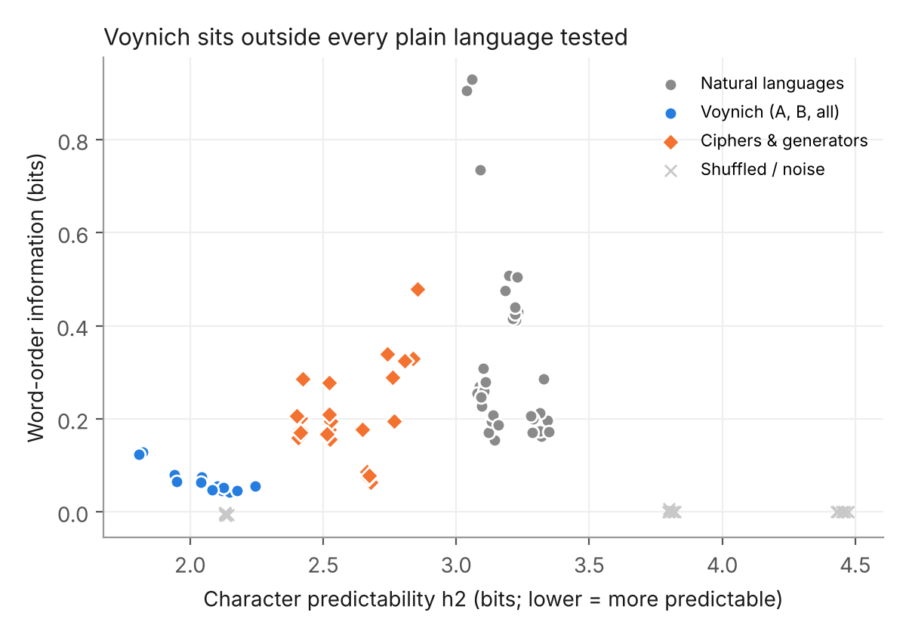
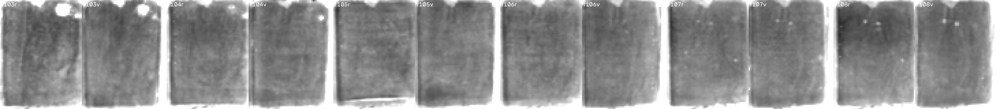
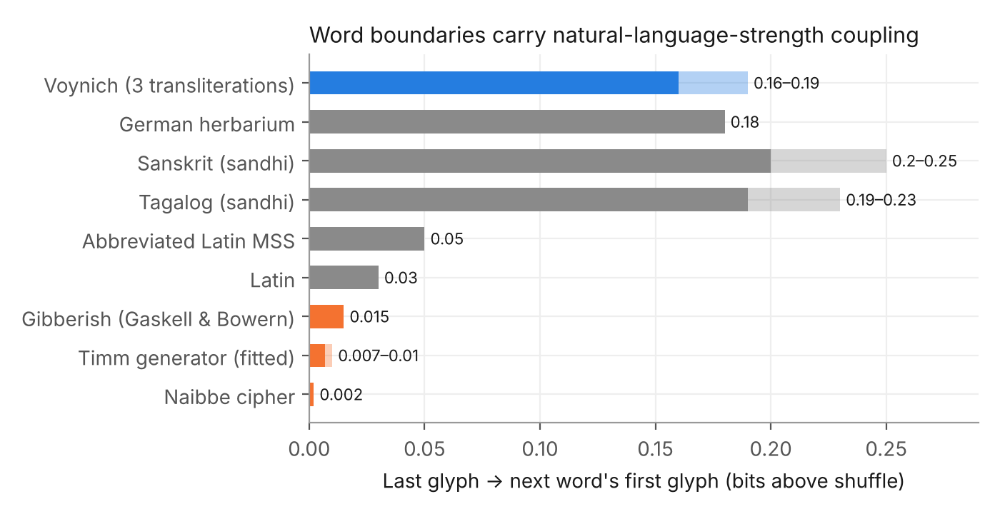

# Abstract {.unnumbered}

We ran 249 tests on Beinecke MS 408, the Voynich Manuscript. Most of them test hypotheses that other researchers proposed, and all of them depend on transliterations, images, code and corpora those researchers made public. Every test was compared against shuffled text, generated text or both; 120 were pre-registered before the data were examined. A reading would have counted as a translation only if it held on pages it was not built from and beat those controls. None did, and we claim no translation.

The positive findings mostly confirm earlier work. As Layfield and Davis reported, pages on the same bifolium share vocabulary far beyond chance, and inner conjoint pages share more than outer ones (sign-flip p = 0.0008 with LSA, 0.047 with TF-IDF, 0.19 with Jaccard), which suggests each sheet was written in reading order (Xr→Xv→Yr→Yv). The text cannot recover the order of sheets inside a quire, however: no quire beats a shuffled-page null (p 0.55–0.997). Calibration on known-order texts shows the test finds the true order in roughly a quarter to a half of quires when content runs on from page to page, almost never in an alphabetical herbal, and in about 15% of quires of Voynich-like generated text. Quire 20, the most testable quire, shows no measurable page-to-page vocabulary carry-over, a level at which the test is near chance. Stain and discolouration maps rank the current nesting first in six of nine quires; in quire 20, paint transfers, an edge flaw and wormholes also fix the current stack.

The text does not behave like a plain language: character predictability (h2 = 2.07 bits against 3.06–3.33) and word-order information (0.07 against 0.19–0.86 bits) fall outside six comparison languages. Simple and homophonic substitution, several published decipherments, word-level codes and crib attacks all failed, although each decoder recovered planted signals at 92–99%. Two structures stand out instead: strong line- and paragraph-position rules in the transliterated text, and a coupling between a word's last glyph and the next word's first glyph (0.16–0.19 bits) that matches natural languages and exceeds every generator and cipher tested.

The statistics are well explained by a scribe copying and varying earlier words, with habits tied to line position. This extends the self-citation model of Timm and Schinner (2020). Our version of it, a frozen copy-and-vary generator (S6-Z1b), reproduces 20.8 of 24 statistics on held-out sheets. That figure is not a comparison of merit with Timm's generator: we chose the 24 statistics and tuned our generator towards them with far more settings than his model has. The generator still makes rare one-off words the wrong way. A glyph-level test of pen form at line edges, first reported as a possible Voynich-specific signal, turned out to be ordinary: a dated Latin hand (BSB Clm 5905, 1479) shows the line-initial effect at least as strongly (AUC 0.68 against 0.64). We sort the findings into rules we can show, choices that look free within those rules, and patterns that are structured but unexplained, and we note that none of them requires or rules out meaning.

# Plain-language summary {.unnumbered}

The Voynich Manuscript is a fifteenth-century book in an unknown script, held by the Beinecke Library at Yale. Many careful people have studied it, and much of what we did was possible only because they published their transcriptions, measurements and code. We used that material to ask specific questions and to check each answer against fake versions of the text: the same words shuffled into random order, and text produced by computer programs designed to imitate the manuscript. A result counted only if the real manuscript behaved differently from those fakes.

**How the book was put together.** The book is made of folded sheets, each giving four pages. Lisa Fagin Davis and Colin Layfield showed that pages on the same sheet share more words than pages on different sheets. We found the same, by a wide margin, and also that each sheet was probably written in the order you would read it once folded. Layfield and Davis also proposed that the sheets were later shuffled and bound out of their first order. We tried to recover the first order from the text and could not: the words do not point to any order better than chance. We then tested our method on books whose order we know and found that it cannot detect order at this scale either, so this is an absence of evidence, not evidence against their idea. The physical marks on the pages (stains, ink offsets, paint in the folds, wormholes) fit the present binding best in most quires, which suggests the present arrangement is old.

**What kind of text it is.** Figure 1 places the manuscript beside six languages, two ciphers and two text generators on two measures: how predictable each letter is from the one before, and how much word order matters. The manuscript sits outside every language. Its letters are much more predictable and its word order carries almost no information. We tried the standard ways of turning such a text back into a language (letter-for-letter substitution, codes for whole words, guessing known plant or star names as cribs) and several published decipherments. Our decoders found hidden messages that we had planted in test texts almost every time, but found nothing in the manuscript.

{width=78%}

**What the text does have.** Two patterns are strong. Lines and paragraphs follow their own rules: paragraphs usually open with a tall "gallows" glyph, and other lines often open with one of three glyphs (Figure 5). And the end of one word predicts the start of the next as strongly as in real languages (Figure 6), much more than in any generator or cipher we tried. These patterns survive in three independent transcriptions and in our own machine reading of the page images.

**A machine that writes Voynich-like text.** Torsten Timm and Andreas Schinner proposed that the scribe wrote by copying earlier words and changing them slightly. We built on their idea, added rules for line position and other habits, and tuned the result until it matched the manuscript on 24 measures. On pages it was not tuned on, it matches about 21 of the 24 (Figure 2). That number should not be read as "better than Timm": we picked the 24 measures ourselves and gave our program many more settings to tune towards them, while Timm's program has only a few. What the test shows is that his basic idea still works when it is pushed much harder. Our program still gets one thing wrong: the manuscript is full of long words that appear only once, and our program cannot make them the way the scribe did.

{width=88%}

**The pen at the edge of the line.** We trained a program to outline individual glyphs in the page images. Glyphs at the start of lines are drawn a little differently from the same glyphs mid-line. We then ran the same test on a Latin herbal manuscript copied in 1479 by a known scribe, and found the same thing, slightly more strongly: scribes of the period often enlarged or flourished the first letter of a line. So this is ordinary scribal behaviour, not something special about the Voynich script.

**What this adds up to.** The manuscript looks most like text produced by a rule-governed writing procedure: copying and varying words, with special rules at line and paragraph edges. That is close to what Timm and Schinner and others have argued. We could not show that it hides a language, and we could not show that it does not. Section 7 sorts what we found into three groups: rules we can demonstrate, choices that look free within those rules, and patterns that are clearly structured but that no model we built explains.

# Introduction {.newpage}

Beinecke MS 408 has drawn more than a century of study. Currier separated two "languages" (A and B) in 1976; Davis identified five scribal hands; Zandbergen and Landini built the transliteration standard and the reference site that most current work depends on; Timm and Schinner proposed and implemented a self-citation model of how the text was produced; and Layfield and Davis (2026) argued from same-sheet vocabulary that many bifolia were written as loose singulions and later nested in a different order. Timm reviewed that proposal and raised the question of whether the text can carry order information at all.

This paper reports a series of tests of those ideas and of others: published decipherments by Bax (2014) and Cheshire (2019), Greshko's Naibbe cipher (2025), Parisel's cho/che switch (2026), Stolfi's word grammar and singulion model for quire 13, and Rugg's table-and-grille method (2004), which we used as a control. We did not set out to replace any of these proposals. Where our version of a test failed, the failure belongs to our version: our fitting, our transliteration choices and our controls. The originals may survive a better test.

Three rules applied throughout. First, every claim was compared against shuffled text, generated text or both. Second, tests that could be pre-registered were (120 of 249), with the decision rule written before the data were examined. Third, a decipherment counted only if it held on held-out pages it was not built from and beat generated-text and shuffled controls. Negative results are reported as plainly as positive ones; the full register is in Appendix A.

**Changes in version 1.2.** The calibration of the sheet-order test is now stated from the calibration results themselves (Section 3.2), the physical-evidence summary separates the strong stain maps from the weaker methods and adds the illustration continuities (Section 3.3), all three similarity metrics are given for the within-sheet result, the scoring bands are defined (Section 6.1), the correction count has its sources, and figures are numbered in order.

**Changes in version 1.1.** The control-hand test (P3-e) is added, and the line-edge pen-form result (P3-c) is now reported as ordinary scribal behaviour rather than a new Voynich observation (Section 5.1). The comparison with Timm's generator is reframed (Section 6.1). Section 7 sorts the findings into three groups. Appendix E summarises the catalogue of one-off words. References follow the Unified Style Sheet for Linguistics.

# Data

**Transliterations.** We used four IVTFF transliterations from voynich.nu, all released under CC0: ZL3b-n (Zandbergen and Landini), IT2a-n (based on Takahashi's transcription), RF1b-e and CD2a-n, credited to the transcribers named in each file header. ZL3b-n was the default. Headline structural results were repeated on IT2a-n and RF1b-e.

**Machine transliteration.** To check that results do not depend on transcriber choices, we trained a Kraken line reader (Kiessling 2019) from scratch on page images and IT labels. Three seeds run as an ensemble reach a page character error rate of 0.111 [0.082, 0.143] against ZL on held-out pages, and 0.061 [0.048, 0.079] after a geometry-only change to row grouping. Line CER on 649 ZL-paired test lines is 0.073, close to Lemur Labs' reported 7.0%; both figures are optimistic because ZL helped choose the lines.

**Images and glyph segmentation.** Page images and multispectral data are from the Beinecke Rare Book and Manuscript Library, Yale University. We trained a U-Net glyph segmenter on rendered scenes built from 37,086 clean exemplars, cross-fitted over two sheet folds. Held-out IoU was 0.93–0.98 for k, t and n, against 0.81–0.88 for a threshold baseline. Letter boxes came from the voynichese.com word boxes archived by Rozanova and Temerev and from Ward's `voynich-letters` (2026). The control hand for the line-edge test is Munich, Bayerische Staatsbibliothek, Clm 5905, from its IIIF images.

**Comparison corpora.** These came from Gaskell and Bowern (2022, gibberish and meaningful texts), Montemurro and Zanette (2013), RIDGES Herbology v9.0 (Odebrecht et al. 2017), ReM (Klein et al. 2016), HTRomance, and three Zenodo HTR ground-truth sets (Klosterneuburg, Inzigkofen, Early New High German charters 1480–85), plus editions of herbals and medical texts listed in the references and in the corpus READMEs.

# Part I: page order

## Same-sheet units

Layfield and Davis found that pages on the same sheet share vocabulary. Our manuscript-wide test agrees. Against a null stratified by scribe, Currier language and illustration type, confoliate pairs score z = +7.4 (TF-IDF), +6.2 (LSA) and +6.6 (Jaccard); inner conjoint pairs score +5.7, +7.4 and +3.7. Inner conjoint pairs beat outer ones in 27 of 35 sheets (LSA sign-flip p = 0.0008; TF-IDF p = 0.047; Jaccard p = 0.19, not significant), so this result rests mainly on LSA. Fitting all twelve four-page orders, Xr→Xv→Yr→Yv wins under TF-IDF and LSA. The simplest reading is that each sheet was folded and written in reading order. That fits the singulion picture, but it fits equally well with a scribe filling one folded sheet at a time before nesting, which is Timm's "unit of production" reading. The signal shows the sheet was the unit of writing, not that sheets were read as loose singulions.

## Sheet order inside quires

If sheets were written as loose units and later nested, the text might still carry their first order. We searched every nesting of nine quires for the order that maximises adjacent-sheet similarity and compared it with a null built from shuffled pages. No quire beats the null under any of three metrics (Fisher combined p 0.55–0.997; Figure 3). The orders that Layfield and Davis proposed score at the random level.

{width=85%}

A calibration matters here (Appendix C, §9 and S17). We cut known-order texts into pages and fake quires of quire 20's shape and ran the same search and null. When content runs on from page to page or sheet to sheet (*The Forme of Cury*, Isidore, the *Gesta Romanorum* and longer texts), the test reaches p < 0.06 in roughly 25–47% of quires, with false positives of 1–3% in scrambled text. In an alphabetical herbal (Culpeper) it almost never finds the order. On Voynich-like generated text with a planted page order (S17-E), its power with LSA, the metric used for quire 20, is about 15%. The decisive measurement is S17-I, which asked how much vocabulary actually carries over from page to page in the Voynich itself. In quire 20 it found none: the consecutive-page ratio is 1.15 (CI 0.91–1.42), at the no-carry level, and at that level the test is near chance. Quire 20's own p values (0.056, and 0.14 for the f116r variant) therefore cannot be read either way. Our negative result says nothing against the singulion hypothesis itself; the question has to be settled by physical evidence.

## Physical evidence

Following Pelling (2006, 2022) and using Dulov's wormhole survey (2022) and the McCrone ink and pigment table (McCrone Associates 2009), we looked at water stains, discolouration, ink offsets, gutter paint and wormholes. The methods differ a great deal in strength. Stain and discolouration maps, scored for every alternative nesting, rank the current nesting first in six of nine quires; this is the only manuscript-wide ranking. The offset detector found true offsets on only about 3% of real facing pairs, so it has little power, and gutter paint was inconclusive. Quire 20 has the most physical evidence. Its stain pattern runs continuously across sheets in their present order (Figure 4), which loose singulions could not produce. Pelling's two paint transfers (f116r→f115v and f113v→f115r, the second past the vellum edge flaw on f114) are both between pages that touch in the current binding, and Dulov's main wormhole track is absent on f111–f112 and grows steadily from f113 to f116, as a worm entering from the back board through the current stack would make. Skin-side alternation was random with respect to binding (Gregory's rule not supported). Together these suggest that the current nesting is old, whatever the writing order was.

We also checked five published claims that an illustration continues across a fold that is not a facing pair today. Two are confirmed: the streams of 78v|81r and the blue petals of 33v|40r really do continue across the join, so those sheets were once open with their inner spread exposed. That fits the singulion picture, but it also fits decoration on flat sheets before sewing. One claim is contradicted: the splashed stain listed for 10v|15r has no partner on 10v's gutter, while 14v, the neighbouring page in the current binding, has brown droplets in mirror position on top of its paint. The splash therefore happened with 14v facing 15r, in the current binding (pigment-coincidence check P = 0.020 for 14v|15r; 10v|15r scores 0). Pelling's 84v|78r continuity also failed. These are among the most concrete physical results bearing on the Layfield and Davis proposal: two sheets did lie open, but the one splash claimed for an earlier facing order belongs to the present one.

{width=90%}

# Part II: what kind of text

## Language profile

We measured twelve statistics on the manuscript, six natural languages (Latin, Middle and Early Modern English, Italian, German), two ciphers, the Timm and Rugg generators, shuffled text and noise. Conditional character entropy h2 is 2.07 bits for the manuscript against 3.06–3.33 for the languages; word-order mutual information is 0.07 bits against 0.19–0.86 (Figure 1). Ciphers that expand plaintext (verbose Latin, sorted Latin) approach the manuscript on h2 but not on word order.

## Decipherment tests

The decipherment harness recovers true substitution and homophonic keys from about 2,300 words of ciphertext. Bax's 2014 reading fails in all five languages we tried. Cheshire's 2019 reading fails even with its most favourable settings: fitted Timm text does as well, and its one Latin pass does not hold across seeds. Bax-style plant-name keys, scored on herbal pages away from his source leaves with Arabic names verified in Leclerc's Ibn al-Baytar (1877–1883) and Greek names from Wellmann's Dioscorides (1906–1914), rank true names no better than shuffled names (p 0.48–0.63). A later language-model decoder fails in Latin, Middle High German and Occitan, with restart agreement 0.11–0.19 against 0.54–0.92 in calibration, and Timm, shuffled and gibberish controls match or beat the manuscript. Its Italian version passes calibration (S16g), and the manuscript in Italian also fails. These are tests of our implementations of the authors' readings, not of every refinement they might make.

Word-level codes, glossary-based codes, Tironian-style abbreviation, ingredient notation and the Naibbe cipher (with Greshko's own code) were fitted to the manuscript and scored on held-out statistics. All failed; Naibbe text matched 5 of 14 statistics. Crib decoders for plant names, the f57v ring sequence, zodiac labels and marginalia recovered planted names at 92–99% and found nothing in the manuscript. Decoders that look for a message hidden in the copying choices themselves found nothing beyond what generated text produces.

## Line and paragraph rules

Line position shapes the text strongly (Figure 5). Paragraphs start with a gallows glyph 80–86% of the time across three transliterations; other lines start with y, s or d 42–48% of the time, against 12–13% for the same glyphs at mid-line word starts. Line ends carry their own marking. Compared with 13 real scribal manuscripts, the manuscript's line-end effect in the transliterated text (E2 +0.083) exceeds all of them, and the machine transliteration gives the same value (+0.082), so the effect is in the writing, not in transcription choices. These are statistics of which glyphs appear where. The separate question of whether the same glyph is drawn differently at a line edge is taken up in Section 5.1, where a control hand shows that this kind of letter-form marking is ordinary.

{width=85%}

## Coupling across word boundaries

The last glyph of a word predicts the first glyph of the next by 0.16–0.19 bits above shuffle (Figure 6), in agreement with Rozanova and Temerev (2026). That matches natural languages (a German herbarium gives 0.18) and is about twenty times the value for fitted Timm text (0.007–0.010), Naibbe (0.002) or gibberish (0.015). The ratio of boundary to within-word coupling is 0.16, inside the language range (0.05–0.20) and far from randomly respaced text (1.1), so spaces mark real boundaries.

{width=85%}

It is not sandhi. With the root held fixed, a word's final glyph does not depend on the next word (excess 0.005 against 0.23–0.34 in Sanskrit). Sandhi languages match the boundary strength but also show strong ending agreement and word order, which the manuscript lacks (ending agreement 0.0075 against 0.05–0.09). No language, cipher or generator we tested combines strong boundary coupling with near-zero agreement.

# Robustness and image tests

The machine transliteration reproduces the key findings: boundary coupling, line-start classes, line-end marking and the generator ranking. Three human transliterations agree on all main structural results.

## Line-edge pen form (P3-c) and the control hand (P3-e)

Using the segmenter, we measured pen-form features of glyph masks with extent and size removed, and compared line-edge glyphs with the same glyphs mid-line under placement matching. In the Voynich, held-out AUC was 0.641 for line-initial against mid-line and 0.587 for line-final (both p = 0.005). Shape-only (HOG) features give 0.633 and 0.586. Placebo splits and a box-only control sit at chance. The line-initial effect appears in every scribe and section with enough glyphs (0.56–0.61); the line-final effect is uneven.

Version 1.0 of this paper called that a new positive result that needed a control hand. The pre-registered control (P3-e) is now done. We ran the same pipeline on BSB Clm 5905, a Latin herbal (Macer's verse and remedy prose) written in gothic cursive at Ebersberg in 1479 by Vitus Auslasser: 336 text pages, 6,047 lines and 157,000 letters, with the segmenter retrained on this hand's own clean exemplars (rendered validation IoU 0.94–0.98). The control hand shows a line-initial effect of 0.681 (HOG-only 0.680, p = 0.005; placebo 0.522), above the Voynich value (Figure 7). By the pre-registered rule this makes the Voynich line-initial effect **ordinary scribal behaviour**. By eye, the control's line-initial letters are often enlarged or near-capital forms (long-stemmed l, h, f and p), which is the same kind of habit as the flourished line-initial y and gallows in the Voynich. The line-final effect is weak in both hands (control 0.556, Voynich 0.587). The Voynich value is formally the stronger one, but the gap in shape-only AUC is 0.03, below the 0.07 margin set in advance, so we do not count it as a finding.

{width=85%}

We therefore withdraw the claim that the line-edge pen-form effect is a new Voynich-specific observation. It is reported here as a negative result: the Voynich scribes marked line starts in the way an ordinary fifteenth-century scribe did. One control manuscript, in cursive and with verse sections, is a narrow base. A prose-only textualis hand would be a useful second control, but we do not expect it to change the conclusion for the line-initial arm.

## Tests that could not be done

Several image tests failed their own calibration gates and are reported as not testable. They include UV detection of erasures, Davis's stroke criteria for distinguishing scribes (third attempt, H10h), ink-session breaks on f105r (the method finds a known break on f115r at p = 0.001, but f105r only fades), and a suspected first-glyph column on f88v. A literature sweep (P5-l) found about 16 published scribal corrections in the Voynichese text, not the 40 sometimes cited: our own six visible overwrites, the emendations shown in Zandbergen's "apparent lack of corrections" gallery on voynich.nu (which confirms four of ours and adds five), and two uncertain spots raised on the Voynich Ninja forum and by Pelling. Stolfi's "retracer" passages are a different claim (later reinforcement of faded ink) and were not counted. The full list with sources is `lit_corrections/published_corrections.csv` in the results archive.

# Part III: a copy-and-vary model

## The S6 generator, and what the comparison with Timm's generator does and does not show

Timm and Schinner's self-citation model proposes that each word is a modified copy of an earlier one. We kept that core and added, in stages, line- and paragraph-position rules, per-language parameters and a boundary rule. The target was a 24-statistic profile, and each stage was scored on held-out sheet halves under six split directions. The final model, S6-Z1b, falls in the Voynich band on 20.8 of 24 statistics on average, and passes in 5 of 6 directions (Figure 2).

How the bands were set matters. For each statistic, the band is the 95th percentile of the difference between two halves of the real manuscript over 200 random sheet splits, so it does not depend on which split is being scored. On this scale two real halves score 22–24 of 24 against each other, which is the ceiling a perfect generator could expect. An earlier generator (the hybrid model) looked successful only under the project's first bands, which were about twice as wide as the sample size allowed: it passed on 19 of 20 seeds under those bands and on none under page-bootstrap bands. S6-Z1b's 20.8 is measured with the stricter split-independent bands, so it does not have that problem. A later variant (S6-Z6) did not improve the held-out score and was not kept. The generator was then frozen.

On the same held-out sheets Timm's generator scores 11.4 and shuffled Voynich text 11.9. **This does not show that our generator is better than Timm's, and it should not be cited as showing that.** We chose the 24 statistics. We then tuned S6-Z1b towards them over many rounds, with far more adjustable settings than Timm and Schinner's model has. Timm's generator was run as published with its own settings and was never tuned to our profile. A model fitted to a scorecard will do well on that scorecard. Held-out sheets were needed because our many-parameter model could overfit, not because anything was wrong with Timm's evaluation: a model with few parameters is reasonably judged on the whole text, as Timm and Schinner did. What the comparison does show is narrower. The copy-and-vary idea at the centre of their model can be extended, rule by rule, to cover line position, paragraph openings and language differences without breaking, and it then reproduces most of what we measured. We see this work as extending and stress-testing their idea, not replacing it.

## What the generator misses

The generator still misses Zipf slope in 13 of 30 runs and three other statistics in 9–11 runs. Its biggest failure is one-off words (Figure 8). In the manuscript 13.8% of words occur once, and only 8.3% of those are one edit from a word in the previous 40. The generator makes fewer one-offs (7–9%) and builds 20–31% of them by local edits. Adding one-off share to the fitting objective did not fix this: the fit still prefers local recycling. Long real one-offs keep line-edge and glyph-sequence habits that free recombination breaks. One-offs do not cluster by subject the way topic nouns do in German herbals. Appendix E summarises a catalogue of the 1,328 most isolated one-offs.

{width=85%}

# What the procedure leaves over: three kinds of finding

The tests above can be sorted into three groups. The sorting is ours and is meant to help the next reader decide what to work on. **None of the three groups requires meaning, and none rules it out.** A procedure with rules, free choices and some unexplained habits could carry a message or could carry none; our tests of meaning (decoders, cribs, choice-channel readings) found nothing, but those tests are bounded as Section 8 explains.

## Rules we can show

These are regularities that beat shuffled text by a wide margin, hold in several transliterations and, where tested, in the machine reading.

| Rule | Evidence | Controls |
|---|---|---|
| Copy and vary: words are modified copies of recent words | A frozen copy-and-vary generator reproduces 20.8 of 24 statistics on held-out sheets | Held-out sheet halves, six split directions; shuffled Voynich 11.9 |
| Paragraph openings | Gallows glyph first in 80–86% of paragraphs | Three transliterations; mid-line rates |
| Line openings | y, s or d start 42–48% of non-paragraph lines, against 12–13% mid-line | Three transliterations; machine reading; shuffles |
| Line endings | Line-end effect E2 +0.083 in the text, above 13 real scribal manuscripts | Machine reading +0.082; real-manuscript comparison |
| Same-sheet vocabulary | Confoliate pairs z +6.2 to +7.4; inner beats outer (p 0.0008 with LSA; 0.047 TF-IDF; 0.19 Jaccard), suggesting order Xr→Xv→Yr→Yv | Null stratified by scribe, language and illustration |
| Section-level ending order | Adjacent ending-pair order is consistent within a section (split-half ρ 0.41–0.57) but differs between sections of one hand (herbal B vs balneological ρ 0.00) | Shuffles; size-matched groups; stock bigrams removed |

Line-edge letter forms are not in this table. They exist in the Voynich, but a dated Latin control hand shows them as strongly (Section 5.1), so they tell us about scribal practice in general, not about this text.

## Choices that look free within those rules

These are the parts of the procedure where we could find no structure beyond what random choice gives.

| Choice | Evidence | Controls |
|---|---|---|
| Which earlier word is copied, and what is changed | The 26 copy-choice symbols, mapped to letters on fit pages and scored on test pages, decode no better than shuffled in Latin, Middle High German, Italian or Occitan, and no better than Timm's random choices | Planted-message calibration passes clearly (homophonic Latin); shuffled choices |
| Sheet order inside quires | No quire beats a shuffled-page null (p 0.55–0.997) | Calibration shows the method cannot see order at quire scale, so "free" here means "not visible", not "absent" |
| Glyph variants that EVA merges | Variants in Claston's transliteration depend on line and paragraph position, not on any hidden choice | Labels shuffled within pages |

## Patterns that are structured but unexplained

These beat their controls but no model we built reproduces them.

| Pattern | Evidence | Controls | Why it is unexplained |
|---|---|---|---|
| Long one-off words | 1,328 free one-offs (24% of one-offs) have fewer doubled e/i (0.30 against 0.44 in generator one-offs), more stacked gallows (0.16 against 0.11) and 133 start–ending pairs not seen in recurring words; enriched in labels (p 0.0015) | S6-Z generator one-offs; unit-shuffled one-offs; shuffled placement; German herbal one-offs (Appendix E) | The generator builds rare words by local edits; the scribe did not |
| Neighbouring-word boundary link | Last glyph predicts next first glyph by 0.16–0.19 bits, with near-zero ending agreement (0.0075) | Languages, sandhi languages, Timm, Naibbe, gibberish, respaced text | Every language with this strength also shows ending agreement; every generator is far weaker |
| Two-back onset alternation | A word's onset is linked to the onset two words later (+0.011 bits, p < 0.0005), in Currier B only | 2,000 shuffles; Timm ≤ 0.005; gibberish | Not built into any generator; replicates in three transliterations |

Either the procedure had richer rules than ours, or the rules sit on top of something else, a language or a stock of names, that the procedure conceals. The data we have do not decide between these.

# Discussion

Much of what we found confirms earlier work. Layfield and Davis's same-sheet signal is strong, and the within-sheet writing order fits their singulion picture. Timm and Schinner's self-citation idea, extended with position rules, gives the best generative description of the text that we could build. That is a statement about how far their idea can be pushed, not a ranking of our generator against theirs (Section 6.1). Parisel's per-folio cho/che switch replicates in three transliterations. Currier's languages and Davis's hands remain useful structure: the generator needs per-language parameters, and the line-start rules differ by section.

The negative results are bounded. A failed sheet-order search on quire-sized text is uninformative by our own calibration. A failed decipherment tests a particular decoder against a particular language and transliteration. The decoders were calibrated on planted signals, and the text was compared with generated controls, so the failures are not blind, but they do not rule out a system we did not model. The line-edge pen-form test is the clearest example of why controls matter: within the Voynich it passed every internal check, and only a second manuscript showed that it was ordinary.

# Limitations

- The glyph segmenter was validated by eye by the same session that trained it, not by independent annotators.
- The control-hand test uses one manuscript, in cursive, with verse sections. Its letter cuts are coarser than the Voynich letter boxes, which if anything biases it towards finding no effect.
- Most tests use ZL3b-n; structural results were repeated on two other transliterations and the machine reading, but many secondary tests were not.
- The language comparison uses a limited set of languages and editions, and some comparison texts are normalised editions rather than manuscripts.
- Decipherment tests cover the languages, cipher families and readings we implemented. Our versions of published readings may differ from the authors' intent.
- The 24-statistic profile was chosen by us, and our generator was tuned towards it. A generator that matches it may still differ from the manuscript in ways the profile does not measure, as the one-off result shows, and the profile is not a fair basis for ranking other generators.
- 129 of 249 tests were exploratory rather than pre-registered and should be read as such.
- We did not reach Glen Claston's hair/flesh list or the Beinecke conservation notes (Zyats 2016), which may bear on the physical analysis.

# Future work

1. **The one-off word process.** Model how long one-off words arise, given that they keep line-edge habits but have new onset–ending pairs and fewer doubled glyphs. The catalogue in the repository is a starting point.
2. **A boundary mechanism** that produces strong boundary coupling without ending agreement or word order, tested against the frozen S6-Z1b.
3. **A second control hand (low priority).** Repeat the line-edge test on a prose-only textualis manuscript, mainly to check the weak line-final arm.
4. **Davis's stroke criteria with independent annotation.** Ask independent annotators to mark strokes, then retry the scribe-distinction test with the segmenter.
5. **New multispectral imaging** at higher resolution of candidate erasures and ink breaks.
6. **Hand-confirmed overwrites**, using the segmenter to propose candidates for expert review.

# AI assistance statement {.unnumbered}

This work was carried out with substantial AI assistance. Claude Opus 5.5, a large language model made by Anthropic, designed and ran the analyses, wrote the code, drafted the pre-registrations and wrote this paper, working under the direction of Paul Stark. Paul Stark chose the questions and ground rules (shuffled and generated controls for every claim, pre-registration where possible, held-out pages for any reading), ran the GPU jobs on his own computer, decided which results to pursue and how to present them, and checked the results and the text. Claude is listed as a co-author to make its role clear; responsibility for the paper rests with Paul Stark. All code, decision rules and outputs are public so that any result can be checked independently.

# Acknowledgements {.unnumbered}

This work rests on the research and generosity of the Voynich community. We thank René Zandbergen and Gabriel Landini for the ZL transliteration, the IVTFF format and voynich.nu; the transcribers behind IT2a-n (Takeshi Takahashi), RF1b-e and CD2a-n; the EVMT project; Lisa Fagin Davis for the scribal hands and the 2024 multispectral study; Colin Layfield and Lisa Fagin Davis for the singulion hypothesis; Torsten Timm and Andreas Schinner for the self-citation model, and Torsten Timm for his generator code under MIT and his review of the singulion proposal; Stephen Bax, Gerard Cheshire, Michael Greshko (the Naibbe cipher and code), Christophe Parisel, Gordon Rugg and Jorge Stolfi, whose proposals we tested; Prescott Currier; Nick Pelling, Wladimir Dulov and McCrone Associates for physical evidence; Liudmila Rozanova, Alexander Temerev and Lainey Louise Ward for word and letter boxes; Benjamin Kiessling and the Kraken contributors; Daniel Gaskell and Claire Bowern, Marcelo Montemurro and Damián Zanette, and the editors of RIDGES, ReM, HTRomance and the Zenodo ground-truth sets; the Bayerische Staatsbibliothek for the images of Clm 5905; and the Beinecke Rare Book and Manuscript Library, Yale University, for the images and multispectral data of MS 408.

# References {.unnumbered}

::: {.ref}
Bax, Stephen. 2014. A proposed partial decoding of the Voynich script. Version 1, January 2014. Self-published. https://stephenbax.net/wp-content/uploads/2014/01/Voynich-a-provisional-partial-decoding-BAX.pdf.
:::

::: {.ref}
Bayerische Staatsbibliothek. 1479. Clm 5905 (Macer, *De viribus herbarum*, and Latin remedies; Ebersberg, scribe Vitus Auslasser). Munich: Bayerische Staatsbibliothek. Digital facsimile: https://www.digitale-sammlungen.de/view/bsb00092488.
:::

::: {.ref}
Beinecke Rare Book and Manuscript Library. n.d. *Cipher manuscript* (MS 408, the Voynich Manuscript). New Haven, CT: Yale University. https://collections.library.yale.edu/catalog/2002046.
:::

::: {.ref}
Brunel, Clovis. 1957. Recettes médicales, alchimiques et astrologiques du XV^e^ siècle en langue vulgaire des Pyrénées. *Romania* 78(3). 289–339.
:::

::: {.ref}
Cheshire, Gerard. 2019. The language and writing system of MS408 (Voynich) explained. *Romance Studies* 37(1). 30–67. https://doi.org/10.1080/02639904.2019.1599566.
:::

::: {.ref}
Currier, Prescott H. 1976. Papers on the Voynich Manuscript. In Mary E. D'Imperio (ed.), *New research on the Voynich Manuscript: Proceedings of a seminar, 30 November 1976*. Washington, DC. Transcribed at https://www.voynich.nu/extra/curr_main.html.
:::

::: {.ref}
Davis, Lisa Fagin. 2020. How many glyphs and how many scribes? Digital paleography and the Voynich Manuscript. *Manuscript Studies* 5(1). 164–180. https://doi.org/10.1353/mns.2020.0011.
:::

::: {.ref}
Davis, Lisa Fagin. 2024. Multispectral imaging and the Voynich Manuscript. *Manuscript Road Trip* (blog), 8 September 2024. https://manuscriptroadtrip.wordpress.com/2024/09/08/multispectral-imaging-and-the-voynich-manuscript/.
:::

::: {.ref}
Dulov, Wladimir. 2022. [Wormholes and page numbering in quire 20 of the Voynich Manuscript.] Blog post, June 2022. https://vladimirdulov.blogspot.com/2022/06/page-numbering-was-done-by-at-least-4.html.
:::

::: {.ref}
Early New High German diplomatic HTR ground truth, version 2 (charters and registers, 1480–1485). n.d. Dataset. Zenodo. https://zenodo.org/records/21257167.
:::

::: {.ref}
Gaskell, Daniel E. & Claire L. Bowern. 2022. Gibberish after all? Voynichese is statistically similar to human-produced samples of meaningless text. In *Proceedings of the International Conference on the Voynich Manuscript 2022* (CEUR Workshop Proceedings 3313), paper 4. https://ceur-ws.org/Vol-3313/paper4.pdf.
:::

::: {.ref}
Greshko, Michael A. 2025. The Naibbe cipher: A substitution cipher that encrypts Latin and Italian as Voynich Manuscript-like ciphertext. *Cryptologia*. https://doi.org/10.1080/01611194.2025.2566408. Code: https://github.com/greshko/naibbe-cipher.
:::

::: {.ref}
HTRomance project. n.d. HTRomance: Ground truth for handwritten text recognition of medieval Romance-language manuscripts. https://github.com/HTRomance-Project.
:::

::: {.ref}
Ineichen, Gustav (ed.). 1962–1966. *El libro agregà de Serapiom*. 2 vols. Venice & Rome: Istituto per la Collaborazione Culturale.
:::

::: {.ref}
Inzigkofen manuscripts (Berlin, Ms. germ. oct. 842 and fol. 1045), full transcriptions. n.d. Dataset. Zenodo. https://doi.org/10.5281/zenodo.17978574.
:::

::: {.ref}
Kiessling, Benjamin. 2019. Kraken: An universal text recognizer for the humanities. In *Digital Humanities 2019 (DH2019): Book of abstracts*. Utrecht: Utrecht University. Software, version 7.1.1: https://github.com/mittagessen/kraken.
:::

::: {.ref}
Klein, Thomas, Klaus-Peter Wegera, Stefanie Dipper & Claudia Wich-Reif. 2016. *Referenzkorpus Mittelhochdeutsch (1050–1350)*, version 1.0. Bochum: Ruhr-Universität Bochum. https://www.linguistics.ruhr-uni-bochum.de/rem/.
:::

::: {.ref}
Klosterneuburg Cod. 48 HTR ground truth. n.d. Dataset. Zenodo. https://doi.org/10.5281/zenodo.7466927.
:::

::: {.ref}
Layfield, Colin & Lisa Fagin Davis. 2026. Singulion structure and the Voynich Manuscript. *Digital Medievalist* 19. https://doi.org/10.4000/16k0a.
:::

::: {.ref}
Leclerc, Lucien (trans.). 1877–1883. *Traité des simples par Ibn el-Beïthar*. 3 vols. Paris: Imprimerie nationale.
:::

::: {.ref}
McCrone Associates. 2009. Materials analysis of the Voynich Manuscript. Report prepared for the Beinecke Rare Book and Manuscript Library. Westmont, IL: McCrone Associates.
:::

::: {.ref}
Montemurro, Marcelo A. & Damián H. Zanette. 2013. Keywords and co-occurrence patterns in the Voynich Manuscript: An information-theoretic analysis. *PLoS ONE* 8(6). e66344. https://doi.org/10.1371/journal.pone.0066344.
:::

::: {.ref}
Odebrecht, Carolin, Malte Belz, Amir Zeldes, Anke Lüdeling & Thomas Krause. 2017. RIDGES Herbology: Designing a diachronic multi-layer corpus. *Language Resources and Evaluation* 51(3). 695–725. https://doi.org/10.1007/s10579-016-9374-3. Corpus version 9.0.
:::

::: {.ref}
Parisel, Christophe. 2026. A quantitative confirmation of the Currier language distinction. arXiv:2604.25979. https://arxiv.org/abs/2604.25979.
:::

::: {.ref}
Pelling, Nick. 2006. *The curse of the Voynich: The secret history of the world's most mysterious manuscript*. Surbiton: Compelling Press.
:::

::: {.ref}
Pelling, Nick. 2022. Quire 20, order from chaos… (Part 1: Evidence). *Cipher Mysteries* (blog), 20 December 2022. https://ciphermysteries.com/2022/12/20/quire-20-order-from-chaos-part-1-evidence.
:::

::: {.ref}
Rozanova, Liudmila & Alexander Temerev. 2026. A glyph is not a letter, a token is not a word, a space is not a space: What the units of Voynichese are not. arXiv:2608.17096. https://arxiv.org/abs/2608.17096. Word-box data: https://github.com/lrozanova/voynich-units.
:::

::: {.ref}
Rugg, Gordon. 2004. An elegant hoax? A possible solution to the Voynich manuscript. *Cryptologia* 28(1). 31–46. https://doi.org/10.1080/0161-110491892755.
:::

::: {.ref}
Stolfi, Jorge. 2000. A grammar for Voynichese words. Campinas: Universidade Estadual de Campinas. https://www.ic.unicamp.br/~stolfi/voynich/00-06-07-word-grammar/.
:::

::: {.ref}
Timm, Torsten. 2026. [Review of Layfield and Davis's singulion hypothesis.] *The Voynich Ninja* forum, thread 5911. https://www.voynich.ninja/archive/index.php/thread-5911.html.
:::

::: {.ref}
Timm, Torsten. n.d. SelfCitationTextgenerator (software, MIT licence). https://github.com/TorstenTimm/SelfCitationTextgenerator.
:::

::: {.ref}
Timm, Torsten & Andreas Schinner. 2020. A possible generating algorithm of the Voynich manuscript. *Cryptologia* 44(1). 1–19. https://doi.org/10.1080/01611194.2019.1596999.
:::

::: {.ref}
Ward, Lainey Louise. 2026. voynich-letters (software). https://github.com/LaineyLouiseWard/voynich-letters.
:::

::: {.ref}
Wellmann, Max (ed.). 1906–1914. *Pedanii Dioscuridis Anazarbei De materia medica libri quinque*. 3 vols. Berlin: Weidmann.
:::

::: {.ref}
Zandbergen, René. n.d. *The Voynich Manuscript* (website). https://www.voynich.nu.
:::

::: {.ref}
Zandbergen, René & Gabriel Landini. n.d. ZL3b-n transliteration of the Voynich MS, in IVTFF format. https://www.voynich.nu/transcr.html. Released under CC0.
:::

::: {.ref}
Zyats, Paula. 2016. [Codicology and conservation of MS 408.] In Raymond Clemens (ed.), *The Voynich Manuscript*. New Haven, CT: Yale University Press in association with the Beinecke Rare Book and Manuscript Library. Not consulted.
:::

Further comparison editions (*Alphita*, *Sinonoma Bartholomei*, Brunschwig, Megenberg, Culpeper, Isidore, Pliny, Lilly and *The Forme of Cury*) are listed with their editors and sources in the corpus READMEs in the repository.
