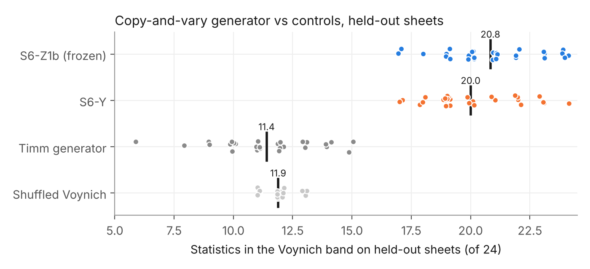
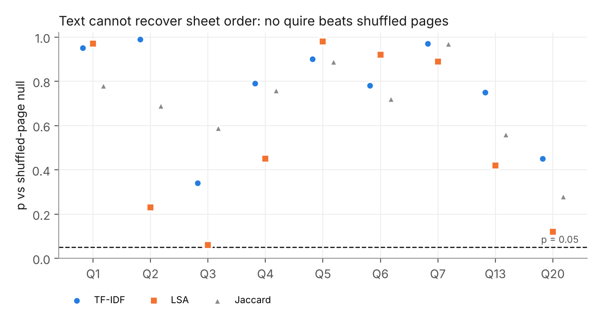
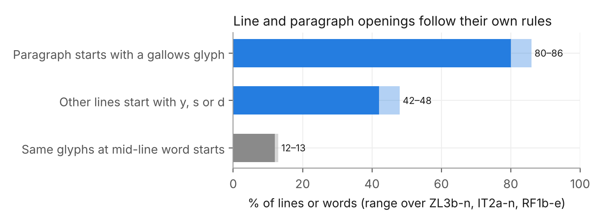
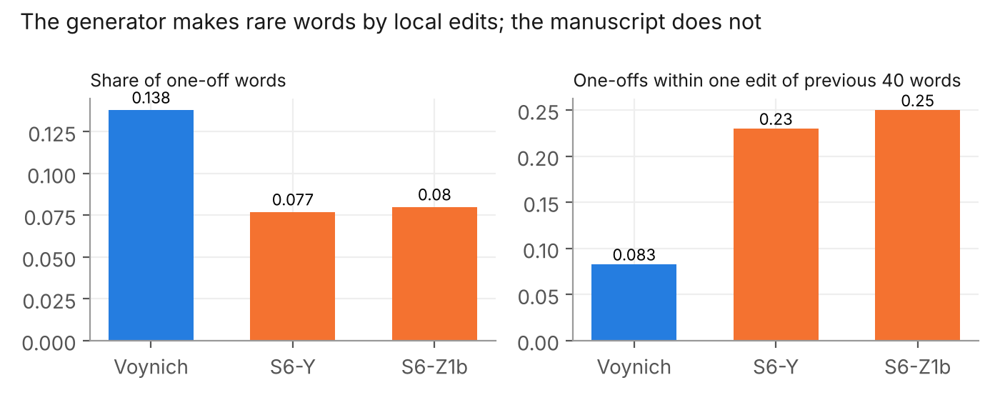
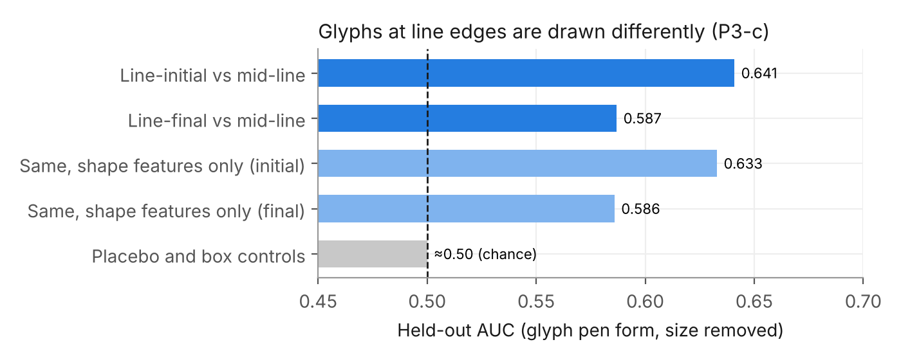

# Abstract {.unnumbered}

We ran 248 tests on Beinecke MS 408, the Voynich Manuscript. Most of them test hypotheses that other researchers proposed, and all of them depend on transliterations, images, code and corpora those researchers made public. Every test was compared against shuffled text, generated text or both; 119 were pre-registered before the data were examined. A reading would have counted as a translation only if it held on pages it was not built from and beat those controls. None did.

The positive findings mostly confirm earlier work. As Layfield and Davis reported, pages on the same bifolium share vocabulary far beyond chance, and the four pages of a sheet appear to have been written in reading order (Xr→Xv→Yr→Yv, sign-flip p = 0.0008). The text cannot recover the order of sheets inside a quire, however: no quire beats a shuffled-page null (p 0.55–0.997), and a calibration on texts of known order shows that this method could not have detected order at the scale of a Voynich quire. Physical evidence (stains, offsets, gutter paint and wormholes) fits the current nesting best in six of nine quires.

The text does not behave like a plain language: character predictability (h2 = 2.07 bits against 3.06–3.33) and word-order information (0.07 against 0.19–0.86 bits) fall outside six comparison languages. Simple and homophonic substitution, several published decipherments, word-level codes and crib attacks all failed, although each decoder recovered planted signals at 92–99%. Two structures stand out instead: strong line- and paragraph-position rules, and a coupling between a word's last glyph and the next word's first glyph (0.16–0.19 bits) that matches natural languages and exceeds every generator and cipher tested.

Building on Timm's self-citation model, a frozen copy-and-vary generator (S6-Z1b) reproduces 20.8 of 24 statistics on held-out sheets, against 11.4 for Timm's generator and 11.9 for shuffled text. It still makes rare words the wrong way. A trained glyph segmenter (held-out IoU 0.93–0.98) shows that glyphs at line edges have a different pen form from the same glyphs mid-line (AUC 0.641 for line-initial, 0.587 for line-final, p = 0.005). That last result is new and needs a control-hand test before it can be read with confidence.

# Plain-language summary {.unnumbered}

The Voynich Manuscript is a fifteenth-century book in an unknown script, held by the Beinecke Library at Yale. Many careful people have studied it, and much of what we did was possible only because they published their transcriptions, measurements and code. We used that material to ask specific questions and to check each answer against fake versions of the text: the same words shuffled into random order, and text produced by computer programs designed to imitate the manuscript. A result counted only if the real manuscript behaved differently from those fakes.

**How the book was put together.** The book is made of folded sheets, each giving four pages. Lisa Fagin Davis and Colin Layfield showed that pages on the same sheet share more words than pages on different sheets. We found the same, by a wide margin, and also that each sheet was probably written in the order you would read it once folded. Layfield and Davis also proposed that the sheets were later shuffled and bound out of their first order. We tried to recover the first order from the text and could not: the words do not point to any order better than chance. We then tested our method on books whose order we know and found that it cannot detect order at this scale either, so this is an absence of evidence, not evidence against their idea. The physical marks on the pages (stains, ink offsets, paint in the folds, wormholes) fit the present binding best in most quires, which suggests the present arrangement is old.

**What kind of text it is.** Figure 2 places the manuscript beside six languages, two ciphers and two text generators on two measures: how predictable each letter is from the one before, and how much word order matters. The manuscript sits outside every language. Its letters are much more predictable and its word order carries almost no information. We tried the standard ways of turning such a text back into a language (letter-for-letter substitution, codes for whole words, guessing known plant or star names as cribs) and several published decipherments. Our decoders found hidden messages that we had planted in test texts almost every time, but found nothing in the manuscript.

{width=78%}

**What the text does have.** Two patterns are strong. Lines and paragraphs follow their own rules: paragraphs usually open with a tall "gallows" glyph, and other lines often open with one of three glyphs (Figure 5). And the end of one word predicts the start of the next as strongly as in real languages (Figure 6), much more than in any generator or cipher we tried. These patterns survive in three independent transcriptions and in our own machine reading of the page images.

**A machine that writes Voynich-like text.** Torsten Timm proposed that the scribe wrote by copying earlier words and changing them slightly. We built on his idea and tuned a copy-and-vary program until it matched the manuscript on 24 measures. On pages it was not tuned on, it matches about 21 of the 24 (Figure 3), which is much closer than Timm's original program or shuffled text. It still gets one thing wrong: the manuscript is full of long words that appear only once, and our program cannot make them the way the scribe did.

{width=88%}

**The pen at the edge of the line.** Finally, we trained a program to outline individual glyphs in the page images. Glyphs at the start and end of lines turn out to be drawn differently from the same glyphs mid-line, even after their size is removed from the comparison. This supports the idea that the scribes treated line edges as special while writing, not only in what they wrote. It is the newest result here, and it still needs one more control (Section 9).

**What this adds up to.** The manuscript looks most like text produced by a rule-governed writing procedure: copying and varying words, with special rules at line and paragraph edges. That is close to what Timm and others have argued. We could not show that it hides a language, and we could not show that it does not. The two structures above, and the way the scribes made one-off words, are where we think the next work should go.

# Introduction {.newpage}

Beinecke MS 408 has drawn more than a century of study. Currier separated two "languages" (A and B) in 1976; Davis identified five scribal hands; Zandbergen and Landini built the transliteration standard and the reference site that most current work depends on; Timm proposed and implemented a self-citation model of how the text was produced; and Layfield and Davis (2026) argued from same-sheet vocabulary that many bifolia were written as loose singulions and later nested in a different order. Timm reviewed that proposal and raised the question of whether the text can carry order information at all.

This paper reports a series of tests of those ideas and of others: published decipherments by Bax (2014) and Cheshire (2019), Greshko's Naibbe cipher, Parisel's cho/che switch, Stolfi's word grammar and singulion model for quire 13, and Rugg's table-and-grille method, which we used as a control. We did not set out to replace any of these proposals. Where our version of a test failed, the failure belongs to our version: our fitting, our transliteration choices and our controls. The originals may survive a better test.

Three rules applied throughout. First, every claim was compared against shuffled text, generated text or both. Second, tests that could be pre-registered were (119 of 248), with the decision rule written before the data were examined. Third, a decipherment counted only if it held on held-out pages it was not built from and beat generated-text and shuffled controls. Negative results are reported as plainly as positive ones; the full register is in Appendix A.

# Data

**Transliterations.** We used four IVTFF transliterations from voynich.nu, all released under CC0: ZL3b-n (Zandbergen and Landini), IT2a-n (based on Takahashi's transcription), RF1b-e and CD2a-n, credited to the transcribers named in each file header. ZL3b-n was the default. Headline structural results were repeated on IT2a-n and RF1b-e.

**Machine transliteration.** To check that results do not depend on transcriber choices, we trained a Kraken line reader (Kiessling and contributors) from scratch on page images and IT labels. Three seeds run as an ensemble reach a page character error rate of 0.111 [0.082, 0.143] against ZL on held-out pages, and 0.061 [0.048, 0.079] after a geometry-only change to row grouping. Line CER on 649 ZL-paired test lines is 0.073, close to Lemur Labs' reported 7.0%; both figures are optimistic because ZL helped choose the lines.

**Images and glyph segmentation.** Page images and multispectral data are from the Beinecke Library. We trained a U-Net glyph segmenter on rendered scenes built from 37,086 clean exemplars, cross-fitted over two sheet folds. Held-out IoU was 0.93–0.98 for k, t and n, against 0.81–0.88 for a threshold baseline. Letter boxes came from the word boxes of Rozanova and Temerev (2026, via voynichese.com) and Ward's `voynich-letters` (2026).

**Comparison corpora.** These came from Gaskell and Bowern (2022, gibberish and meaningful texts in 55 languages), Montemurro and Zanette (2013), RIDGES Herbology v9.0, ReM, HTRomance, and three Zenodo HTR ground-truth sets (Klosterneuburg, Inzigkofen, ENHG 1480–85), plus editions of herbals and medical texts listed in Appendix D.

# Part I: page order

## Same-sheet units

Layfield and Davis found that pages on the same sheet share vocabulary. Our manuscript-wide test agrees. Against a null stratified by scribe, Currier language and illustration type, confoliate pairs score z = +7.4 (TF-IDF), +6.2 (LSA) and +6.6 (Jaccard); inner conjoint pairs score +5.7, +7.4 and +3.7. Inner conjoint pairs beat outer ones in 27 of 35 sheets (LSA sign-flip p = 0.0008; TF-IDF p = 0.047; Jaccard p = 0.19, not significant). Fitting all twelve four-page orders, Xr→Xv→Yr→Yv wins under TF-IDF and LSA. The simplest reading is that each sheet was folded and written in reading order, which fits the singulion picture.

## Sheet order inside quires

If sheets were written as loose units and later nested, the text might still carry their first order. We searched every nesting of nine quires for the order that maximises adjacent-sheet similarity and compared it with a null built from shuffled pages. No quire beats the null under any of three metrics (Fisher combined p 0.55–0.997; Figure 1). The orders that Layfield and Davis proposed score at the random level.

{width=85%}

A calibration matters here. On texts of known order, cut into units the size of Voynich quires, the same search gives p values of 0.06–0.14 even when the true order is present. A quire 20-sized test therefore cannot see order, and our negative result says nothing against the singulion hypothesis itself. The question has to be settled by physical evidence.

## Physical evidence

Following Pelling (2006) and using Dulov's wormhole survey and the McCrone ink and pigment table, we scored water stains, ink offsets, gutter paint and wormholes for every alternative nesting. The current nesting fits best in six of nine quires. In quire 20 the stain pattern runs continuously across sheets in their present order (Figure 4), which loose singulions could not produce. Skin-side alternation was random with respect to binding (Gregory's rule not supported). Together these suggest that the current nesting is old, whatever the writing order was.

{width=90%}

# Part II: what kind of text

## Language profile

We measured twelve statistics on the manuscript, six natural languages (Latin, Middle and Early Modern English, Italian, German), two ciphers, the Timm and Rugg generators, shuffled text and noise. Conditional character entropy h2 is 2.07 bits for the manuscript against 3.06–3.33 for the languages; word-order mutual information is 0.07 bits against 0.19–0.86 (Figure 2). Ciphers that expand plaintext (verbose Latin, sorted Latin) approach the manuscript on h2 but not on word order.

## Decipherment tests

The decipherment harness recovers true substitution and homophonic keys from about 2,300 words of ciphertext. Bax's 2014 reading fails in all five languages we tried. Cheshire's 2019 reading fails even with its most favourable settings: fitted Timm text does as well, and its one Latin pass does not hold across seeds. Bax-style plant-name keys, scored on herbal pages away from his source leaves with Arabic names verified in Leclerc's Ibn al-Baytar and Greek names from Wellmann's Dioscorides, rank true names no better than shuffled names (p 0.48–0.63). A later language-model decoder fails in Latin, Middle High German and Occitan, with restart agreement 0.11–0.19 against 0.54–0.92 in calibration, and Timm, shuffled and gibberish controls match or beat the manuscript. Its Italian version passes calibration (S16g), and the manuscript in Italian also fails. These are tests of our implementations of the authors' readings, not of every refinement they might make.

Word-level codes, glossary-based codes, Tironian-style abbreviation, ingredient notation and the Naibbe cipher (with Greshko's own code) were fitted to the manuscript and scored on held-out statistics. All failed; Naibbe text matched 5 of 14 statistics. Crib decoders for plant names, the f57v ring sequence, zodiac labels and marginalia recovered planted names at 92–99% and found nothing in the manuscript. Decoders that look for a message hidden in the copying choices themselves found nothing beyond what generated text produces.

## Line and paragraph rules

Line position shapes the text strongly (Figure 5). Paragraphs start with a gallows glyph 80–86% of the time across three transliterations; other lines start with y, s or d 42–48% of the time, against 12–13% for the same glyphs at mid-line word starts. Line ends carry their own marking. Compared with 13 real scribal manuscripts, the manuscript's line-end effect (E2 +0.083) exceeds all of them, and the machine transliteration gives the same value (+0.082), so the effect is in the writing, not in transcription choices.

{width=85%}

## Coupling across word boundaries

The last glyph of a word predicts the first glyph of the next by 0.16–0.19 bits above shuffle (Figure 6), in agreement with Rozanova and Temerev (2026). That matches natural languages (a German herbarium gives 0.18) and is about twenty times the value for fitted Timm text (0.007–0.010), Naibbe (0.002) or gibberish (0.015). The ratio of boundary to within-word coupling is 0.16, inside the language range (0.05–0.20) and far from randomly respaced text (1.1), so spaces mark real boundaries.

{width=85%}

It is not sandhi. With the root held fixed, a word's final glyph does not depend on the next word (excess 0.005 against 0.23–0.34 in Sanskrit). Sandhi languages match the boundary strength but also show strong ending agreement and word order, which the manuscript lacks (ending agreement 0.0075 against 0.05–0.09). No language, cipher or generator we tested combines strong boundary coupling with near-zero agreement.

# Part III: a copy-and-vary model

## The S6 generator

Timm's self-citation model proposes that each word is a modified copy of an earlier one. We kept that core and added, in stages, line- and paragraph-position rules, per-language parameters and a boundary rule. The target was a 24-statistic profile, and each stage was scored on held-out sheet halves under six split directions. The final model, S6-Z1b, falls in the Voynich band on 20.8 of 24 statistics on average, and passes in 5 of 6 directions; Timm's generator scores 11.4 and shuffled Voynich 11.9 (Figure 3). A later variant (S6-Z6) did not improve the held-out score and was not kept. The generator was then frozen. The gain over Timm's generator comes from additions to his model, not from a different idea.

## What the generator misses

The generator still misses Zipf slope in 13 of 30 runs and three other statistics in 9–11 runs. Its biggest failure is one-off words (Figure 7). In the manuscript 13.8% of words occur once, and only 8.3% of those are one edit from a word in the previous 40. The generator makes fewer one-offs (7–9%) and builds 20–31% of them by local edits. Adding one-off share to the fitting objective did not fix this: the fit still prefers local recycling. Long real one-offs keep line-edge and glyph-sequence habits that free recombination breaks. One-offs do not cluster by subject the way topic nouns do in German herbals. We list this as an unmodelled process.

{width=85%}

# Robustness and image tests

The machine transliteration reproduces the key findings: boundary coupling, line-start classes, line-end marking and the generator ranking. Three human transliterations agree on all main structural results.

## Line-edge pen form (P3-c)

Using the segmenter, we measured pen-form features of glyph masks with extent and size removed, and compared line-edge glyphs with the same glyphs mid-line under placement matching. Held-out AUC was 0.641 for line-initial against mid-line and 0.587 for line-final (both p = 0.005). Shape-only (HOG) features give 0.633 and 0.586, so the signal is in pen form, not mask extent. Placebo splits and a box-only control sit at chance. The strongest glyphs are line-initial t (0.90) and sh (0.72) and line-final n (0.66). The line-initial effect appears in every scribe and section with enough glyphs (Scribe 1 0.608, Scribe 2 0.604, Scribe 3 0.564; Biological 0.586, Herbal 0.601, Stars 0.604; p 0.01–0.06). The line-final effect is uneven: present for Scribe 3 (0.642) and Stars (0.622), weak or absent elsewhere (Herbal 0.531). No subset reverses. Figure 8 summarises the AUCs; mean masks are shown in Appendix C as an illustration only, because band-fit error at line ends partly confounds them.

{width=85%}

## Tests that could not be done

Several image tests failed their own calibration gates and are reported as not testable. They include UV detection of erasures, Davis's stroke criteria for distinguishing scribes (third attempt, H10h), ink-session breaks on f105r (the method finds a known break on f115r at p = 0.001, but f105r only fades), and a suspected first-glyph column on f88v. A literature sweep found about 16 published scribal corrections, not the 40 sometimes cited.

# Discussion

Much of what we found confirms earlier work. Layfield and Davis's same-sheet signal is strong, and the within-sheet writing order fits their singulion picture. Timm's self-citation idea, extended with position rules, gives the best generative description of the text that we could build, and it beats shuffled text and his own generator by a wide margin on held-out sheets. Parisel's per-folio cho/che switch replicates in three transliterations. Currier's languages and Davis's hands remain useful structure: the generator needs per-language parameters, and the line-initial pen effect holds across hands.

The negative results are bounded. A failed sheet-order search on quire-sized text is uninformative by our own calibration. A failed decipherment tests a particular decoder against a particular language and transliteration. The decoders were calibrated on planted signals, and the text was compared with generated controls, so the failures are not blind, but they do not rule out a system we did not model.

Two features remain unexplained by any model we tested: boundary coupling at natural-language strength with near-zero ending agreement, and long one-off words that keep the line habits of common words while having new onset–ending pairs. Either could come from a procedure with richer rules than ours, or from an underlying language that the procedure conceals. The line-edge pen-form result suggests that position rules were part of the act of writing, which fits a procedure applied by hand.

# Limitations

- **P3-c has no control hand.** The line-edge pen-form effect has not been measured on a real manuscript written by a known scribe with the same segmenter and features. Without that, we cannot exclude a general scribal habit (for example, pen pressure at line starts) that any fifteenth-century hand would show.
- The glyph segmenter was validated by eye by the same session that trained it, not by independent annotators.
- Most tests use ZL3b-n; structural results were repeated on two other transliterations and the machine reading, but many secondary tests were not.
- The language comparison uses a limited set of languages and editions, and some comparison texts are normalised editions rather than manuscripts.
- Decipherment tests cover the languages, cipher families and readings we implemented. Our versions of published readings may differ from the authors' intent.
- The 24-statistic profile was chosen by us. A generator that matches it may still differ from the manuscript in ways the profile does not measure, as the one-off result shows.
- 129 of 248 tests were exploratory rather than pre-registered and should be read as such.
- We did not reach Glen Claston's hair/flesh list or Zyats's conservation notes, which may bear on the physical analysis.

# Future work

1. **A control-hand test for P3-c.** Run the segmenter and pen-form features on one or more real manuscripts written by a single known scribe, with matched line lengths, to see whether line-edge glyphs differ from mid-line glyphs there too. This is the first item because the result is the only new positive finding and depends on it.
2. **The one-off word process.** Model how long one-off words arise, given that they keep line-edge habits but have new onset–ending pairs.
3. **Davis's stroke criteria with independent annotation.** Ask independent annotators to mark strokes, then retry the scribe-distinction test with the segmenter.
4. **New multispectral imaging** at higher resolution of candidate erasures and ink breaks.
5. **Hand-confirmed overwrites**, using the segmenter to propose candidates for expert review.
6. **A boundary mechanism** that produces strong boundary coupling without ending agreement or word order, tested against the frozen S6-Z1b.

# Acknowledgements {.unnumbered}

This work rests on the research and generosity of the Voynich community. We thank René Zandbergen and Gabriel Landini for the ZL transliteration, the IVTFF format and voynich.nu; the transcribers behind IT2a-n (Takahashi), RF1b-e and CD2a-n; the EVMT project; Lisa Fagin Davis for the scribal hands and the 2024 multispectral study; Colin Layfield and Lisa Fagin Davis for the singulion hypothesis; Torsten Timm for the self-citation model, his generator code under MIT and his review of the singulion proposal; Stephen Bax, Gerard Cheshire, Michael Greshko (the Naibbe cipher and code), Parisel, Gordon Rugg and Jorge Stolfi, whose proposals we tested; Prescott Currier; Nick Pelling, Dulov and McCrone Associates for physical evidence; Rozanova and Temerev and Ward for word and letter boxes; Kiessling and the Kraken contributors; Gaskell and Bowern, Montemurro and Zanette, and the editors of RIDGES, ReM, HTRomance and the Zenodo ground-truth sets; and the Beinecke Rare Book and Manuscript Library for the images and multispectral data.

# References {.unnumbered}

::: {.ref}
Bax, S. (2014). A proposed partial decoding of the Voynich script.
:::

::: {.ref}
Brunel, C. (1957). *Recettes médicales, alchimiques et astrologiques du XVe siècle en langue vulgaire des Pyrénées.*
:::

::: {.ref}
Cheshire, G. (2019). The language and writing system of MS408 (Voynich) explained. *Romance Studies* 37(1).
:::

::: {.ref}
Currier, P. (1976). Papers on the Voynich Manuscript.
:::

::: {.ref}
Davis, L. F. (2020). How many glyphs and how many scribes? Digital palaeography and the Voynich Manuscript. *Manuscript Studies* 5(1).
:::

::: {.ref}
Davis, L. F. (2024). Multispectral imaging of the Voynich Manuscript (report).
:::

::: {.ref}
Gaskell, D. E. and Bowern, C. L. (2022). Gibberish after all? Voynichese is statistically similar to human-produced samples of meaningless text.
:::

::: {.ref}
Greshko, M. The Naibbe cipher (paper and code).
:::

::: {.ref}
Ineichen, G. (1962). *El libro agregà de Serapiom.*
:::

::: {.ref}
Kiessling, B. et al. Kraken OCR engine, version 7.1.1.
:::

::: {.ref}
Layfield, C. and Davis, L. F. (2026). *Digital Medievalist* 19.
:::

::: {.ref}
Montemurro, M. A. and Zanette, D. H. (2013). Keywords and co-occurrence patterns in the Voynich Manuscript. *PLoS ONE* 8(6).
:::

::: {.ref}
Parisel (2026). The cho/che switch.
:::

::: {.ref}
Pelling, N. (2006). *The Curse of the Voynich.*
:::

::: {.ref}
Rozanova and Temerev (2026). Word boxes, voynichese.com.
:::

::: {.ref}
Rugg, G. (2004). An elegant hoax? A possible solution to the Voynich manuscript. *Cryptologia* 28(1).
:::

::: {.ref}
Stolfi, J. Voynich word grammar and notes on quire 13.
:::

::: {.ref}
Timm, T. and Schinner, A. (2020). A possible generating algorithm of the Voynich manuscript. *Cryptologia* 44(1).
:::

::: {.ref}
Timm, T. SelfCitationTextGenerator (MIT licence), github.com/TorstenTimm.
:::

::: {.ref}
Ward (2026). `voynich-letters`.
:::

::: {.ref}
Zandbergen, R. and Landini, G. ZL3b-n transliteration and IVTFF format, voynich.nu.
:::

Comparison editions (Leclerc's Ibn al-Baytar, Wellmann's Dioscorides, *Alphita*, *Sinonoma Bartholomei*, Brunschwig, Megenberg, Culpeper, Isidore, Pliny, Lilly, *The Forme of Cury*) are listed with their editors in the corpus READMEs in the repository.
